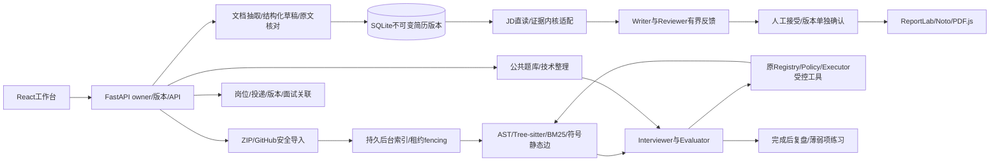
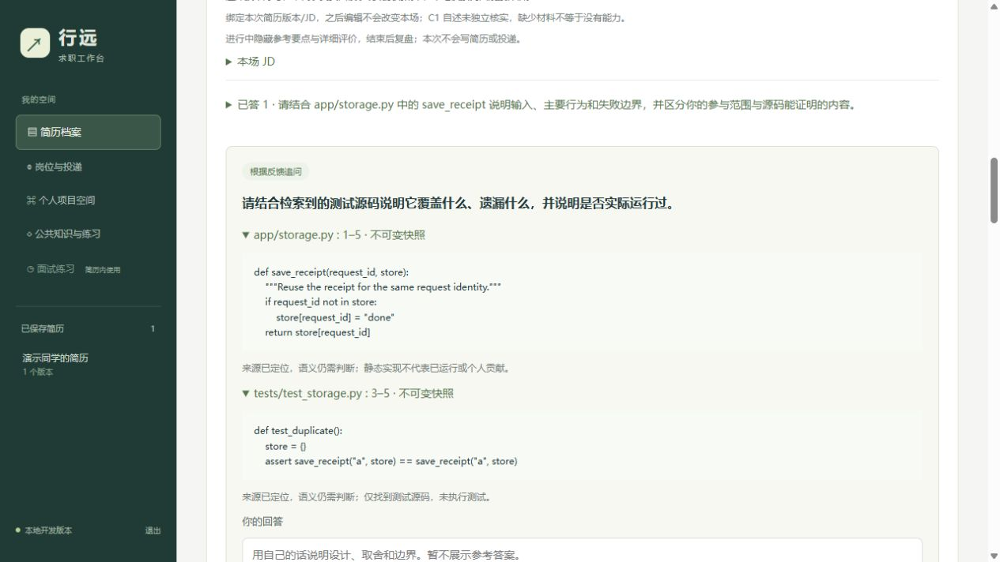
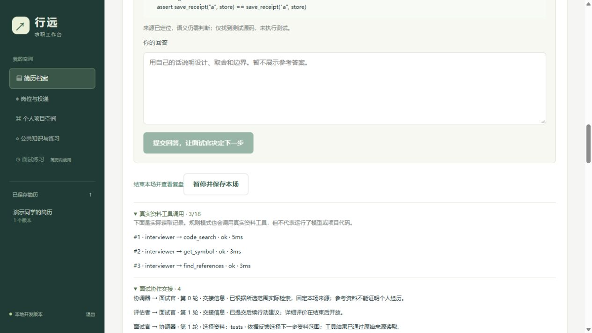
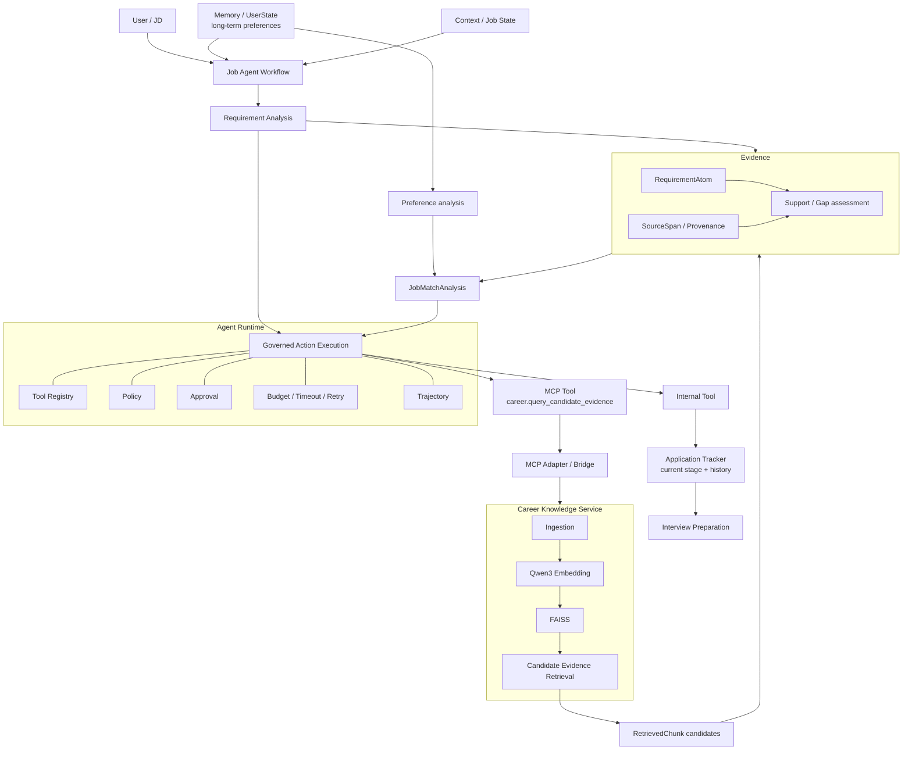

# Job Agent V3 · 长期求职与代码面试工作台

## 2026-10-23 S0—S8工程交付入口

当前代码以[CURRENT_SPEC](docs/tech-specs/CURRENT_SPEC.md)、[S8结果/30分钟导读](docs/devlog/EXPAND-S8.md)及[启动与四演示](docs/demo/EXPANSION_RUNBOOK.md)为准；以下较早阶段叙述保留为历史。

相关回归612通过/4限定跳过；离线583通过/33依赖跳过，正阈值开发门禁通过。真实本地检索dev/test各630调用无错误，新目录新进程同索引/引用排序重放且文档编码0。26原文/72题仍是AI候选，人工核对经用户明确延期，不能据此声称人工语义质量或用户掌握。全仓1024/44/54按历史依赖分类，未宣称全绿；真实文本模型负结果仍保留。

默认SQLite/Embedding关闭，可显式选本地真实检索、PG项目索引及Redis独立Worker；项目源码和公共知识不代替个人经历。源码/学习/研究包带逐文件hash与独立解包检查；不包含私料、凭据、权重、运行库或Git历史。另一个聊天的handbook不在本轮范围。

基于 React + FastAPI + LangGraph，连接简历导入/事实核对、JD分析、受约束局部改写、版本化PDF、岗位投递记录，以及公共知识与项目源码驱动的面试练习。重点是每项结论能回到来源，每个Agent动作有权限和预算。

**当前验证范围：本地合成/公开数据。真实外部LLM与Embedding未配置，不能宣称模型效果已验收。** 全量855通过、2项Redis缺服务失败、50项依赖/模型条件跳过。扫描OCR因本机原生运行时失败阻塞；文字PDF可用。完整状态见[FEATURE_MATRIX](FEATURE_MATRIX.md)、[实验与限制](docs/evaluation/RESULTS.md)。F7本地范围已交付，详见FINAL_HANDOVER.md。

## 快速体验
Python3.12与Node≥22.12，在项目根：
```text
python -m venv .venv
.venv/Scripts/python -m pip install -e ".[workbench,dev]"
cd frontend
npm ci --ignore-scripts
npm run build
cd ..
.venv/Scripts/python scripts/demo_resume_workbench.py --port 8019 --persistent --seed
```
Linux改用`.venv/bin/python`。已有前端构建可跳过npm步骤。打开http://127.0.0.1:8019；公开合成口令`job-agent-synthetic-demo-only-2026`，第二用户`job-agent-second-demo-user-2026`。仅供本地合成/公开资料，不能作公网或私人档案口令。

上传样例[合成输入PDF](docs/demo/assets/synthetic-resume-source.pdf)，或点“填入合成示例”；项目种子含原创CC0回执项目与固定commit的BSD-3-Clause Starlette，明确不声称用户是开源项目作者。持久数据保存在output/demo-v3，源代码包不包含运行数据库。
部署/私人工作区说明见[DEPLOYMENT](docs/demo/DEPLOYMENT.md)。容器配置已提供但本机无Docker，**NOT_RUN**；旧PG/Redis部署是独立v1链路，不冒充当前产品存储。

## 实际产品链


- PDF/DOCX/文本导入、字段可编辑、来源/hash/字符范围核对；短材料JD分析保留直接上下文，规则模式只定位词面线索。
- 局部Writer/Reviewer独立Schema角色、有界修订、数字/技术/责任范围硬约束、人工接受为新C1自述。来源一致、语义支持、现实真实性、用户确认分别表达。
- 双模板中文PDF嵌入OFL Noto字体，确认版绑定hash、历史下载、PDF.js真实预览。长样例6/5页逐页检查。
- 私人源码只解析不执行：Python AST、JS/TS/TSX Tree-sitter、符号/静态引用/测试位置，commit/快照/文件/行原文可校验。代码存在不证明作者或实际运行。
- 三种面试：岗位公共题、项目源码、已完成场次薄弱项；反馈选择不同检索目标并派发真实只读工具，每主题一次追问/最多6答/18工具预算，支持暂停与历史。活动阶段不返回rubric。
- 后台索引真实HTTP/独立Worker故障恢复：发布后退出、租约恢复、旧attempt不能提交、同键去重、跨用户404。SQLite本地适配，不称PG/Redis产品链已接通。




## 结果如何解释
40道F0冻结机械代码题：flat与code_aware文件Recall@5均1.00，MRR分别.75/1.00，20跨文件完整均20/20。**没有文件召回增益**；精确函数名/合成结构不能外推语义问答。README-only在该库无候选，不作为有效质量对照。
公共40项/39种query是实现后标签诊断：BM25漏metadata的v1与修复v2都保留，不是人工语义金标；标签方法与gold共享metadata，不能宣传“RAG准确率100%”。真实向量、重排、模型协作消融、人工盲评LIVE_PENDING，未虚构收益。

最终全量`work/v3-f7-final-full.xml/log`：855 passed / 2 failed / 50 skipped，169.92秒；2失败是Redis127.0.0.1:63799缺服务，34 PG+16模型条件跳过。Windows旧UI深路径问题用短临时目录复核解决。历史R12的17JD/101原子、93.07%/97.30%只属于旧实验，不能转用于V3。

## 学习与追溯
先读[学习入口](docs/learning/00_READ_FIRST.md)、[完整调用链](docs/learning/01_END_TO_END.md)、[面试问答](docs/learning/INTERVIEW_QA.md)，再看[阶段日志](docs/devlog/INDEX.md)、[源码审计](docs/PROJECT_AUDIT.md)、[简历口径](docs/resume_notes.md)。后续开发先读AGENTS.md和docs/CONTINUE_DEVELOPMENT.md；既存dirty修改与冻结数据保留，不用旧ZIP覆盖当前源码。

## 旧入口与独立模块的真实边界
下文保留旧Streamlit/CLI/MCP/FAISS/PG-Redis模块说明。它们是可复用的独立实现，不表示已全部并入上面的React产品。旧历史成绩也不替代本轮验证。

## 实际入口与实现范围

| 入口 | 真实执行路径 | 检索与证据边界 |
| --- | --- | --- |
| Streamlit 普通桌面 UI | `new_session_wizard → run_initial_v2_live → EvidenceV2Pipeline` | LLM 直接读取原始材料；Python 校验 snapshot/hash/唯一 quote/offset/等级；不调用向量检索 |
| 普通 `job-agent` CLI | 默认规则流程；`--mode agent_api` 使用 `AgentGraphRuntime` | 旧 `EvidenceMappingAgent`，没有 v2 的完整来源校验，不调用 Career RAG |
| 独立 `JobSearchWorkflow` / MemoryAware analysis | RequirementAnalyzer → 受治理 MCP → Career Knowledge → RetrievedEvidenceMapping | 真正调用 embedding/index；来源白名单、版本/hash/quote 校验；不是 UI 默认流程 |
| FastAPI 内存 tracer | `backend_service.main` | 内存任务队列和 mock semantic DAG，供合同测试 |
| FastAPI 持久化部署 | `persistent_main` + `worker_main` | PostgreSQL/Outbox/Redis Streams/lease/fencing/checkpoint；semantic task 使用旧 DAG；application assistant 使用脚本控制器及文本搜索 |
| V3 React产品 | frontend/src/main.jsx → resume_workspace.api.create_resume_app | 简历/JD直读、局部改写/PDF、双知识检索/三模式面试、本地SQLite后台索引；真实模型/向量/PG-Redis产品集成未验收 |

UI wizard 当前只接收 JD 和原始简历，默认没有额外 C2/C3 supporting sources；原始简历最多 C1，只能作为待确认线索。`EvidenceV2Pipeline.run(supporting_sources=...)` 是程序接口，不等于 UI 已接入知识库材料。

Evidence v2 适合少量、可装入模型上下文的材料。直读减少检索漏召回及维护成本，但不提供大规模文档搜索；独立 RAG 适合较大候选材料池。两者共用部分来源约束，mapper schema 与冲突处理能力仍有差别。

## What the independent RAG workflow does

以下描述 `JobSearchWorkflow` 演示/测试中的调用链。它使用长期偏好：杭州 / Agent / 大模型应用 / 实习。输入一份 JD 后，该工作流会：

1. 读取 `UserState` 中的长期求职偏好。
2. 将 JD 拆成可独立验证的 requirements。
3. 让 Agent Runtime 调用已注册的 MCP Career Knowledge Tool。
4. 从 candidate-owned corpus 检索项目经历，保留 chunk provenance。
5. 由 Evidence Mapping 判断每个候选片段是 support、partial、contradictory 还是 gap。
6. 生成 `JobMatchAnalysis`，分开呈现技术证据与偏好匹配。
7. 在用户批准后，通过受治理的 Internal Tool 记录岗位。
8. 持久化 application lifecycle：`to_apply → applied → resume_screen → first_interview`。
9. 进入面试阶段后，基于岗位要求和已确认来源生成 job-specific interview prep。

仓库内的完整、脱敏场景见 [Demo walkthrough](docs/demo.md)，对应机器可读结果是 [`tests/fixtures/job_search_workflow/demo_result.json`](tests/fixtures/job_search_workflow/demo_result.json)。

## Independent RAG workflow architecture

下图对应 `JobSearchWorkflow`，不能用它证明 Streamlit 或 FastAPI 已接入同一链路。检索动作在 `GovernedCareerKnowledgeRuntime` 中由脚本决策发起，受 AgentLoop 治理，不是 LLM 自由决定所有工具步骤。



三个重要边界：

- **MCP 不绕过 Runtime**：MCP Tool 仍受 Registry、Policy、Approval、Budget、Timeout 和 Trajectory 约束。
- **`RetrievedChunk` 不等于 Evidence**：相似度只产生候选材料；Evidence Mapping 必须再次判断语义支持并生成可验证 `SourceSpan`。
- **Preference mismatch 不等于 technical gap**：城市、方向或岗位类型冲突单独进入 preference analysis，不污染技术证据结论。

更完整的系统边界见 [architecture.md](docs/architecture.md) 与 [security-boundaries.md](docs/security-boundaries.md)。

## Engineering Decisions / What We Learned

### 1. Retrieval baseline: keep the measured winner

同一 Career corpus、20 条 query（18 条有 gold evidence）上的受控实验结果：

| Retriever | Recall@1 | Recall@3 | Recall@5 | MRR |
| --- | ---: | ---: | ---: | ---: |
| Qwen Dense | **0.8241** | **0.8889** | **1.0000** | **0.9167** |
| BM25 | 0.5463 | 0.6481 | 0.8889 | 0.6769 |
| Dense + BM25 RRF | 0.7130 | 0.8889 | 1.0000 | 0.8583 |

BM25 确实救回了 `CareerContextAdapter` 精确实体 case，但在多个 semantic/requirement case 上明显落后；RRF 也没有超过 Dense 的 Recall@1 或 MRR，并出现 semantic regression。因此默认链路保留 Dense。BM25、RRF 和负向实验代码仍保留，结论不是为了堆技术栈而选择 Hybrid。

### 2. Candidate evidence needs its own scope

早期检索中，JD 本身会因语义高度相似排在候选人经历之前。系统因此建立 candidate-owned retrieval scope，并让 JD 只作为 requirement source、不能成为 candidate evidence。核心原则是：**similarity != evidence**。

### 3. Real structured output differs from mock success

Mock E2E 正常时，Qwen2.5-7B-Instruct 的初始真实评估仍有 7/8 schema error。问题集中在 requirement 与 atom 的双向 ID 引用对自回归 structured generation 不稳定。通过简化现有 contract 的生成形状、明确 JSON-only 协议、最小 JSON 提取和严格 schema validation，真实 Requirement Analysis 达到 8/8；没有加入 mock fallback 或 Python 业务字段猜测。

### 4. Retrieved does not mean supported

真实模型曾把相关的后端材料推断成 Kubernetes 经验，也把通用文本 ingestion 推断成 PDF/DOCX 能力。Evidence semantic contract 现在明确要求逐候选源判断、引用原文、禁止从邻近技术过度推断。最终结果：positive source correctness 6/6、gap detection 3/3、false supports 0、provenance validity 6/6。

## Historical Real-Model Validation

以下是仓库保留的历史 Qwen synthetic 验证口径，本次源码审计没有重跑真实模型。它与下面 R12 的 DeepSeek 语义评测是不同实验。

- Generation model: `Qwen2.5-7B-Instruct`
- Embedding model: `Qwen3-Embedding-0.6B`
- Mock fallback: **NO**

真实路径：

```text
JD
→ Real Requirement Analysis
→ Runtime
→ MCP
→ Real Qwen Retrieval
→ Real Evidence Mapping
→ JobMatchAnalysis
→ Application Lifecycle
→ Interview Prep
```

| Check | Result |
| --- | ---: |
| Requirement Analysis | 8/8 |
| Evidence schema validity | 10/10 |
| Positive source correctness | 6/6 |
| Gap detection | 3/3 |
| False supports | 0 |
| Provenance validity | 6/6 |
| Preference correctness | 8/8 |
| Full workflow | completed |

这些是固定 synthetic JD 与脱敏 candidate project materials 上的工程验证，不是招聘效果、生产 SLA 或泛化准确率声明。

## Quick Start

### 1. Core environment

需要 Python 3.11+（代码使用 `datetime.UTC`）。包含 MCP/FAISS 的确定性检索与工作流测试还需 `career-knowledge` 依赖：

```bash
git clone https://github.com/lhuowang681-cpu/stateful-job-agent.git
cd stateful-job-agent
python -m venv .venv
source .venv/bin/activate  # Windows: .venv\Scripts\activate
python -m pip install -e ".[dev,ui,career-knowledge]"
```

运行代表性的 deterministic workflow 与治理回归：

```bash
python -m pytest -q \
  tests/test_end_to_end_job_search_workflow.py \
  tests/test_governed_application_lifecycle.py \
  tests/test_memory_aware_job_analysis.py \
  tests/test_evidence_mapping_v2.py \
  tests/test_knowledge_bm25.py \
  tests/test_knowledge_rrf.py
```

启动 UI 使用 `python -m streamlit run src/job_agent/ui/app.py`。实际生成还需要外部 release skill root（`LLM_INTERN_SKILL_ROOT`）、有效模型/base URL 和环境变量 `JOB_AGENT_LIVE_API_KEY`；仓库不附带真实密钥，也不保证仅 clone 后即可 live 生成。不要将密钥写入源码或 artifact。

### 2. Real embedding / FAISS

真实检索测试需要一个额外的 model-enabled 环境，提供与本机 CUDA/CPU 匹配的 `torch`、`transformers`、`sentence-transformers`、`numpy` 和 FAISS，以及本地 Qwen3 模型目录。仓库不会自动下载模型。

`python -m pip install -e ".[career-knowledge,embedding]"` 声明这些可选组件；torch 的设备版本仍需按运行机器配置。没有模型路径的真实模型测试应跳过，不能算模型验证通过。

FAISS 的 `save/load` 位于 `knowledge/faiss_vector_index.py`；`knowledge/durable.py` 提供 SQLite 文档版本、corpus version、索引 manifest、维度/身份/checksum 校验和显式 rebuild。MCP 配置 `CAREER_KNOWLEDGE_DB_PATH` 后加载持久化索引；不配置时从 fixture corpus 重建。它是单机快照方案，索引、manifest 与 SQLite 不构成跨资源原子事务；不兼容会拒绝加载，需要显式重建，不支持并发在线写保证。

```bash
export QWEN_EMBEDDING_MODEL_PATH=/absolute/path/to/Qwen3-Embedding-0.6B

python -m pytest -q \
  tests/test_knowledge_real_embedding.py \
  tests/test_knowledge_retrieval_benchmark.py

python -m pytest -q \
  tests/test_career_knowledge_mcp.py::test_real_qwen_retrieval_through_career_mcp
```

重现实验中的 Dense / BM25 / RRF 对比：

```bash
python -m job_agent.knowledge.career_benchmark_compare \
  --model-path "$QWEN_EMBEDDING_MODEL_PATH" \
  --device cuda
```

没有 GPU 时可使用兼容的 CPU 环境并将 `--device` 改为 `cpu`；运行时间和依赖组合会不同。

### 3. Real-model E2E

完整真实链路还需要本地 Qwen2.5 generation model。两个环境变量都必须指向已存在的模型目录：

```bash
export JOB_AGENT_REAL_MODEL_PATH=/absolute/path/to/Qwen2.5-7B-Instruct
export QWEN_EMBEDDING_MODEL_PATH=/absolute/path/to/Qwen3-Embedding-0.6B

python -m pytest -q -s tests/test_real_model_end_to_end_validation.py
```

未配置模型、CUDA 或可兼容依赖时，不能声称真实 E2E 可一键运行；deterministic tests 与 real-model results 必须分开解读。

## Repository Guide

| Path | Purpose |
| --- | --- |
| `src/job_agent/agent_runtime/` | Tool registry、policy、approval、execution、checkpoint 与 trajectory |
| `src/job_agent/knowledge/` | Knowledge contracts、ingestion、Dense/BM25/RRF、MCP Career Knowledge Service |
| `src/job_agent/evidence/` | Requirement analysis、source snapshot、provenance 与 semantic evidence mapping |
| `src/job_agent/memory/` | 长期 `UserState` 与偏好 |
| `src/job_agent/domain_agents/` | 受治理的 application tracking / lifecycle |
| `src/job_agent/interview/` | 基于岗位与证据的 interview preparation |
| `tests/fixtures/` | Synthetic JD、脱敏项目材料、gold labels 与 demo result |
| `docs/` | 架构、Demo、评测、简历和面试说明 |

## Historical R12 unseen holdout: metric scope

公开来源：[R12 report](eval/unseen_career_holdout_v2/report.md) 和 [aggregate results](eval/unseen_career_holdout_v2/results-final.json)。本次仅核对公开汇总及统计源码，没有读取私人 JD/简历或重跑模型。

| 轨道 | 历史结果 | 含义 |
| --- | --- | --- |
| Gold Atomic Evidence | 17 real JDs / 101 人工标注 atoms；Accuracy 94/101=93.07%；Supported Precision 36/37=97.30% | 人工给定 atom 后的检索+语义 judge；不是 UI 或全系统 E2E 准确率 |
| 同一轨道 | FP=1/59 gold negatives，FN=6/42 gold positives；source precision 71.15% | 精确原文引用不保证语义判断或来源选择完全正确 |
| Gold retrieval | 42 positive atoms；Recall@3/@5=100%，MRR=0.8175 | 冻结候选语料上的历史检索结果 |
| Raw-JD E2E | 完成 16/17；parent strength/gap correctness=26/51=50.98% | 生产 RequirementAnalyzer + MCP + RAG mapper；暴露 requirement miss 和语义泛化不足 |

`evaluation/unseen_career_holdout.py:_run_gold_atomic` 使用独立 `_judge_atom`；`_run_end_to_end` 使用生产 `MemoryAwareJobAnalysisService`。最终报告脚本保留首轮 gold 指标并合并技术续跑，未把 gold 指标替换成新链路成绩。公开 manifest 声明这些 JD 未参与调优；本次未独立审查私人原始冻结记录。以上全部保留为历史结果，不代表本次 guard/projection 修复后的新成绩。

## Scope and Limitations

- 历史 synthetic 验证为 8 个 Job Analysis cases、20 个 retrieval queries；另有上述 17-JD R12 holdout。各自语料、模型和指标不能混用。
- Candidate evidence 主要来自仓库内脱敏项目材料；没有外部招聘平台自动抓取。
- Application actions 通过 policy/approval 和本地 store 演示，不会自动投递岗位或发送消息。
- FAISS 支持本地文件持久化，并有 SQLite 版本与 manifest 校验；不是托管或分布式向量数据库，也没有统一接入桌面主流程。
- Kubernetes 与 PDF/DOCX 是历史特定语料中的 gap cases。仓库现有独立 PDF/DOCX 文本 loader，不等于候选人具备该经验，也不是 UI 全文档 ingestion 已接通；语义误判仍可能发生。
- quote/hash/offset 校验保证引用可定位，不证明 LLM 判断必然正确。C2/C3 来源类型也需要可信输入治理；系统不能自动认证外部报告真实性。
- `gap` 表示本次材料未提供证据，不能据此断言候选人没有能力。冲突及待确认链接保留供复核，不生成新简历事实。

面试现场可从 [Demo](docs/demo.md) 开始，再查看 [Resume notes](docs/resume_notes.md) 和 [Interview notes](docs/interview_notes.md)。
