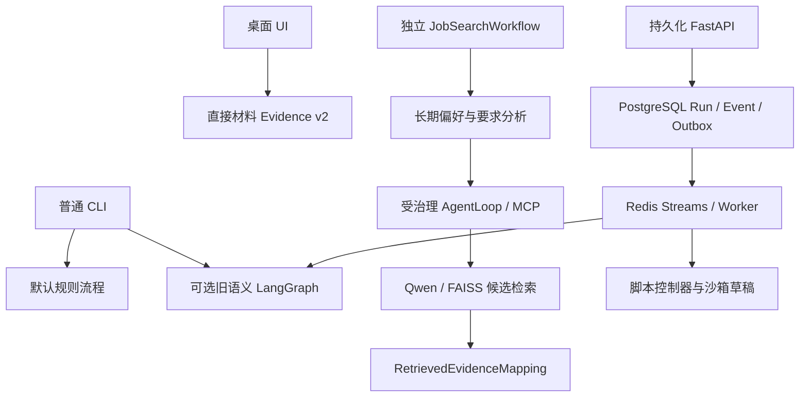

# Stateful Job Agent 面试源码指南

## V3当前主链（2026-10-21，优先于下文历史审计）

目前产品入口是React→FastAPI create_resume_app，不是旧Streamlit默认流程。简历/来源/不可变版本→JD直接上下文→局部Writer↔Reviewer→人工接受新C1→确认版PDF；项目ZIP/GitHub→AST/Tree-sitter→受控工具→Interviewer↔Evaluator→结束复盘/薄弱项→岗位关联。精确文件/函数逐步见[完整调用链](learning/01_END_TO_END.md)，每核心模块3–4个追问及源码锚点见[INTERVIEW_QA](learning/INTERVIEW_QA.md)。

优先阅读src/job_agent/resume_workspace/api.py::create_resume_app → parsing.py::ResumeParser.parse → repository.py::accept_draft/edit_version → matching.py::WorkbenchMatcher.analyze → rewrite.py::RewriteService.start/decide → pdf_export.py::PDFRepository → retrieval_interview.py::RetrievalInterviewEngine.prepare/_invoke → interview_collaboration.py::InterviewEngine.execute → tasks.py::IndexTaskWorker.process_once。

LLM是可配置接口，当前未获真实调用授权；规则与替身明确区分。来源、owner/hash/span、预算、事务、PDF、静态代码解析是确定性Python。旧MCP/Qwen/FAISS和PG/Redis Worker保留独立边界，新产品默认BM25/符号/静态关系，向量缺失显式降级。

最新全量855/2/50：2 Redis依赖失败，34 PG+16模型条件跳过；真实本地HTTP/Worker故障恢复与浏览器源码追问有证据，生产/模型质量未验收。[实验范围](evaluation/RESULTS.md)、[真实架构](devlog/ARCHITECTURE_MAP.md)、[简历口径](resume_notes.md)。下文2026-10-18/20是历史背景，不是V3最新能力清单。

适用版本：2026-10-18 本地源码审计后的工作副本。完整问题分类、变更和实际测试记录见
[PROJECT_AUDIT.md](PROJECT_AUDIT.md)。下文的已实现、独立实验、历史成绩和未来建议分别表述。

最终收尾：Linux 隔离真实 PostgreSQL/Redis 环境全量 **568 passed / 0 failed / 16 skipped**。
Application Assistant evaluator-v2 的原 24 个确定性场景全部通过；真实模型条件测试尚未重跑。
以上是上一轮冻结基线。2026-10-20 启动产品升级：M1 提供结构化来源与简历版本；
M2 接通导入/编辑；后续 M3 已用当前版本适配 Evidence 内核，但未统一下文旧 RAG/队列入口。最新 [PHASE-03](devlog/PHASE-03-match-and-rewrite.md) 给出当前 JD 调用链和真实边界。
[第 1 步](upgrade/01_STRUCTURED_RESUME.md) 和 [第 2 步](upgrade/02_IMPORT_PARSE_EDITOR.md) 提供各自调用链、取舍和问答。
M2 后端相关回归 154 passed、前端 4 passed，真实模型未调用；四角色统一工作流、OCR/PDF 仍是目标。

阶段学习入口已补齐：[PHASE-01](devlog/PHASE-01-structured-resume.md)、
[PHASE-02](devlog/PHASE-02-import-parse-editor.md)，各含 5 个追问、实际代码锚点和学习路线。
继续工作先读 [继续开发手册](CONTINUE_DEVELOPMENT.md)，不依赖对话记忆恢复阶段边界。

## 1. 用一分钟讲清真实架构

这是一个面向长期求职的 Agent 工程实践仓库。桌面工作台把 JD 和原始简历保存为不可变来源，
让模型提取要求和判断证据，再用 Python 检查引用、来源身份、等级以及可生成的下游内容。
另有一条独立的 MCP/RAG 工作流，用 Qwen embedding 和 FAISS 检索候选材料；
还有受权限、审批、预算和 checkpoint 约束的 AgentLoop，以及 PostgreSQL/Redis Streams 异步后端。
它们共享一些模型和治理组件，但没有全部统一成一条桌面到后端再到 RAG 的调用链。

面试时应先说明正在讲哪个入口，再展开技术；不能从“模块存在”推导“所有入口都在使用”。

## 2. 一个桌面 JD 匹配请求怎样执行

| 顺序 | 文件与函数位置（相对仓库根目录） | 输入与输出 | LLM / Python |
|---|---|---|---|
| 1 | `src/job_agent/ui/new_session_wizard.py:172` `_create_session`，内部 `create_operation` | 用户 JD、简历、选中岗位 → runtime 与创建操作 | Python；检查 live readiness |
| 2 | `src/job_agent/ui/runner.py:31` `run_initial_v2_live` | 创建 staging session → 调 Pipeline | Python |
| 3 | `src/job_agent/evidence/pipeline.py:34` `EvidenceV2Pipeline.run` | 固定本次来源、组织分析与提交 | Python 编排 |
| 4 | `src/job_agent/evidence/sources.py:41` `snapshot` | 原始字节 → 规范化文本、hash、source catalog | Python |
| 5 | `src/job_agent/evidence/requirements.py:47` `analyze` | JD → compact requirement candidates | LLM 提取；schema/guard 校验 |
| 6 | 同文件 `:149` `_materialize` | candidate → parent/atom ID 与 JD SourceSpan | Python；唯一 quote resolver |
| 7 | `src/job_agent/evidence/mapping.py:49` `map` | atom + 非 JD 原始材料 → link candidates | LLM 语义判断，不运行检索 |
| 8 | 同文件 `:167` `_materialize`、`:202` `_guard` | link candidate → 来源校验、等级限制、match status | Python |
| 9 | `src/job_agent/evidence/assessment.py:38` `assess` | requirements + mapping → fit、coverage、review | Python 固定政策 |
| 10 | `src/job_agent/evidence/repository.py:43` `commit` | bundle → 文件 hashes、manifest、current pointer | Python 原子替换 |
| 11 | `src/job_agent/evidence/projections.py:27` `for_resume`、`:79` `for_resume_agent` | 过滤可用于新事实的证据 | Python |
| 12 | `ui/runner.py:run_initial_v2_live` → `agents/resume_tailoring.py:ResumeTailoringAgent.run` | 合格证据 → 简历草稿；不足时保留原始简历 | 允许时 LLM；否则 Python |
| 13 | 同一 runner 的 `os.replace(staging_dir, session_dir)` | 成功发布 session；失败清理 staging | Python |

位置以本次源码为准；后续改动时同时核对函数名。面试现场可先打开 pipeline，再沿表逐个跳转。

当前 UI wizard 只传入 JD 与原始简历。Pipeline 虽有 supporting_sources 参数，UI 没有把
持久化 Career Knowledge 里的材料传进来。原始简历最多 C1，默认场景没有新增 C2/C3 简历事实依据，
这属于当前产品接线范围，不是模型失败后悄悄回退。

## 3. 要求、证据与来源：哪些能保证，哪些不能

`RequirementAnalyzer` 让模型输出 `text/importance/hard_gate/exact_quote/verification_signals`。
当前 `_materialize` 每条候选创建一个 parent 和一个 atom；并没有额外调用一个多 atom 拆解器。
因此可以说“结构化为可验证要求”，不应保证所有复合要求都已被严格拆成最小语义命题。

`SourceQuoteResolver.resolve`（`evidence/sources.py:191`）在不可变规范化文本里寻找唯一引用，
必要时使用 prefix/suffix anchor 消歧。hash 与字符 offset 由 Python 计算，不让模型猜测。
offset 是规范化 Unicode 文本的字符位置；PDF/DOCX loader 的 offset 对应抽取文本，不是原文件字节。

| 名称 | 实际含义 |
|---|---|
| `gap` | 本次候选材料没有正向可定位证据；不是证明候选人不会 |
| `unsupported` | UI mapper 有引用但没有正向支持；与空 links 的 gap 不同 |
| `partial` | 只明确支持部分要求；不能变成完整能力事实 |
| `unverified_lead` | 有语义支持线索，但来源等级不足；典型是原始简历 C1 |
| `supported` | UI mapper 的完整语义支持 + C2/C3 来源门槛；仍不是第三方事实认证 |
| `contradictory` | UI mapper 的 link 状态；atom 另有 has_contradiction，不是独立 atom match status |

`EvidenceLevelPolicy.maximum_level`：raw JD 不提供候选经历等级；original_resume 无论被贴什么
artifact_type 都最多 C1；可信输入中的实验/对照/设计记录最多 C2，指标/生产/事故记录最多 C3。
这些是来源等级上限，不是给“生产日志”四个字就自动认证经历。

UI mapper 不接受 JD 作为 evidence source；RAG 的 candidate scope 也把 JD 排除。
但调用方若把 JD 错标成项目材料，或提交伪造的“实验记录”，代码无法仅凭标签识别事实造假；
来源分类与所有权仍需可信 ingestion/人工治理。

quote/hash/offset 校验能证明“这段话来自给定材料”，不能证明模型的 claim 一定被引用蕴涵，
更不能证明外部材料本身真实。LLM 负责语义，Python 负责结构、来源与执行边界。

## 4. CLI、LangGraph、AgentLoop 的关系

普通 `job-agent` 的默认规则路径见 `cli.py:main → graph.py:_run_selected_job_flow`。
规则 evidence mapper 是 `nodes/evidence_mapping.py:map_evidence`，不是 RAG。

`--mode agent_api` 使用 `runtime/graph_runtime.py:AgentGraphRuntime.run_selected_job`。
native graph 构造在 `:410 _build_langgraph_if_available`，旧 evidence 节点在 `:460 _evidence_node`，
实际调用 `agents/evidence_mapping.py:33 EvidenceMappingAgent.run`。它验证 schema 和 ID 覆盖，
没有 v2 的 hash/offset/quote 校验，不能把较新的 v2 安全保证套在它身上。

LangGraph 负责固定 DAG 与分支；`AgentLoop` 负责 action/observation/finish/approval/input 的受限循环。
`career-journey-live` 是另外的有界 canary CLI，默认 semantic artifacts 仍可为 fixture；
不能把“调用了 live planner”说成“所有语义 artifact 都来自真实模型”。

AgentLoop 主要源码：

- `agent_runtime/loop.py:123 run`：模型决策、验证完成、恢复、保存状态。
- `agent_runtime/tool_registry.py:ToolRegistry`：schema、工具身份与 fingerprint。
- `agent_runtime/policy.py:44 authorize`：三层 allowlist、effect、审批 digest 和 scope。
- `agent_runtime/budgets.py:BudgetManager`：模型/工具/活跃时间/token/cost/重复/无进展预算。
- `agent_runtime/tool_executor.py:40 execute`：再次校验授权、执行 handler、拒绝迟到结果。
- `agent_runtime/checkpoint.py:JsonCheckpointStore`：原子 checkpoint。

工具 timeout 是协作 deadline；预算通常在下一步前检查，token 使用还依赖 provider 回报。
这些不能宣传成任意 Python 代码的强制抢占、操作系统隔离或零超支的模型计费机制。

## 5. 真正运行检索的路径与持久化取舍

`JobSearchWorkflow.run → MemoryAwareJobAnalysisService.analyze` 先读取长期偏好并提取要求，
每个 atom 调 `GovernedCareerKnowledgeRuntime.query_candidate_evidence`。
该 wrapper 使用脚本 action 驱动 AgentLoop，通过注册 MCP 工具调用服务；检索动作不是自由规划。

`CareerKnowledgeService → CandidateEvidenceRetriever → KnowledgeRetriever.retrieve`：
QwenEmbeddingBackend 为 query 编码，index.search 返回带 document/version/hash/offset/rank 的 chunk。
`RequirementEvidenceService.assess_retrieved` 先检查来源版本与 chunk 范围，
`RetrievedEvidenceMappingService` 再对每个候选做三类判断，选最佳候选并生成 SourceSpan。
分数和排名不会直接转成支持；排名只在语义支持优先级相同时作为选择顺序。
这个 mapper 没有 contradictory 类别，不能宣称它能像 UI mapper 一样保留冲突证据。

FAISS 代码与持久化：

| 位置 | 已实现 | 代价/边界 |
|---|---|---|
| `knowledge/faiss_vector_index.py:FAISSVectorIndex` | 归一化 IndexFlatIP，add/search，`:30 save`、`:36 load` | 精确扫描本地 baseline；不是向量数据库集群 |
| `knowledge/durable.py:KnowledgeRepository` | SQLite 文档历史、active version、chunk 与 ingestion 状态 | 来源版本不可变，不能自动认证内容真实性 |
| 同文件 `:427 ingest_text`、`:595 rebuild_index` | 更新和显式重建 | 目前整库 embedding/rebuild；不是增量在线索引 |
| 同文件 `:604 load_index` | manifest/embedding/corpus/hash/count/dimension 校验 | 不一致拒绝加载，需要人工/程序显式 rebuild |
| 同文件 `:697 _publish_snapshot` | 临时文件和逐文件原子替换 | 索引、manifest、SQLite 不是一个原子事务 |
| `knowledge/career_mcp_server.py:_service_from_environment` | 配置 DB path 后接持久化加载，否则建 fixture index | 不等于桌面 UI 已接入 |

历史 A→B→A 内容回退会触发同 document/hash 唯一约束；并发写、跨资源崩溃恢复与运行中 service
热更新不是当前完整保证。补齐它们需要明确版本和恢复协议，本次不重构。

为什么没有强接桌面 RAG：小规模简历直接输入更简单，不会因 top-k 漏召回丢材料；
代价是上下文容量与 token 成本。RAG 能扩大材料范围，但检索漏召回、版本同步和来源等级适配都要测试。
不能为了展示 FAISS 把现有 provenance/level/projection 约束换成相似度阈值。

## 6. 长期状态、Checkpoint 与异步后端

长期偏好在 `memory/user_state_store.py:UserStateStore`；UI 公司/岗位索引在
`career/store.py:CareerStore`；另一条 durable career 工作流在 `career/durable.py`。
它们不是同一个数据库表，也不自动共享跨入口事务。

Agent checkpoint 保存 usage、pending action、完成动作、inflight 非幂等标记及 registry/runtime 版本。
resume 不只是把旧聊天塞回模型；它会验证身份，恢复预算，等待绑定的批准，并阻止不确定写重放。
semantic DAG 另有 `runtime/semantic_checkpoint.py` 的节点恢复，不是整个业务流程的全局事务恢复。

持久化后端链路：`persistent_bootstrap.py:44 create_persistent_api_stack` → RunService →
PostgresRunRepository 的事务 run/event/outbox → `outbox.py:19 publish_once` → Redis Streams →
`reliable_worker.py:93 process`（claim/lease/heartbeat/fencing）→ task adapter → 提交 → ack。
`recovery.py:35 run_once` 与 consumer reclaim 负责重投/租约恢复。

`worker_main.py` 把 semantic task 接到旧 DAG；application task 接到
`application_assistant.py:337 build_application_assistant_loop`。后者的
`:307 _build_application_assistant_runtime` 明确使用 `ApplicationAssistantMockModel`，
是脚本控制器的合同与恢复实验；read_snapshot、文本搜索、沙箱草稿没有完整 Evidence v2 核验。
本次修复补回了草稿工具的 allowlist 项，仍需 action digest 绑定审批，仍只能写 sandbox。

收尾已在临时隔离 PostgreSQL 14.24/Redis 7.4.6 上同机执行真实事务、Outbox、租约、恢复、
审批及 receipt/UNCERTAIN 测试，受影响后端与评测模块 50 项通过。
这不是仅有内存测试，也不是 PostgreSQL 16 Compose 全部署/生产验收；header allowlist 仍不是完整认证系统。

## 7. 历史指标该怎样回答

公开 R12 记录：[report.md](../eval/unseen_career_holdout_v2/report.md)、
[results-final.json](../eval/unseen_career_holdout_v2/results-final.json)。
统计入口 `evaluation/unseen_career_holdout.py:82 _run_gold_atomic`；
指标公式 `evaluation/real_atomic_evidence.py:387 _atom_metrics`；
端到端入口 `unseen_career_holdout.py:223 _run_end_to_end`；
合并续跑 `scripts/finalize_unseen_holdout_report.py:main`。

| 数字 | 分母与实验范围 | 可以怎样说 |
|---|---|---|
| 93.07% | Gold Atomic 94/101，TP36/TN58/FP1/FN6 | 17 份真实 JD 的历史 gold-atom 证据判断成绩 |
| 97.30% | supported precision 36/37 | 输出支持判断的精度，不是所有要求的覆盖率 |
| 85.71% | supported recall 36/42 | 仍漏掉 6 个 gold 正例 |
| 100% Recall@3/@5 | 42 positive atoms 的冻结候选语料检索 | 不代表任意新语料都有同样召回 |
| 90.20% | 51 parents 中 46 个状态正确 | 使用 gold atoms 的确定性聚合结果 |
| 50.98%，完成 16/17 | raw-JD E2E：26/51 parent correctness | 必须同时披露的端到端泛化局限 |

Gold Atomic 由人工给定 atom，不测模型是否漏提要求；使用独立 `_judge_atom`，
不是 UI 或生产 RAG mapper 的整链准确率。quote/provenance validity 100% 也不等于语义支持全正确。
R12 使用 DeepSeek 语义 provider + Qwen3 embedding；README 较早的 8-case/20-query 是另一组 Qwen 实验。

本次验证了公开汇总的算术与源码对应关系，没有读取私人 JD、标注或原始模型输出，
没有重新调用真实模型。公开记录声明未参与调优和调用前冻结；本次未独立核查其私有原始过程。
所有数字继续标注为历史成绩，不是本次修复后的新 benchmark。

## 8. 分模块高频追问与源码回答

### UI 与整体架构

1. **桌面点一次匹配就会调用 FAISS 吗？** 不会。`ui/runner.py:run_initial_v2_live` 调直接材料
   Pipeline；真实检索在 MemoryAware 独立工作流。用入口区分实现范围。
2. **为什么同时保留几套实现？** 规则/旧语义 DAG 保留兼容与 fixture，v2 加强来源约束，
   RAG 工作流验证候选检索。`graph.py`、`runtime/graph_runtime.py` 与 `evidence/pipeline.py` 是不同边界。
3. **只给简历为什么不能生成很强的新经历？** `EvidenceLevelPolicy` 限制 original_resume 为 C1，
   projection 不把它当新事实依据；runner 保留原始简历，而不是凭空升级。

### JD 要求提取

1. **ID、offset 是模型生成的吗？** 不是。`RequirementAnalyzer._materialize` 创建 ID，
   `SourceQuoteResolver` 从原文定位唯一引用。
2. **严格原子化了吗？** 当前 UI 每条候选一个 parent/atom，复合句的语义粒度仍靠模型；
   评测 `atomic_evidence_v2.py` 中的人工 atom 数据是另一层，不能混淆。
3. **原文引用有效就代表要求没漏吗？** 不代表。guard 证明引用存在，requirement recall 要靠 gold；
   R12 raw-JD extraction major recall 43/51，说明仍有漏提。

### Evidence 与下游生成

1. **相似度高能直接 supported 吗？** 不行。`RetrievedEvidenceMappingService.map` 逐候选判断语义；
   `RequirementEvidenceService` 检查来源，分数只留作检索元数据。
2. **C1 和 gap 有什么差别？** C1 可有真实原文但可信等级不足，形成 unverified_lead；
   gap 是没有可用支持，二者都不是“人没有能力”的证明。
3. **存在冲突时会怎样？** UI mapper 保留 contradictory link 和标记；本次 projection 在有冲突时
   拒绝新增 resume claim，interview 视图保留材料。RAG mapper 当前不支持该类别。
4. **能保证生成的每个字都真实吗？** 不能。来源可定位、等级/ID 和输出范围有 Python 限制，
   但 `ResumeTailoringAgent._guard` 不是语义蕴涵证明器，仍需人工审阅最终文案。

### RAG 与索引

1. **FAISS 真的能落盘吗？** 可以，`FAISSVectorIndex.save/load`；生命周期还核对 SQLite、manifest、
   embedding 身份、维度和 checksum，不是只有 InMemoryVectorIndex。
2. **如何防 JD 证明自己？** `candidate_evidence.is_candidate_evidence_document` 白名单过滤；
   `RequirementEvidenceService._retrieved_documents` 再检查，UI mapper 也拒绝 raw_jd source。
3. **为什么没用 Hybrid？** 历史同语料 20-query 比较中 Dense 优于 BM25/RRF 的整体指标。
   代码在 `career_benchmark_compare.py`；这是实验选择，不是普遍结论。
4. **可在线并发写并无缝恢复吗？** 目前不保证。`_publish_snapshot` 与 SQLite 是多步提交，
   校验不兼容会拒绝加载，需要显式 rebuild；全量重建适合单机小库。

### Agent Runtime

1. **模型能直接执行工具吗？** 必须经 `ToolRegistry → PolicyEngine → ToolExecutor`；
   handler 是受信实现，模型只给 schema 约束参数。
2. **批准后参数能改吗？** `compute_action_digest` 覆盖 action 身份和参数，policy/executor 都核对，
   还绑定 session/run/request，不能跨请求复用批准。
3. **预算与 timeout 有多强？** `BudgetManager` 在操作边界检查并记录使用量；executor 传协作 deadline。
   不声称能终止任意阻塞代码，也不保证未知 token 使用绝不超出估计。
4. **这是完全自主 Agent 吗？** 部分模型支持自由 action 决策；Career query wrapper 和后端
   ApplicationAssistant 当前明确使用 Scripted/Mock 控制器。治理真实存在，自主性需要按入口说明。

### 状态与恢复

1. **Memory 和 checkpoint 一样吗？** `UserStateStore` 保存长期偏好；Agent checkpoint 保存某次执行的
   usage、steps、pending action 等；CareerStore 保存业务索引，各自生命周期不同。
2. **等待批准耗预算吗？** `BudgetManager.pause_for_user/resume_from_user` 暂停活跃时间，恢复保存计数。
3. **崩溃后重复写怎么办？** Agent checkpoint 记录 inflight 非幂等动作，恢复遇到不确定执行拒绝重放；
   后端 `tool_operations.py` 再保存操作 receipt/uncertain，不宣称 exactly-once 外部副作用。

### 后端可靠性

1. **为什么 Outbox？** run/event/outbox 在同一 PostgreSQL 事务写入；publisher 再唤醒 Redis。
   解决业务状态已提交但队列未写的问题，重复投递仍靠 claim/幂等处理。
2. **Worker 死了谁接管？** lease heartbeat、attempt fencing、recovery 与 consumer reclaim；
   见 `ReliableWorker.process`、`RecoveryCoordinator.run_once`。相关用例已在临时真实服务上执行通过；
   不把这描述成生产高并发或所有部署组合验收。
3. **Redis 里保存简历吗？** dispatch message 是唤醒元数据，Worker 从持久化 Run/快照解析业务输入；
   `outbox.py` 与 `redis_streams.py` 可追踪，不把 Redis 当业务 source of truth。
4. **后端真的做 LLM/RAG 申请生成了吗？** semantic task 有旧 DAG provider 路径，
   application assistant 则是脚本控制器和 sandbox draft。它的完成验证不是完整语义核验。

### 评测与简历表达

1. **93.07% 是端到端准确率吗？** 不是，是给定人工 atom 的历史 Gold Atomic Evidence accuracy；
   raw-JD parent correctness 是 50.98%。二者应同时说明。
2. **为什么 97.30% precision 但 recall 不是一样？** TP36/预测正例37 和 TP36/gold正例42 的分母不同，
   说明支持判断保守但有漏证据。
3. **测试通过能证明模型泛化吗？** 不能。synthetic/mock 验证合同与失败语义；真实冻结数据评测才测语义，
   本次没有重跑真实模型，历史结果不能移作新结果。
4. **新增一个可选工具为何曾让评测变差？** 旧 evaluator 把 allowlist 全体当作 required tools。
   历史任务实际只需要 read_snapshot 和批准后的 sandbox write；可选 search 不必使用。
   收尾的 evaluator-v2 用 `_tool_selection_scores` 分别计算 allowed precision 与 required recall；
   漏掉 read/write 仍扣分，非法调用仍扣 precision，100% 门槛不变，原场景标签未改。

## 9. 简历与演示的推荐边界

可写：实现不可变来源与确定性校验的 Evidence v2、受治理 AgentLoop、单机持久化知识模块、
PostgreSQL/Streams 的任务恢复设计和对应源码测试；运行成绩附本次实际环境与未运行项。

单独标注实验：Qwen/FAISS/MCP workflow、Dense/BM25/RRF 对比、历史 R12 gold-atom 评测。
不能写：所有 UI/CLI/后端均统一接通 RAG、完整冲突处理跨所有 mapper、生产多租户 SLA、
exactly-once 自动投递、任意规模在线向量数据库、当前修复后仍有 93.07% 全系统准确率。

技术面试演示建议：先展示 `pipeline.py` 与一个 synthetic 来源校验失败，再展示独立 MCP 检索调用，
最后展示 action digest 绑定的 approval/resume 测试。每次明确当前入口和输入，避免把模拟控制器
或历史评测录像说成现场真实模型运行。

## 10. 最终验证范围与架构冻结

| 能力 | 本轮验证 |
|---|---|
| UI 来源快照、quote/hash/offset、等级、partial/gap、冲突和待确认投影 | 确定性与 UI 测试通过 |
| Agent 权限、审批 digest、预算、checkpoint/resume | 合同与恢复测试通过 |
| FAISS 维度、保存/加载、manifest、重建与 MCP 调用 | synthetic embedding 和真实 MCP 子进程测试通过 |
| PG/Redis Outbox、事务、lease/fencing、幂等、故障、UNCERTAIN | 隔离真实服务上通过；fsync/synchronous_commit 开启 |
| Application Assistant v2 | 原 24 场景通过；脚本控制器，不是 LLM 选择准确率 |
| 真实 Qwen embedding/generation、DeepSeek live/stateful | 16 项条件测试跳过，未新验证 |
| PostgreSQL 16 Compose 全部署、生产负载、真实邮件/表单副作用 | 本轮未验收，不能宣称已证明 |
| UI→RAG→后端统一主链 | 未实现，也不作为此次收尾目标 |

原 50 项跳过中的 34 项为 PostgreSQL 缺失，已补跑通过；剩余 7 项缺 embedding 模型路径，
6 项 DeepSeek 显式 live opt-in，2 项本地 generation opt-in/path，1 项真实 E2E generation path。
具体记录见 [最终 JUnit](audit/closeout/closeout-full-final.xml) 与
[剩余跳过清单](audit/closeout/remaining-skips.json)。

保留当前小规模直读 UI、独立 RAG、旧语义 DAG 和异步后端的边界。不新增 Multi-Agent、
Milvus 或统一大框架。接下来的工作是解释现有代码、练习追问和演示失败边界，不继续工程扩张。

## M2A：PDF 抽取与自动填写的面试边界

PDF 抽取早已存在，新增的是普通无标签/空格分栏文字的本地结构定位和自动填表反馈。
`extract_upload`→pypdf→`LocalExtractor.extract`→`materialize`→`save_draft`→核对→`accept_draft`。
规则不是 LLM，不生成新经历；原文引用不保证语义分组和现实真实性。真实模型、多栏/OCR 尚未验收。
可复述的技术取舍、8 个源码锚点、同样例对照和 5 题问答见 [PHASE-02A](devlog/PHASE-02A-pdf-autofill.md)。

## M3 新工作台 JD 调用链（最新）

MatchingPanel → match_api.install_matching_routes → MatchRepository.begin（owner/版本/请求键）→ WorkbenchMatcher.analyze（当前版本 C1 视图；本地预检查或旧要求/映射内核）→ validate_bundle → SQLite 分析快照 → 行级原文/限制/缺口。
建议接受：MatchRepository.decide → 当前 head/服务器 proposal → 事实清单完全一致的重排 → 原 _append → 未确认新版。
源码前缀 src/job_agent/resume_workspace/；前端 frontend/src/MatchingPanel.jsx。复用的是旧内核，不是整条文件型 pipeline。
相关 201/0/0、前端 9/0/0、构建、合成浏览器/15 HTTP 通过；模型替身不等于真实质量。自由改写/补充 C2/C3/生产队列仍未完成。
8 个源码入口、取舍和 5 个问答见 [PHASE-03](devlog/PHASE-03-match-and-rewrite.md)。

## M3B 最新：摘录式摘要协作，如何解释

此前“不新增 Multi-Agent”的文字属于审计收尾阶段约束；后续用户已明确启动产品升级并授权有界协作，本节是最新实际状态。未重写旧入口或统一检索/队列。

完整调用链：frontend/src/main.jsx → CollaborationPanel（选版本/JD/本次同意）→ POST /api/v2/resumes/{id}/collaborations → collaboration_api.install_collaboration_routes → CollaborationRepository.begin（owner/版本/hash/请求键）→ claim（lease/token）→ CollaborationEngine.execute（LangGraph）→ WriterDraft → ReviewerOutput + hard_review → Supervisor 条件边 → 两次以内修订/需材料/用户审批 → checkpoint → decision → decide（最新稿hash/revision/head/幂等）→ 旧 _append → 带原来源、未确认的新版本。
后端前缀均为 src/job_agent/resume_workspace/。只有在线 Writer/Reviewer 使用 LLMHarness；本地二者是规则；路由、预算、来源、存储、审批与版本完全由 Python 确定。
不是旧 AgentLoop 自由调用工具：本图 tools=()，三个节点中协调器不用 LLM。两角色可共用模型；反馈改变下一稿，不代表已证明质量优于单 Agent。
原句 C1 摘录是独立动作合同：只复制完整原句/SourceSpan，不能生成新数字/年限/经历；用户确认不升级。旧 C1 新 claim 投影限制未放宽。Reviewer 错误认可不能覆盖硬门。
状态保存是 SQLite 应用 checkpoint，不是原生 LangGraph saver，也未接 PG/Redis Worker；未知模型调用禁止自动重放，不宣称 exactly-once。
已测：42 新增、相关243/0/0、前端11/0/0、合成浏览器与17 HTTP。未测：真实模型、质量/成本对照、生产恢复、全仓库回归。旧93.07%/97.30%不能用于协作成绩。
10 个源码入口、45 分钟路线和 5 个面试问答见 [PHASE-03B](devlog/PHASE-03B-writer-reviewer.md)，历史 R12 统计来源仍用原章节。

## M3C 最新面试源码链与核验术语

“核验通过”不再概括所有步骤：provenance检查文字来源，statement检查完整原句，relevance区分关键词与模型建议，independent_truth保持not_verified/C1；用户接受和该次保存版本确认另列。源码collaboration_contracts.py::ProposalVerification与collaboration_repository.py::_view，前缀src/job_agent/resume_workspace/。

完整岗位→面试链：main.jsx→MatchingPanel（保存的JD/match_id移交）→InterviewPanel（当前选中版本）→interview_api.install_interview_routes.start→InterviewRepository.start（owner/版本/hash/match-JD/题库快照）→公开首题。
回答链：interview_api.answer→InterviewRepository.answer（幂等键/问题ID/修订）→claim→InterviewEngine.execute→Evaluator（私有覆盖/需证据风险）→Interviewer（合法关注点与follow_up/next）→Python路由上限→checkpoint→get公开下一题。finish后review只返已答详细评价，结束不可继续答题。
后端前缀src/job_agent/resume_workspace/；题库和旧规则来源src/job_agent/interview/question_bank.py::QuestionAnchorLibrary、copilot_service.py::evaluate_answer。未把新C1材料适配为旧verified claims，未调用整套旧ApplicationCopilotService或旧AgentLoop。
在线Evaluator/Interviewer用Harness不同Schema、零工具；协调、来源、路由、预算、存储和公开投影是Python。Interviewer不看完整rubric，模型只选择ID，题目由审核模板渲染。活动get不含plan/evaluation/note，review未结束409。
当前六anchor、三主题、每主题一次追问、2～6轮/最多12模型预留；本地只是规则，个人风险表示需材料不代表说谎或无能力。应用checkpoint不等于原生saver或Worker。
实际相关291/0/0（新34），前端13/0/0、浏览器/两阶段HTTP通过；没有真实模型、同预算质量对照或全仓库新成绩。原R12按历史章节范围保留。
9个源码入口、50分钟学习与5个追问见 [PHASE-03C](devlog/PHASE-03C-verification-interview.md)。下一产品主线仍为PDF与长期投递，不以技术题库替代完整求职闭环。
