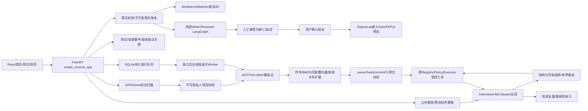
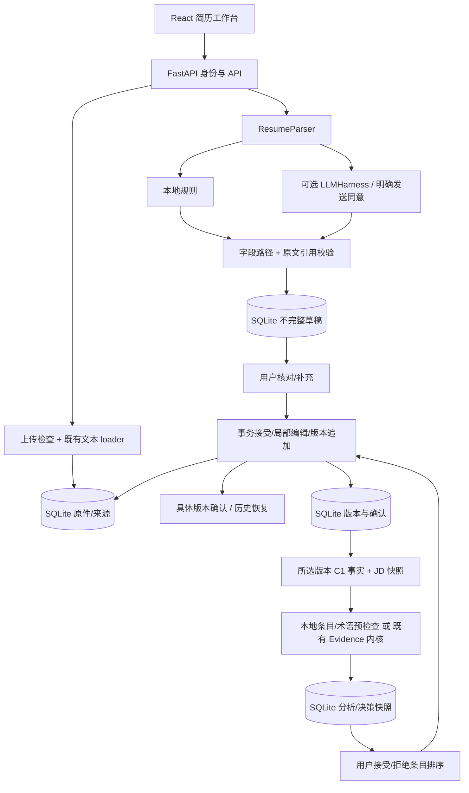

# 当前真实架构与调用链

## 2026-10-23 第三轮增量

显式project/snapshot→CodeRAG直接命中优先/关系补余→EvidencePack状态/理由→限定源码题与安全ProjectEvidenceBoundary→LLM逐项评价→原R1完整ID/原句/分区门禁→窄无依据断言降级→观察绑定已回答Question→同来源新ID空历史再练。保留默认词面与显式本地模型，不新增DB/Agent。题目scope充分仅表示引用几何，语义与运行/个人事实未核；Trace沿用原schema绑定状态/hash。F1评分独立保留旧单引用gold，F2锁和一次预约保留。

## 2026-10-23 复核增量

原回答API→InterviewEngine evaluator→完整唯一ID/quote/分区门禁→pending→Interviewer→route提交；失败在提交前记录stopped/code，未知派发不重放。完成源→LearningRepository.usable_evaluation_source→指纹匹配→观察/复习：旧不完整LLM源只读失效，规则/完整旧记录兼容。R1合同99通过/1跳过，新环境核心94通过/2跳过。

真实DeepSeek合成材料已跑通完整HTTP学习闭环及改写审批；五类回答均有原始评价。两角色共享首稿比较90行/100网络调用，全部通过稿仍为共同首稿，不能推出协作生成更好。模型语义/人工质量未核。安装链路为源码wheel→site-packages隔离导入→真实HTTP鉴权/来源解析/接受；离线合成研究索引从审计SQL重建新manifest，原门槛不降低。R2全仓分类、R4真实中文语料、R5新交付仍待，旧段落为历史。

## 2026-10-22 S7新增

原InterviewPanel→LearningPanel→learning_api→LearningRepository→原InterviewRepository/图/checkpoint。观察/用户控制/撤回/偏好仍同SQLite域；PG项目只经选中CodeRAG重查来源，源删除隐藏正文并阻止再练习，不做影子双写或跨库事务。来源指纹/owner/题点、CAS/幂等、删除tombstone、上海日有限建议与固定来源新场次已接线，旧活视图/同意/unknown保护保留。

最后517相关通过/4既有跳过、真实规则/PG HTTP5/7检查、合成浏览器2场6观察及前端13/构建已验。Qwen7B只给部分要点评价被门禁停止，模型完整闭环/人工教学效果未验；实际ER、接口、删除/失效边界与学习路线见[EXPAND-S7](EXPAND-S7.md)。S1/S8仍待。

## 2026-10-22 S6新增

原HTTP→同PG task+Outbox事务→独立Publisher→Redis四定位字段→独立consumer→PG事件/状态/代次/config/lease领取→原IndexTaskWorker.process_claim/CodeRAG→原PG publication/任务同提交→ACK。复用旧transport原语，新增游标/近似保留/安全归档/对账。Redis唤醒不替代业务权威，未知DB/网络结果不ACK；文本生成不照搬索引重建。

同schema持久单调度模式，维护无活动任务且轮换authority作epoch；内嵌轮询/Redis互斥，往返切换不复活旧进程。首轮45/0/4、扩大487/0/4、真实13场景42子进程矩阵和真实Qwen独立Publisher/Worker链已验，最终epoch补强后的同源码v3矩阵13/13通过。前端只修文案/状态提示，13测试与构建通过。图/数据字典/实际失败和限制见[EXPAND-S6](EXPAND-S6.md)，生产SLA/完整研究回放仍未验。

## 2026-10-22 S5新增

main/独立worker→ProjectPersistence选择默认SQLite或显式PG；原API、CodeRAG、项目面试同用选中项目/索引/任务权威域。CodeRAG已无直接SQL；PG按project→snapshot→task锁、DB时间lease/token/config/generation门禁，事务内发布不可变payload/active指针/任务成功及事件。读取指针和派生使用同一repeatable-read；原SQLite表合同保留。

简历/审批/岗位/面试仍SQLite，跨域引用每次用选中CodeRAG重查，无跨库事务或影子双写。真实PG14.24、原HTTP/两进程Qwen持久检索/项目面试/PG重启/独立worker、合成迁移与备份回滚及dump恢复已验，最后455通过/4限定跳过。ER/键/状态流/实际证据见[EXPAND-S5](EXPAND-S5.md)。默认仍SQLite；Outbox/Redis仍待S6。

## 2026-10-22 S4新增

原两图现在携带SharedRunState：可信源身份→角色工作投影→真实输出/断言审计→feedback_id→后续节点→原仓储payload/checkpoint。Writer只拿最近一稿和反馈，Reviewer只见原文/当前稿；原始资料/完整有界历史不反复给模型。改写CAS/lease、程序门禁/无进展/明确拒绝与采纳再校验保留C1。面试逐要点评价/同一反馈身份、完整事实裁剪标记、未知运输不重放和同题条件比较均已接线；活动视图不泄内部状态。

新增OfflineTextProvider显式离线加载现有Qwen7B，保留历史Transformers适配。435相关与真实HTTP角色链路通过；108行239次真实生成没有可用改稿增益，未切换默认规则/人工审批。模型解释有误读，属于参考，人工质量未验。图/接口/实际限制见[EXPAND-S4](EXPAND-S4.md)。项目/索引/任务仍SQLite，PG/Redis仅资源只读预检。

## 2026-10-22 S3新增

鉴权Evidence API或RetrievalInterviewEngine→InterviewTools.retrieve_pack→规则计划→原Registry/Policy/Executor逐次搜索/读取→原文校验→EvidencePack→两角色共享身份/状态摘要→内部checkpoint。固定可信scope；每pack至多2搜索/5工具/8000字符/20秒/32768输入预留上界，场内18次工具继续有效，父deadline不延长。候选定位与语义支持分层；个人贡献/运行成果不足不自动补全，C1不升级。

活动HTTP白名单不公开内部pack/rubric；完成复盘后公共资源另有post_review执行ID/最多2工具/trace。InterviewRepository事务内私有/公开引用校验复用当前连接，避免真实worker提交与嵌套新读等待环。相关375通过、真实模型与规则各8流程/6 pack通过；完整共享执行State和真实生成模型协作仍为S4。实际流程图与失败见[EXPAND-S3](EXPAND-S3.md)。

## 2026-10-22 S1/S2新增（覆盖下方旧默认未接线描述）

默认仍BM25/静态符号。私有main显式RetrievalRuntime离线加载Qwen→同实例注入代码/公共/面试。
代码任务：snapshot鉴权/校验→AST→事务外编码→同SQLite事务publish_guard→chunks/edges/vectors统一发布。
公共：启动doc/question预热→配置dense时默认Hybrid→引用仍原文；未就绪显式降级，完整性错误拒绝。
检索：真实BM25/Dense→RRF→符号/关系预算→引用重查→工具/面试；候选与manifest进最小trace。
检索最新为：两路固定20候选→融合30→可选本地CrossEncoder重排30→符号/有界关系→整段quote24000字符预算→原文重查→工具/面试。trace-2记配置、两路、重排前后、预算截断/错误/时延。
真实GPU/重排HTTP及Qwen双进程索引复用已验；开发集对照已跑，独立语义质量/完整Trace待验。旧PG/Redis未迁入产品。
详细图/证据见[EXPAND-S2](EXPAND-S2.md)；权威当前能力见[CURRENT_SPEC](../tech-specs/CURRENT_SPEC.md)。

2026-10-22新增[现状实现学习Spec](../learning/EXISTING_CODE_SPEC.md)及[逐任务说明](../learning/DETAILED_LEARNING_STAGES.md)，按入口、版本、协作、检索、面试和异步路径解释下面架构。本轮仅补文档，未改变架构和接入状态。

## V3 F7收尾的真实主链（覆盖下方历史M3C边界）

F1–F5已接本地UI与真实合成/公开数据链，F7连续文件选择器PDF→v2→导出→ZIP→后台索引→源码反馈追问已操作；测试和截图见FINAL-F1…F7。公共知识在选题/结束复盘使用，代码在项目面试真实工具使用；旧题库面试默认请求保持兼容。PG/Redis旧服务尚未接V3产品异步主链。静态边不证明运行，源码不证明贡献，检索不自动supported；真实LLM/向量效果未验。

更新：2026-10-20，M3C 核验分层与面试协作完成后。目标架构另见 `docs/upgrade/ROADMAP.md`。
“已接通”只表示表内具体入口；不表示全项目已经统一或生产验收完成。

## 实际运行入口

| 入口 | 实际用途与存储 | 验证/边界 |
|---|---|---|
| `scripts/demo_resume_workbench.py::build_demo_app` | React + 新 API，临时 SQLite，模型关闭 | 合成演示已实际运行；不读取私人工作区配置 |
| `src/job_agent/resume_workspace/main.py::create_app` | 私有环境口令、SQLite；可显式配置模型解析/语义分析 | 配置/身份合同测试；真实模型未验收 |
| `src/job_agent/ui/runner.py::run_initial_v2_live` | 旧 Streamlit 的 JD/Evidence v2 原材料直读 | 原证据流程；不是新 React 默认流程 |
| `src/job_agent/cli.py::main` | 规则 / 旧 LangGraph 语义入口 | 独立路径，不能沿用 v2 来源保证描述全部 CLI |
| `src/job_agent/job_search_workflow.py::JobSearchWorkflow.run` | 独立受治理 MCP/RAG/长期流程 | 不等于新前端已经接检索 |
| `src/job_agent/backend_service/persistent_bootstrap.py::create_persistent_api_stack` | 旧 PG/Outbox/Redis Streams/Worker | 历史真实服务已测，新产品任务尚未适配 |

## 新产品的实际链路

其中 LLM 分支代码/合同已接，真实模型未验收；本地与在线不是静默 fallback。
流程由明确 API 操作驱动，本入口尚未使用新 LangGraph 四角色工作流或异步 Worker。

### 一次上传到保存

`frontend/src/main.jsx::App.parse`
→ `src/job_agent/resume_workspace/api.py::create_resume_app.import_file`
→ `src/job_agent/resume_workspace/ingestion.py::extract_upload`
→ `src/job_agent/knowledge/source_loader.py::load_source`
→ `src/job_agent/resume_workspace/repository.py::SqliteResumeRepository.save_upload`
→ `src/job_agent/resume_workspace/api.py::create_resume_app.parse_source`
→ `src/job_agent/resume_workspace/parsing.py::ResumeParser.parse`
→ `src/job_agent/resume_workspace/parsing.py::materialize`
→ `src/job_agent/resume_workspace/repository.py::SqliteResumeRepository.save_draft`
→ 用户表单
→ `src/job_agent/resume_workspace/repository.py::SqliteResumeRepository.accept_draft`
→ `src/job_agent/resume_workspace/repository.py::SqliteResumeRepository._apply_edits`
→ `src/job_agent/resume_workspace/repository.py::SqliteResumeRepository._append`。

### 一个 JD 请求目前走哪里

旧 Streamlit 的 JD：`src/job_agent/ui/runner.py::run_initial_v2_live`
→ `src/job_agent/evidence/pipeline.py::EvidenceV2Pipeline.run`，原始 JD/简历/可选材料快照
→ 要求提取/证据映射 → Python 来源/等级检查 → assessment/projections/artifacts。
旧文件型 pipeline 没有直接接新版本；新 React 走独立版本适配器并复用内核，调用链如下。
完整旧入口源码说明见 `docs/INTERVIEW_SOURCE_GUIDE.md`。

新 React：`frontend/src/MatchingPanel.jsx::MatchingPanel` → `/resumes/{id}/matches`
→ `src/job_agent/resume_workspace/match_repository.py::MatchRepository.begin`
→ `src/job_agent/resume_workspace/matching.py::WorkbenchMatcher.analyze`
→ 本地预检查，或旧 RequirementAnalyzer/EvidenceMappingService
→ 来源/等级/投影约束 → SQLite 分析快照。
接受/拒绝：`src/job_agent/resume_workspace/match_repository.py::MatchRepository.decide` → 事实不变重排 → 既有追加版本。
参见 [PHASE-03](PHASE-03-match-and-rewrite.md)。

## 模块状态

| 业务功能 | 真实锚点 | 当前接通范围 | 验证 | 已知限制 |
|---|---|---|---|---|
| 简历导入 | `src/job_agent/resume_workspace/ingestion.py::extract_upload` | 新 React/API | 合成 PDF/DOCX/HTTP/浏览器 | 无 OCR、复杂版式率未测 |
| 字段解析 | `src/job_agent/resume_workspace/parsing.py::ResumeParser.parse` | 规则/可选模型接口 | 规则与模型替身 | 非真实模型准确率 |
| 来源校验 | `src/job_agent/resume_workspace/repository.py::SqliteResumeRepository._validate_document` | 新版本库 | owner/kind/hash/quote/offset | 不证明现实真相或改写语义 |
| 版本/确认 | `src/job_agent/resume_workspace/repository.py::SqliteResumeRepository.confirm_version` | 新产品 | M1/M2/浏览器 | 自述确认，不升 C2/C3 |
| 岗位/证据分析 | `src/job_agent/resume_workspace/matching.py::WorkbenchMatcher.analyze` | 新 React 版本适配；旧 UI pipeline 保留 | 本地+模型替身/浏览器 | 无 RAG；真实模型未验收，C1 不升级 |
| 独立检索 | `src/job_agent/job_search_workflow.py::JobSearchWorkflow.run` | 独立工作流 | 历史模块/合同 | 新前端未接；不是 ES |
| 受限建议/逐条接受 | `src/job_agent/resume_workspace/match_repository.py::MatchRepository.decide` | 新 React | 拒绝/幂等/并发/版本/浏览器 | 仅排序，不是自由改写 |
| PDF 渲染 | 后续 PHASE-04 | 新产品尚未实现 | 未运行 | 旧 LaTeX 工具存在不等于新模板导出 |
| 异步任务 | `src/job_agent/backend_service/persistent_bootstrap.py::create_persistent_api_stack` | 旧后端 | 历史 PG/Redis | 新解析仍为请求内调用 |

## 关键数据边界

- rw_sources / rw_uploads：规范化来源与原件分离，owner 控制访问。
- rw_drafts：不完整待核对草稿，引用校验仍生效。
- rw_resumes / rw_versions / rw_confirmations：追加历史、父版本冲突检查、确认绑定内容。
- user_statement：人工补充来源；原文不被覆盖，用户确认不代表第三方证明。
- rw_matches / rw_match_decisions：不可变版本/JD 分析与可追溯决策，删除简历级联删除；不写临时来源文件。
- 旧知识索引、PG task/checkpoint 状态仍各有边界；新产品只适配 Evidence 内核，未统一检索/队列。

## M2A 补强（2026-10-20）

PDF→pypdf 文本→LocalExtractor 分段/字段定位→materialize 原文校验→草稿表单→人工核对→accept_draft 版本。
新增本地结构定位见 `src/job_agent/resume_workspace/local_extraction.py::LocalExtractor.extract`；模型路径、来源等级和存储边界不变。
文字 PDF 合成上传/核对/保存已验证；扫描/OCR、复杂多栏、真实模型泛化未验证。报告见 [PHASE-02A](PHASE-02A-pdf-autofill.md)。

## M3B：摘要摘录协作（已接本地产品）

CollaborationPanel → collaboration_api.install_collaboration_routes → CollaborationRepository.begin/claim → CollaborationEngine.execute 的 LangGraph writer/reviewer/supervisor → SQLite 应用 checkpoint → 用户决定 → CollaborationRepository.decide → 旧 _append → 未确认新版。
Writer/Reviewer 有独立目标、Schema 和反馈输入；本地是规则演示，在线是可选 provider 调用，Supervisor 不用 LLM。旧 AgentLoop 不参与此图，零工具权限。
每稿 hash/revision、所选版本/JD、请求键和决定绑定；最多三稿六次模型预留。确定性原句/来源硬门不能被 Reviewer 认可覆盖。
rw_collaborations 保存状态/hash/下一节点/预算/token/lease，rw_collaboration_decisions 保存用户决定；删除简历级联删除。不是原生 LangGraph checkpointer，未接 Worker。
当前仅完整原句复制进摘要，保留 C1/原 SourceSpan/原经历，不能作为自由改写或 C2 新 claim 投影。在线收到条目名称/角色/时间的所选版本上下文，个人信息栏目不传；正文中的私人信息仍需用户检查。
相关 243/0/0、前端 11/0/0、合成浏览器/17 HTTP 已验；真实模型、对照收益、生产恢复未验。详见 [PHASE-03B](PHASE-03B-writer-reviewer.md)。

## M3C：核验分层与岗位到面试（已接通）

摘要视图：CollaborationRepository._view→ProposalVerification→前端分层。来源/原句正确、相关性建议、独立真实性、用户接受和版本确认分别呈现；C1真实性始终not_verified。
面试：MatchingPanel保存JD→InterviewPanel→InterviewRepository.start（所选版本/JD/题库快照）→用户回答→answer/claim→InterviewEngine.execute（LangGraph evaluator→interviewer→route）→checkpoint→公开下一题→finish→review。
复用QuestionAnchorLibrary与evaluate_answer；六个旧anchor的中文适配、三主题。零工具；在线两角色分别调用Harness，模型只能选择审核关注点/动作，服务端渲染问法。
活动 get 显式投影PublicQuestion/PublicTurn，私有plan/evaluation/note不发送；review结束前409，结束后不能再继续答题。交接不泄漏标准要点。
rw_interviews/rw_interview_answers保存owner/请求键/逐答键/hash/lease及应用状态；未知模型不重放。不是原生saver或Worker；旧面试代码/标签未改。
最终相关291/0/0、前端13/0/0、浏览器与两阶段HTTP通过；真实模型效果、生产恢复、全仓库和同预算对照未验。详见 [PHASE-03C](PHASE-03C-verification-interview.md)。

## S8增量 · 2026-10-23

原LongTerm/CodeRAG/PublicKnowledge→固定合成dev/test DB+公共向量快照→EvalRun逐query→新目录/新进程同scope引用排序重放；文档编码计数0。原SharedRunState/Harness/Tools/Pack/所选TaskRepository→认证只读统一Trace，不建第二运行器或观测平台。旧事件时间unknown、根用量只汇总一次。与临时UUID重建相比，可核固定工件身份；代价是携带可信合成派生数据，hash不是恶意生产者签名。

开发BM25正基线减一题形成四门槛，多证据0基线仅观察；真实模型和人工不进普通CI。复杂重排/关系无全面收益，默认不因独立test成绩反调。用户延期的8题核对保持人工0。细节/ER/30分钟导读与实际结果见EXPAND-S8；最终打包审计尚在进行。

S8收尾：真实最终评测/固定索引新进程重放、原业务只读Trace、四项正阈值离线门禁、四演示、三包v2新目录实际启动均通过，详见EXPAND-S8。人工延期仍0/模型负结果/全仓历史边界保留；最终交付由包内manifest与同目录verification旁证固定。不扩监控平台/新向量库/第二项目。

## 2026-10-23 R0—R5最终增量

评价完整性在在线LLM提交边界强制，历史/规则默认仍兼容；来源学习在写入和读取时排除旧不完整LLM来源。DeepSeek配置经正式main传递，默认LLM关闭；真实固定题库来源学习和非照抄改写HTTP完成，仍不认定语义真值。FAISS改用原生文件流回调支持Windows中文路径，未新增数据库。研究允许明确owner_project_source、空公共研究范围不放松产品非空合同；真实40+10题先冻结/后评分并保留E留出6/16、默认入口0/40负结果。精确源码字节由* -text保留，避免跨平台Git自动行尾转换破坏模型/算法hash。交付仅Git审过路径，AGENTS采用已提交版本、并行教材改动保留。工程/真实业务/候选检索/人工0分层签出，16项旧资料缺失条件不伪造gold。详见REVIEW-R1至R5。
