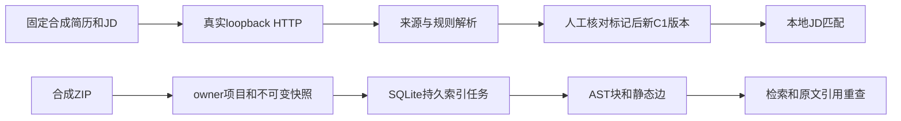

# S0 基线恢复与远端环境

2026-10-22；S0基线核对verified（包括已知失败归因，不是全仓全绿）。依据[阶段Spec](../tech-specs/expansion/S0-baseline.md)。这里的成绩均为本轮执行；历史855/2/50不混入。

## 业务结果与来源

本地新版无.git，捕获794个源码/测试/脚本/前端源/文档文件hash，其中src共341文件、313个Python文件。来源清单：[s0-start](evidence/expansion/s0-start.json)。这与此前“486源码文件”的统计范围不同，本次不沿用旧口径。

用户提供的服务器旧`/root/autodl-tmp/study/agent-backend-service`为main/067bfc7d，缺新版resume_workspace。为保护旧源码及未追踪文件，复制本地新版到新目录`/root/autodl-tmp/study/job-agent-v3`。复制包SHA256为`c1ecee9982befc6f7b919252d012eca11c90e4a2b6082660909af9aeadb9820b`，远端实查一致；包在两端output/expansion及远端study，未覆盖旧repo。不初始化Git或提交/推送；保留当前真实hash、增量包与diff。

Python 3.11.15，基于既有job-agent-mcp环境建独立.venv，新增Tree-sitter三个wheel。两张4090可用，模型目录有Qwen3-Embedding-0.6B。PG/Redis常用及旧测试端口5432/54329/6379/63799实测均未监听。[环境原始结果](evidence/expansion/s0-environment.json)。不是容器/生产环境验收。

## 一条实际数据流

`scripts/expansion_baseline.py`绑定临时loopback端口、启动真实Uvicorn/Worker、用HTTPX走产品API，结束后退出仅本次服务并清理合成库。没有浏览器UI实测，没有真实简历/付费LLM。6项流程检查包括来源→解析→核对版本→JD、ZIP→快照→异步任务成功、全部返回引用重查、C1不升级、第二owner为404、公共rubric不泄露。3次检索基线结果见[s0-http](evidence/expansion/s0-http.json)。

## 实际验证、问题与调整

|验证|本轮结果|证据/限制|
|---|---|---|
|增量前相关后端|246 passed，17.16s|[JUnit](evidence/expansion/s0-baseline.xml)，不是全仓|
|真实HTTP合成链|6项检查、3次检索通过|s0-http.json；规则质量非模型质量|
|本地前端状态逻辑|13 passed，0 failed|Node实际执行；未重建前端，未新跑浏览器|
|增量后相关后端|264 passed，17.81s|[JUnit](evidence/expansion/s2-prewarm-regression.xml)，包含身份/预热合同|
|全仓首次采集|2 errors，5.59s|缺Streamlit，原结果s0-full-regression.xml；隔离补依赖后另跑，不删失败|
|补UI依赖后全仓|839 passed/45 failed/50 skipped，59.79s|[JUnit](evidence/expansion/s0-full-with-ui.xml)、[完整日志](evidence/expansion/s0-full-with-ui-raw.txt)，未宣称全绿|
|修复本次兼容回归后定向|77 passed，3.75s|[JUnit](evidence/expansion/s2-compatibility-fix.xml)，没有用定向通过替代全仓失败|

45失败的[逐项归因](evidence/expansion/s0-failure-triage.json)：41个缺少原包未携带的历史data/eval或eval资源，2个Redis测试端口不可用，1个git check-ignore要求当前目录为Git仓库，1个由本次Qwen constructor新增关键字破坏旧适配测试造成。最后一项恢复旧默认构造/编码参数、将离线和输入预算设为新runtime的显式参数，77项定向复测通过；原始45失败结果仍保留。未擅自从旧项目复制可能含私人事实的历史评测资料，也未为测试假造Git元数据。剩余条件不阻止新合成增量，S8再核对可公开资源和最终全仓。

真实问题：本地runtime缺Web/pytest，远端旧项目又非当前新版，故采用隔离目录及复用依赖的方案，未要求用户重新安装整套环境。备选直接覆盖旧repo更省步骤，但会混淆版本和已有改动，未选。学习handbook由其他工作并发新增，本次未修改，也未计作开发贡献。

可复现（远端新目录）：`.venv/bin/python scripts/expansion_baseline.py --output docs/devlog/evidence/expansion/s0-http.json`；相关回归为`.venv/bin/python -m pytest -q tests/test_resume_workspace.py tests/test_resume_import.py tests/test_resume_pdf_autofill.py tests/test_resume_matching.py tests/test_v3_*.py`。完整原始日志在output/expansion；JUnit保留可追踪用例与运行时间。

## 25分钟源码导读

先5分钟看上图，明确source是原始材料、version是简历内容身份、snapshot是项目源码身份、task是执行状态。然后按以下入口各看一次输入/输出，共15分钟：

1. `scripts/expansion_baseline.py::run`：固定输入→真实HTTP→断言。
2. `src/job_agent/resume_workspace/api.py::create_resume_app`：可信身份与组件组装。
3. `src/job_agent/resume_workspace/repository.py::SqliteResumeRepository.accept_draft`：核对后形成C1版本。
4. `src/job_agent/resume_workspace/tasks.py::IndexTaskWorker.process_once`：租约与发布检查。
5. `src/job_agent/resume_workspace/code_rag.py::CodeRAGService.validate_reference`：按原快照重查引用。

最后5分钟复述失败反例：代码中有save_receipt，能否写“本人实现了线上千万级幂等”？不能，源码只证明该快照有实现，贡献与生产结果需要另外的来源。

## 5个面试追问及回答要点

1. 为什么不能拿包内通过数当当前成绩？代码、依赖、服务状态可能变了，需保留本次原始结果。
2. 为什么source/version/snapshot分开？分别标识材料、简历及项目源码，不随head切换改写历史引用。
3. HTTP通过能说明什么？说明所测合成业务/鉴权/引用链接通；不证明浏览器体验、模型语义或生产可靠性。
4. 新旧存储如何判断接通？沿产品入口追实际repository/worker，旧PG类存在不能证明产品已迁移。
5. 缺一个依赖时怎么办？保留失败，在隔离环境补齐再重测，不能删掉用例或把未跑写通过。
