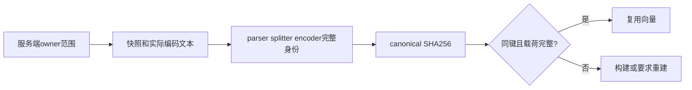

# S1 首个增量：完整索引身份

2026-10-22；身份/失效合同和32候选的静态语料/指标合同verified，人工语义标注仍in_progress。[实施前Spec](../tech-specs/expansion/S1-corpus-contract.md)。

## 问题、前后变化与取舍

旧代码cache按snapshot+model字符串、公共cache按chunk IDs。相同文件改了模型模板或分块器，旧向量可能仍被复用。现在manifest绑定可信scope、实际编码文本及顺序hash、parser/splitter版本、Embedding provider/model/权重revision/维度/归一化/query模板/输入token上限/encoder软件版本。canonical JSON SHA256作为缓存键。

不新建向量库，复用v3_code_vectors.model_id保存manifest键；旧键不复用，用户原数据不删除。内容引用仍用原title/body或快照行号，检索tags不冒充原文。真实模型声明与legacy测试适配分开：旧适配器无revision时明确caller-managed/unverified，维度从实际query解析；正式runtime必须有完整声明。

## 实际功能轨迹与证据

- `knowledge/index_manifest.py::manifest_for`输入KnowledgeChunk序列与可信scope，输出IndexManifest/key；不接收模型解析出的权限filter。
- `code_rag.py::_dense`在_load鉴权/完整性后验证query维度，用manifest读向量；已声明维度变化拒绝，不按旧字符串混用。
- `public_knowledge.py::search`相同身份缓存；坏向量不入缓存，空语料不编码，公开引用不携带私有rubric。
- 测试验证provider/model/revision/维度/模板/token预算/encoder软件、scope/parser/splitter/text变化失效；跨重启同配置复用；跨owner不触发编码；缓存污染拒绝。
- 首次针对性47项通过（3.63s，含既有CodeRAG/Public测试）；后续预热合同纳入264项相关回归17.81s，均为替身/确定性合同，不是语义金标质量。见[s1-identity](evidence/expansion/s1-identity.xml)、[后续回归](evidence/expansion/s2-prewarm-regression.xml)。

备选每次重新编码可减少缓存合同，但增加成本且不便追溯，未选。存储仍SQLite，变更仅派生键；关闭dense回到BM25，旧引用和自述来源不变。无公平质量提升结论。

## 第二个增量：冻结候选与指标合同

[candidates-v1.json](../evaluation/expansion/candidates-v1.json)保存18份固定原文、32个AI候选题：20 dev/12 test，包含代码、项目Markdown、已有CC0公共摘要。快照`corpus-17312a2c02c8b367db21af4a8fd01156525306aa176c83949af0045b87defe57`。公共链接只是摘要的背景出处，未抓取网页或冒充官方原文。开发与测试的gold来源和问题家族隔离；源码无个人贡献证明。人工reviewed=0。

`knowledge/evaluation_contract.py::EvaluationDataset.validate_dataset`校验固定内容hash、gold原文行/quote、快照、家族跨split、gold来源跨split和规范化重复query。语义近重复尚需人工，不能把简单规范化检查说成完整去重。

`evaluate_case`分别返回any-gold Hit、gold覆盖率、all/any需求、首gold MRR、引用有效率。一个gold命中、两个gold只找齐一半时，Hit=true但Recall=.5，all不足。无答案题不算虚假的满Recall；只记retrieved_context_on_unanswerable，不能把返回上下文等同模型幻觉。claim_support/final_business_quality没有人工/生成评判时均null。

生成器`freeze_expansion_eval.py::build`可复现，已有版本内容不同时拒绝覆盖，必须另建版本。静态合同9项通过（0.16s，[JUnit](evidence/expansion/s1-eval-contract.xml)）；独立测试只验证定位/划分，没有跑检索分数或用它调参。

## 尚未完成

首批32候选完成但最终60—80题、人工支持/语义近重复核查、统一EvalRun及A—D实际对照未完成。当前候选指标不等于可信人工语义金标质量。

## 25分钟导读与5追问

5分钟回看旧Spec RAG章节；10分钟读`knowledge/index_manifest.py::EmbeddingIdentity/manifest_for`及`code_rag.py::_dense`；5分钟看`test_v3_retrieval_identity.py::test_revision_invalidates_persistent_vectors_and_restart_reuses`、`test_unauthorized_owner_cannot_trigger_embedding`；最后5分钟复述“同文件换query模板为什么必须失效”。这4个入口足以理解本次新增量。

1. 文件hash足够代表索引吗？不足，还受编码文本、分块和模型语义影响。
2. 为什么query模板也进身份？同一查询在不同指令下的向量空间/分布会变，不能悄悄混用。
3. cache key里有owner就安全了吗？不够，先做可信owner/project/snapshot鉴权，再取源和编码。
4. hash相同能证明断言被支持吗？只能核对身份，语义支持与个人经历要另行判断。
5. 为什么替身通过还不能验语义？替身向量按测试定义构造，只能检查合同与接线。

第二学习单元（20分钟）：5分钟看固定JSON的一个可回答、一个无答案、多gold问题；10分钟读`evaluation_contract.py::validate_dataset/evaluate_case`与`test_v3_eval_contract.py::test_any_hit_does_not_mean_all_gold_retrieved_and_invalid_ranks_count`；5分钟解释以下追问：Hit与Recall分母为何不同？all与any怎么选？原文定位正确为何仍需人工支持标注？无答案但有召回为何不直接算幻觉？为什么独立测试不能参与反复调参？

## 2026-10-23最终候选与Markdown补录

保留旧32题/18源与v2；最终v3为26源/72 AI候选（36/36、显式project/public scope、每组2无答案），dev28与test36的近似在任何评分前发现并改v3。8题原文核对包和1296跨split机械相似审计均已落盘；用户明确稍后人工核对、继续工程，因此human0，不升级gold。Markdown标题/段落切分、围栏内伪标题、超长表格/围栏显式片段及旧索引重建已实现。真实A—G固定研究索引/两个split评分、全新进程/目录恢复与离线正阈值合同详见EXPAND-S8；仅机械指标，原语义支持/近重复人工验收仍待用户。
