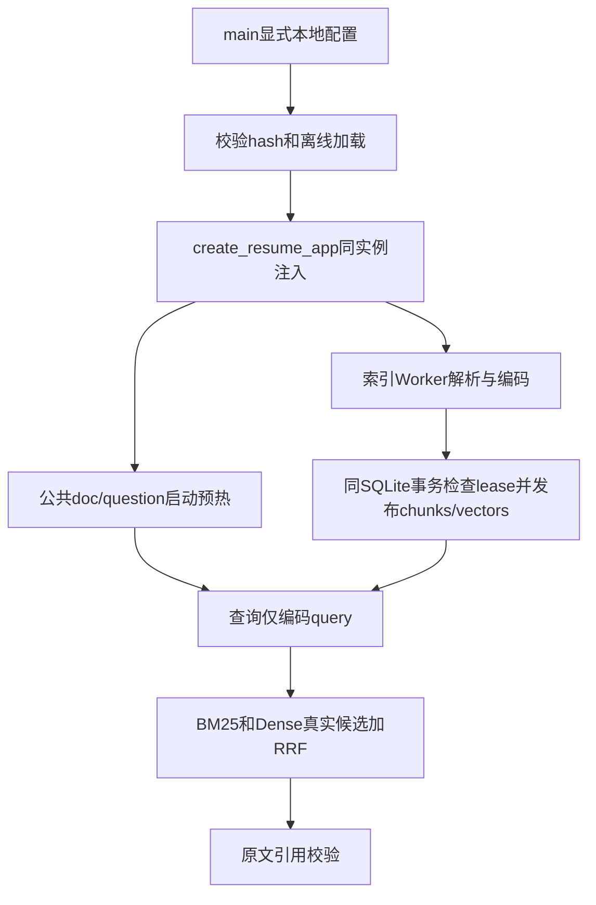

# S2 前两个子增量：真实Qwen接入与预热

2026-10-22；接入/预热/重排/预算和受控开发诊断按下述范围verified；人工gold与独立测试质量未验。S2各子增量实际结果分开保留。[实施前Spec与增量合同](../tech-specs/expansion/S2-retrieval.md)。

## 变化与调用链

默认不开模型；main.create_app显式配置本地目录时，RetrievalRuntime.from_env校验目录/配置/权重、hash实际模型文件并离线加载QwenEmbeddingBackend。同一backend注入CodeRAG/PublicKnowledge/面试工具，能力接口真实返回加载身份。无效显式配置失败，不假报语义能力。合成demo不自动读取私有配置；实验脚本显式传runtime。

代码检索默认code_aware保留符号/静态边，并融合真实BM25/Dense；公共service在配置模型时默认hybrid，面试knowledge_search/question_search因此实际经过Hybrid；显式BM25可用于对照。

## 功能轨迹与取舍

1. `retrieval_runtime.py::RetrievalRuntime.from_env`只接受本地目录，不隐式拉远程模型。身份含权重/配置hash、1024维、l2、实际query prompt、1024 token上限和ST/Transformers/Torch版本。token限制意味着长代码块可能截断，不能假设整块被模型看完。
2. `api.py::create_resume_app`同实例给两条知识路径与RetrievalInterviewEngine；能力在鉴权接口下。默认无Embedding时旧规则与BM25不变。
3. `code_rag.py::CodeRAGService.build`在事务外编码AST块，验证后经原publish_guard把chunks/edges/vectors在同SQLite事务发布。编码失败保留旧发布；过期attempt不能发布。替代“发布chunks后另一个事务写vectors”会产生半发布，未选。
4. 正式本地后端require_prebuilt，当前manifest没有向量时dense报409需重建，hybrid明确BM25降级；不会在在线请求隐藏全量源码编码。旧显式legacy适配仍保留lazy兼容，但不能作为正式预热证据。
5. `public_knowledge.py::PublicKnowledgeService.prewarm`启动构建doc/question向量，不含rubric。语料变更/未预热的过滤子集明确降级，管理员可调用prewarm，新启动也可重建。目前为小语料内存缓存，不宣称跨重启持久公共向量。
6. 检索trace记录两路候选ID、融合ID、最终引用ID、manifest和预算；rerank_applied=false。当前只是最小Trace，尚无完整S8事件/用量合同。

备选引入新向量库暂不选，当前InMemoryVectorIndex余弦及既有RRF足以验证接通。模型计算同步、batch 8，输入/候选有上限；没有宣称可强制中断GPU推理或硬超时。默认回滚只需关闭EMBEDDING，旧来源、版本和审批不变。

## 实测与公平解释

模型Qwen3-Embedding-0.6B，GPU cuda:0；权重/配置revision `47191d5687dbf14319ccb312680caa31a179ed5e16539b8c06aeddc53b63ef6c`。ST 5.7.0/Transformers 4.57.6/Torch 2.5.1+cu121。使用项目原有本地模型，没有付费API、没有私料。

- 第一个真实pilot：[s2-qwen-pilot](evidence/expansion/s2-qwen-pilot.json)，真实HTTP 6项检查、7次检索通过。当时仍lazy建向量，原结果保留。
- 预热后：[s2-qwen-prewarm](evidence/expansion/s2-qwen-prewarm.json)，同合成输入合同、6项检查和7次检索通过。模型hash+加载8472.89ms，总12632.41ms；代码keyword/dense/hybrid/code_aware为66.01/109.91/103.82/99.91ms，公共bm25/dense/hybrid为68.52/116.30/108.03ms。只有单次小样本/真实loopback，无统计置信度，不用于性能宣传或证明提升。
- 全部返回引用按固定快照重查，C1不升级，第二owner为404，公共题不泄rubric。未用LLM生成答案，不能填最终业务质量指标。
- 预热/接线/失效/编码失败保留旧发布/fencing合同等纳入264项相关回归，通过17.81s；前端状态逻辑13通过。未重跑新浏览器UI。
- 最新[真实面试工具pilot](evidence/expansion/s2-qwen-interview.json)进一步走项目面试code_search和岗位面试question_search，并正常结束会话：7流程检查/7检索/2面试入口通过，公共题引用retrieval_method=hybrid。模型仅用于Embedding，面试提问仍规则路径，未评价真实生成模型质量。
- 扩大全仓发现Qwen constructor关键字破坏旧默认适配测试；已恢复旧默认调用参数，将local_files_only/1024token/batch8改为正式runtime显式配置。未改掉旧测试；[兼容性及新增合同77项](evidence/expansion/s2-compatibility-fix.xml)通过3.75s，真实GPU/HTTP面试pilot随后再验通过。

实际调整：第一pilot在get_sentence_embedding_dimension出现弃用警告，按已安装源码API使用新接口并保留兼容分支。代码审查发现公共面试工具默认bm25会绕过已注入的dense，因此将默认方法移到service统一选择，再加启动预热。最初cache只保留一个kind会挤掉另一个kind，改成上限4个身份条目，覆盖双kind预热测试。后两项是开发中发现的设计不足，不冒充生产事故。

## 复现与未完成

远端新目录：`HF_HUB_OFFLINE=1 TRANSFORMERS_OFFLINE=1 .venv/bin/python scripts/expansion_baseline.py --model-path /root/autodl-tmp/new_idea/oasis_streaming_agent_v01/models/Qwen3-Embedding-0.6B --device cuda:0 --output docs/devlog/evidence/expansion/s2-qwen-prewarm.json`。

上述是子增量1/2当时结果；重排/开发对照的后续真实结果见下节。人工语义gold待核，无泛化质量结论。PG/Redis尚未接通；本次仍SQLite同库发布，不是PG产品切片完成。

## 30分钟导读与5追问

前5分钟看调用图；15分钟按以下源码入口走正常链和“换模型后没重建”失败链：

1. `resume_workspace/retrieval_runtime.py::RetrievalRuntime.from_env`：配置→真实后端及身份。
2. `resume_workspace/api.py::create_resume_app`：同实例注入与能力。
3. `resume_workspace/code_rag.py::CodeRAGService.build/search`：编码→fencing发布→两路融合。
4. `resume_workspace/public_knowledge.py::PublicKnowledgeService.prewarm/search`：双kind预热与默认路由。
5. `scripts/expansion_baseline.py::run`：真实HTTP对照与引用重查。

最后10分钟看原始trace和复述：

1. 已有Embedding类为什么还要接入？默认产品未实例化/注入就不会调用，须沿真实入口验证。
2. 什么时候建文档向量？代码在索引任务、公共在启动；查询只编码query，缺当前向量显式重建/降级。
3. 编码放事务外为什么仍能一致发布？昂贵计算不持锁，发布时同事务重新检查lease和snapshot，再写全部派生产物。
4. 真实GPU命中能证明比BM25好吗？不能，尚缺固定题集、gold、同预算/同块对照和独立测试。
5. 模型不可用时怎么做？未配置可BM25；显式启动配置错误失败；旧索引不匹配提示重建，绝不伪造dense分数。

## 子增量3：真实重排、统一预算与实验

新`RetrievalSettings`固定每路20候选、融合30、重排30、请求最终≤20（默认5）、关系≤8、整段quote预算24000字符、重排输入每段≤6000字符。RRF k=60，配置hash进trace。超出输出预算只省略完整原文段，不能截字符却冒充完整引用。符号优先/关系在重排后仍有限保留。

可选`LocalCrossEncoderReranker`只从本地目录加载。官方公开mmarco-mMiniLMv2-L12-H384-v1，固定提交1427fd652930e4ba29e8149678df786c240d8825；实际下载7文件/492748252 bytes，仅safetensors及必要配置/tokenizer/模型卡，没有训练脚本或pickle权重。权重SHA256=`5daeca2481a76b5976a2bdc32f0a78532b6716da4f8cd3ff59460ef8d2f359b4`，本地与远端分别核对一致。[官方模型卡](https://huggingface.co/cross-encoder/mmarco-mMiniLMv2-L12-H384-v1)、[下载manifest](evidence/expansion/mmarco-download.json)。下载在项目output/models，未外发项目材料或调用收费推理。

`RerankerIdentity`绑定实际本地文件hash和ST/Transformers/Torch版本，pair最大512 token，batch8，显式Identity激活输出raw logit。logit只用于排序，不能显示成概率。`apply_rerank`核对数量/有限值、稳定破平、记录输入ID与前后顺序/char和token截断/耗时；失败保留原序/原分数和错误码。未配置默认关闭；配置后对Hybrid/code_aware启用，rerank=false可对照。runtimecapabilities分别显示真实dense/rerank。

向量推理操作失败：Hybrid显式降级BM25并留code/public_embedding_backend_failed，strict Dense返回冲突；维度、hash、引用完整性异常仍硬拒绝。重排异常不会隐藏或伪造分数，也不改原引用或C1。真实GPU没有强制抢占超时承诺。

### 实际验证

- 首批重排/预算/接线/既有面试等105项通过7.85s。新增操作失败合同后扩大相关回归首次305通过/1失败，原因是先前身份测试在按随机snapshot生成的chunk_id排序后盲改第一个chunk；碰到README时return→RETURN是空操作。修成明确选取含return的输入并断言确有变化，保留[失败JUnit](evidence/expansion/s2-final-related-failed.xml)和原始日志，未削弱身份断言。后续[306项相关回归](evidence/expansion/s2-final-related-v2.xml)通过17.76s。
- [真实重排HTTP](evidence/expansion/s2-rerank-http.json)：代码hybrid/code_aware、公共hybrid有rerank_applied=true且无错误，7流程检查/7查询/2面试入口通过，岗位面试question_search的引用method=hybrid_rerank。代码精确符号仍优先，不能因为启用重排就声称每个最终引用都由重排挑出。
- [两个独立真实模型进程](evidence/expansion/s2-dense-restart.json)：先构建SQLite向量，第二进程重新加载Qwen、禁止文档重编码，strict Dense仍命中且manifest相同；实际持久文档向量和query的L2范数容差1e-4通过。不是只用替身证明重启。
- 开发集4题/24调用pilot成功后才扩20dev，独立12test未评分；生成答案/支持分数均null。每个方法重复3次，原始排名/引用/trace/时延均保留。

### 开发诊断结果及边界

第一份A—F[原始结果](evidence/expansion/s2-dev-v1.json)共306次调用/0错误。A—D各20题（17可回答、3无答案），E/F只用11代码题（8可回答）。相同固定AST块、候选和K=5；受控已知语料域来自数据标注，不是自动路由评测。指标按每题第一次试验计算，时延取3次调用的中位数。

|方法|可回答题分母|Hit@1|Hit@5|gold-span Recall@5|MRR@5|调用p50 ms|
|---|---:|---:|---:|---:|---:|---:|
|A AST BM25|17|.5294|.5882|.5882|.5490|4.7865|
|B Dense|17|.6471|.8824|.8235|.7549|47.7825|
|C Hybrid/RRF|17|.6471|.8824|.8235|.7549|47.7225|
|D C+重排|17|.7059|.8824|.8235|.7843|59.1720|
|E code_aware无关系|8|.2500|.7500|.6250|.4792|47.4240|
|F E+关系|8|.2500|.7500|.6250|.4167|47.5060|

该开发诊断里Dense与Hybrid相同；重排只改善首位/MRR，未提高top5覆盖；关系未增覆盖且MRR下降，负结果保留。样本小、语料很小（有top5天花板）、题目为AI候选且人工0，不能宣传生产语义提升或统计显著性。无答案仅记“检索到了上下文”，没有生成答案，不能把它叫幻觉率。

失败定位：部分gold是包含import的完整文件，AST函数片段不足以包含整段gold，回忆式文件命中不等于严格span支持。没有改gold来凑分。另加G flat BM25与A AST BM25隔离切块；第二份完整结果另存s2-dev-v2.json，保持第一份负结果。人工复核应判断gold范围是否必要，不能先改标签再只报告新分数。

追加[第二份A—G完整结果](evidence/expansion/s2-dev-v2.json)：339次调用/0错误，模型加载与hash10581.594ms，总24178.146ms。A—F上述机械指标保持相同；同一8个可回答代码题上A AST BM25的gold-span Recall@5=.1250、MRR=.0417，G flat BM25为.3750/.2917。说明完整文件的gold与函数块定位合同存在实质差别，不能将不同块范围混着归因给融合器。此次仅开发诊断，不据此强改产品默认或声称flat普遍优于AST。

复现限制：试验使用内容固定的临时项目，业务project/snapshot UUID会新建；同一次A—G共享索引、跨新建fixture时完全相同分数的破平可能受ID影响。保留逐行原始ID/排名，不承诺bit级相同结果。S8最终EvalRun应额外保存可重放的合成索引快照及完整scope身份；尚未把该部分当最终验收完成。

复现：`HF_HUB_OFFLINE=1 TRANSFORMERS_OFFLINE=1 .venv/bin/python scripts/expansion_retrieval_eval.py --model-path /root/autodl-tmp/new_idea/oasis_streaming_agent_v01/models/Qwen3-Embedding-0.6B --rerank-path output/models/mmarco-mMiniLMv2-L12-H384-v1 --device cuda:0 --repeats 3 --output docs/devlog/evidence/expansion/s2-dev-v2.json`。下载器为scripts/fetch_reranker_model.py，直接访问官方站失败/镜像超时在远端实际出现，故本地固定版本下载+SFTP再核hash，不假报远端可联网拉模型。

### 新增30分钟学习单元

5分钟看同query的BM25/Dense/RRF/重排ID顺序；15分钟依次读`knowledge/retrieval_policy.py::RetrievalSettings`、`knowledge/reranker.py::apply_rerank`、`resume_workspace/code_rag.py::search`、`resume_workspace/public_knowledge.py::search`、`scripts/expansion_retrieval_eval.py::run`；最后10分钟看负结果和以下追问：

1. 为什么不能把RRF/logit显示为置信概率？它们是排序规则/模型打分，没有概率校准。
2. 怎样保证A—D公平？同语料块、query、候选预算、K和标签，显式逐请求关/开重排，保留同一配置/模型/源码身份。
3. 重排花费值不值？本小样本p50增加约11.45ms、仅首位改善，需更大/人工金标再决策。
4. AST为什么也可能漏必要证据？函数块可能不含import或上下文，严格span gold因此不满足，需要看定位而非只看文件名。
5. 关系扩展是否必然更好？本开发诊断没有覆盖增益且排序下降；保留开关，S3只按有界需求使用，不以组件多当收益。
