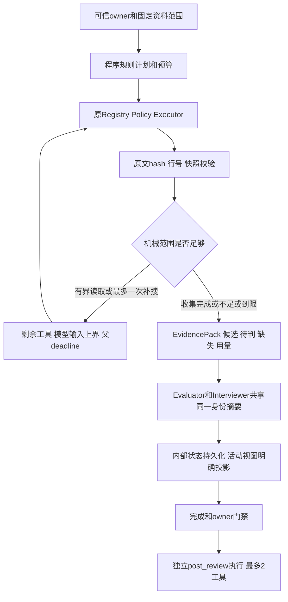

# S3 有界证据交接与真实并发修复

2026-10-22；工程合同与合成HTTP已按以下范围verified。引用定位有效与断言获得支持分别记录，人工语义充分性未验。[实施前Spec及实际调整](../tech-specs/expansion/S3-evidence-pack.md)。

## 业务结果与边界

询问“生产环境每秒吞吐量是多少”，系统可以检索到实现，但不能用函数存在来回答吞吐量。现在返回有来源的EvidencePack、两轮原始结果、仍缺的运行材料和needs_input。普通定位请求可limited_source_only，其含义仅是允许基于已有来源作有限说明；每条断言仍needs_judgment，不是已经证明语义正确。个人职责、量化成果不会因代码命中而升级C1。

此前检索结果直接交给选题，后续读取虽有18次工具限制，却没有统一的两轮计划/分层不足/模型输入上界；结束后的资源检索还在计数之外直接循环。此次复用原Registry/Policy/Executor，保留原面试图；没有增加必调LLM规划器或另造群聊系统。

## 实际合同与取舍

1. 私有scope由服务绑定owner/project/snapshot；公共scope固定条目版本映射。HTTP请求不能传owner，工具参数也不能更换租户。每条引用重新核对原文；损坏/越界/公开版本中途变化直接拒绝，不靠第二轮“修复”非法引用。索引静态引用未解析等限制进入warnings。
2. 每pack最多2次搜索、5次工具、8000字符整段quote和20秒协作时限；场内原18次工具总限继续有效。搜索/定义/引用/范围读取逐次走原执行器。历史pack最多10份，角色只收必要身份、状态与引用ID；不向活动HTTP公开完整pack或rubric。
3. 每次搜索在编码前预留已配置Embedding/Reranker的输入上界：1024+30×512=16384，最多两轮32768。字段明确叫reserved upper bound，实际token未知，不当作实测用量。父deadline取较早者；同步GPU只保证调用前/后拒绝晚结果，没有硬抢占保证。
4. 32K工具结果上限之前去掉重复entry.body/答案字段，整段quote超预算留出位置与省略原因。大代码段可通过计数内read_code_range取完整有限行，不能截断后冒充原始完整引用。到限保留已有合法材料和stop_reason，不再继续搜索。
5. 没搜到不等于语料无答案；只有范围确实没有资料才no_material_in_scope。源码不能证明本人贡献、生产吞吐或求职成功率，直接标相应不足。一般语义仍待判；枚举预留supported/partial/conflict供后续审查，但本阶段不自行作这些肯定判断。
6. Evaluator与Interviewer实际消费同一pack身份与状态；反馈选择的读取也形成pack并计入同一场内工具计数。schema替身证明双角色输入一致、Interviewer无rubric，不能当真实生成模型质量证据。真实HTTP面试仍用规则提问，Embedding与重排是真实本地模型。
7. 结束复盘的公共资源改为独立post_review执行ID/trace/最多2工具；先检查完成和owner，再检索。保留UI需要的entry.body，正文由已校验quote还原，没有额外未计数读取；失败也留下执行计数/安全错误码。本场18次与复盘执行分别展示，不能混称同一个预算。

没有选LLM判定“多找一段就充分”，因为本阶段没有人工语义金标；额外模型调用也不能自动建立个人经历真实性。原始事实、审批、版本和C1边界不变。新增状态字段有默认值，旧checkpoint仍可解析。回滚需按本增量diff恢复旧引擎接线，尚无单独运行时开关；原始证据与失败记录应保留。

## 真实失败与修复

首轮合同47通过7.20秒；扩大相关回归373通过20.28秒。但带后台索引worker的真实HTTP在面试读取出现500/database is locked：[原失败](evidence/expansion/s3-http-model-v2-failed.log)，[当时373项](evidence/expansion/s3-related-v2.xml)均保留。这说明纯同步/无后台worker的机制测试不能代替真实集成。

结合调用栈与锁模型，等待环是：状态外层读持锁→后台提交等待读结束并阻止新读→引用校验另开连接等后台提交。SQLite回滚日志模式的PENDING确实允许旧读继续、阻止新读，见[官方锁说明](https://www.sqlite.org/lockingv3.html)。修复让私有/公开引用校验复用当前读或写事务，不延长超时、不关闭worker、不跳过校验。两个新增测试实际观察到独立写事务已阻止新读，再读带引用面试，最后确认写事务成功提交；分别覆盖私有和公开引用。

修复后[375项相关回归](evidence/expansion/s3-related-v3.xml)通过20.25秒，包括23项S3用例，以及原产品/引用/工具/策略/预算/checkpoint/故障合同。没有新跑全仓全量或浏览器，不能替代S0保留的41缺历史资源/2 Redis/1 Git等失败分类。此前Qwen兼容回归已修复，此处不把全部旧失败说成仍由本增量导致。

## 真实HTTP与补轮诊断

[真实Qwen与重排记录](evidence/expansion/s3-http-model-v3.json)：8项流程检查、7次原检索、2个面试入口、6个新增pack全部通过。模型hash/加载10612.34ms，总16600.89ms。[纯规则记录](evidence/expansion/s3-http-rules-v3.json)：同6个pack和8流程检查，原检索为3次，总3697.17ms。两条路径原检索数量不同，不据此宣称速度或质量优劣。全部数据为自编CC0合成材料，无付费API、无私人材料外发。

|模型路径中的pack|搜索轮/工具|新增候选变化|结果/花费边界|
|---|---|---|---|
|save_receipt callers|1/1|首轮3|344字符；62ms；仅来源说明，语义待判|
|生产吞吐量|2/2|3→再加0|422字符；135ms；仍缺运行测量，needs_input|
|本人主导并提高成功率|2/2|3→再加0|344字符；131ms；个人贡献/成果不足|
|吞吐量、tools=1|1/1|首轮3|92ms；budget_exhausted，未执行第二次|
|公共Checkpoint题|1/1|首轮3|131字符；81ms；无answer_points/aliases|
|含恶意指令的README|1/1|首轮1|86字符；54ms；只作原文，项目仍存在|

正常单轮模型pack预留16384输入token上界；两轮预留32768，不是实际token数。两轮吞吐量请求没有新增候选，属于保留的无增益结果。规则路径该请求从0到1条，但不能因此认为找到了性能证明。

另有两个受控测试：补轮可以找到相关候选；补轮也可以因固定扩展词找到无关天气说明。两者同样保持candidate_needs_semantic_review/needs_judgment。新增命中数、路径数和引用有效只说明机械变化，人工支持、幻觉率和最终回答质量均未测。没有为了提高指标改人工gold；目前人工gold仍为0，独立测试集未评分。

本轮已测源码身份：`8eced583b6f77953f7cb2e812e3924b11beedd46398cdd46960ae69cebf96c6e`，本地/远端独立计算一致；详见[s3-summary](evidence/expansion/s3-summary.json)。原始pack保存scope/计划/两轮/引用/trace，临时索引会随合成运行结束清理；完整可重放快照仍是S8任务，不宣称bit级复现完成。本地无.git，hash/diff是本轮实际留痕，不冒充Git提交。

## 30分钟学习单元与5追问

先5分钟看上图，接着15分钟按以下五个入口阅读：

1. [evidence_pack.py](../../src/job_agent/resume_workspace/evidence_pack.py)：make_plan与BoundedEvidenceRetriever.retrieve，找出每种停止条件。
2. [interview_tools.py](../../src/job_agent/resume_workspace/interview_tools.py)：retrieve_pack/run/_project_result，区分模型选择的读取与确定性原文校验。
3. [retrieval_interview.py](../../src/job_agent/resume_workspace/retrieval_interview.py)：prepare/_invoke，追踪同一pack如何进入两个角色。
4. [interview_repository.py](../../src/job_agent/resume_workspace/interview_repository.py)：_load/get，解释同事务引用校验和活动视图字段白名单。
5. [interview_api.py](../../src/job_agent/resume_workspace/interview_api.py)：review，解释为什么复盘另有执行ID和预算。

再用5分钟比较吞吐量两轮与tools=1结果，最后5分钟自行回答：

- 找到三个文件且引用有效，为什么仍可能完全不支持问题？
- 父deadline如何避免被子工具重新计时延长？GPU为什么仍可能晚返回？
- 两个角色共享什么，为什么不能把完整题库/rubric直接塞给两者？
- 代码和测试文件为什么不能证明本人职责或测试已经通过？
- 读操作为什么也会参与SQLite等待环？复用事务究竟改变了哪一步？

学习是否完成由用户自检，本报告不代为标记掌握。下一步S4先写详细Spec，补真正共享执行状态、中文新增成果断言门禁与实际反馈、同预算本地生成模型对照；S1最终候选/人工核对、PG/Redis切片和统一验收仍未完成。
