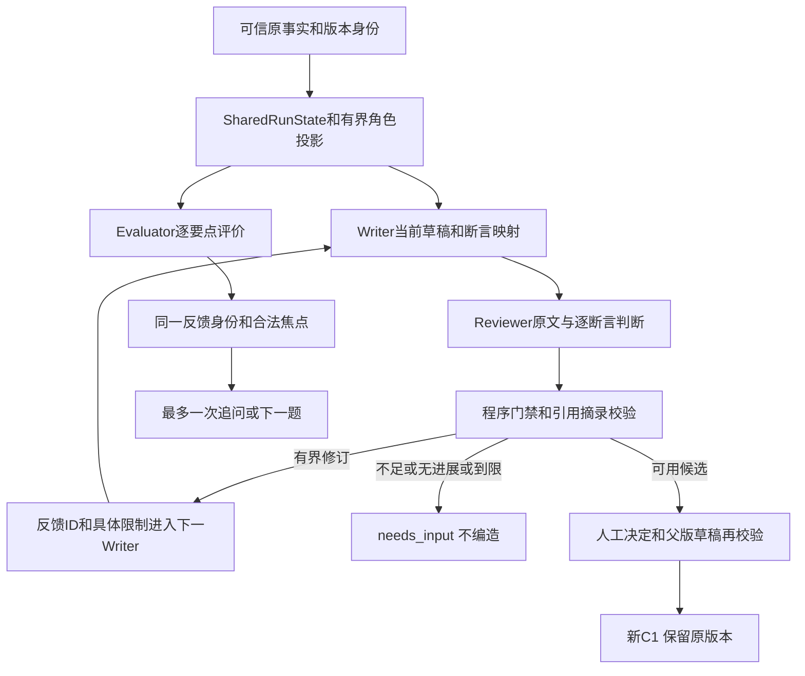

# S4 共享执行状态、事实审查与真实模型对照

2026-10-22；工程合同/真实模型/候选对照按下述范围verified，语义质量与人工盲审未验。[实施前Spec](../tech-specs/expansion/S4-collaboration.md)。本地无.git，本轮用真实源码hash/diff留痕，不伪造历史。

## 已实现的业务变化

旧改写图只传revision/outcome、面试图只传node，必要资料在外围；现在两图携带并消费SharedRunState。可信owner/源版本/hash/JD身份、当前节点、最新反馈身份、产物/证据ID、预算/已知未知用量、派发状态、lease与有界事件随原仓储payload/checkpoint保存。模型只收到必要投影，不得到owner/租约；原文/全部历史不反复塞给模型。

Writer只拿最新一稿和反馈，Reviewer独立看原事实/当前稿，屏蔽作者自我认可和理由。断言分句有精确草稿偏移、分类和C1来源映射；相等/受限转换、模型语义参考、缺证分别标记。数字/技术/范围原门禁保留，新增中文成果/因果/成果强度/否定实体冲突等程序检查。即使Reviewer接受，“显著提升求职成功率”等无原文依据成果也不能通过；一般语义映射仍是model_semantic_unverified，不能称事实已独立证实。

重复坏稿在第3次角色调用停止，不再耗满六次；三份不同坏稿仍验证3稿/6调用上限。Reviewer明确needs_input不会被改成继续修订。接受前重查源身份/上下文/父版/草稿/最新审查；仍只创建新C1。改写CAS与有限lease阻止过期执行覆盖恢复决定。面试运输结果未知保留model_inflight，不能因catch而清除后自动重放；已知坏JSON/schema另行失败。

面试新增逐要点correct/incorrect/uncertain及回答原句，错误/不确定不能留在covered；local_lexical、窄确定性反例、模型语义参考分开标。Interviewer消费带同一feedback_id的安全反馈，活动视图仍不公开评价/rubric/内部状态。上下文裁剪只省略完整事实，标context_incomplete，不能把被省略当作用户没有经历。比较还需同题面/引用/要点/别名/模型/评价方法，不能只按topic相同就计算提升。

## 已运行验证与真实失败

- 首个命令写了不存在的测试文件，0项运行，不能称通过；[命令错误](evidence/expansion/s4-first-command-error.log)保留。随后[76通过/2失败](evidence/expansion/s4-state-v2.xml)：旧重复坏稿用例仍预期耗满预算，另一个请求完整性错误码被派生状态校验抢先。已保留三份不同坏稿的上限验证，另加重复早停；恢复原请求校验优先级。
- [定向100通过](evidence/expansion/s4-contract-v3.xml)，15.25秒；扩大[431通过](evidence/expansion/s4-related-v4.xml)，28.35秒。之后新增Reviewer拒绝、完整事实裁剪、晚结果停止等，[最新协调器70通过](evidence/expansion/s4-coordinator-v5.xml)，10.10秒。不同范围/源码时点不相加成新成绩。未新跑全仓或浏览器。
- 本地准备数据曾因顶层导入RewriteRoles要求未安装的LangGraph而失败；把运行时导入延后后，纯静态prepare成功。没有为此改全局Python或把后续命令exit0误当准备成功。
- [真实pilot v1](evidence/expansion/s4-collaboration-pilot-v1.json)：2例/3路径/6行、8调用。normal-api三条共同首稿带额外revision，被严格schema拒绝；另3行保留原文/needs_input。原输出保留，没有放宽schema或偷偷删未知字段。
- 明确每层允许键并递增prompt版本后，[pilot v2](evidence/expansion/s4-collaboration-pilot-v2.json)6行/10调用，格式均有效，但全部保留原文或请求补充；暂无协作收益。加载/hash29508.86ms，总59626.20ms。同案例三路径首稿prompt/seed相同；12例候选在pilot之前冻结，未根据结果改标签。
- 最后[435项相关回归](evidence/expansion/s4-related-v6.xml)通过31.45秒，包括输入8193 token在任何模型派发前拒绝且释放锁。此项才是最后扩大结果；不是前述几个套件成绩的相加。

## 真实HTTP角色链路与已知评价局限

[真实HTTP记录](evidence/expansion/s4-http-real-v1.json)使用Qwen2.5-7B，实际Qwen2ForCausalLM、7615616512参数、BF16、GPU cuda:0；权重/配置/tokenizer revision为`f5d2f69828f4fcacd4a2712fdbe7d1798714fd3f072c309adf06d33eeabe16b7`。旧LocalTransformersProvider适配未改变，新增显式OfflineTextProvider离线加载、本地safetensors/trust_remote_code=False、真实token计数、输入8192/输出512上限。仅自编合成材料，无付费API，GPU计算成本未知。

实际4次生成：Writer/Reviewer各1、Evaluator/Interviewer各1，共4944输入/484输出token；6流程检查通过。改写needs_input，非法接受409，原版本未变。面试依真实评价从主问题转到“怎样区分重试同一操作与新操作”的追问；feedback_id与结果持久化。活动视图不泄内部资料，第二owner404，未结束不能读复盘。本次普通岗位面试未启检索，不能说已在同一次HTTP联合验完PG/检索/生成全链。

观察到评价解释与回答存在字面冲突：回答明确写“用幂等键记录执行标识”，模型note却称未提及；又把未明确说出的“不盲目重试”解释成已覆盖。这不等于程序可以仅凭关键词自动判p0正确，而是说明模型理由/判断需核对。保留原始评价，不改成漂亮分数，不把本地模型Judge当用户能力或教学效果真值。模型语义质量/人工盲审仍待验，后续学习纠错应引用这条真实记录。

## 冻结候选正式对照与小消融

[108行完整记录](evidence/expansion/s4-collaboration-formal-v1.json)、[派生汇总](evidence/expansion/s4-fair-summary.json)：冻结12例×3路径×3重复，239次真实生成，256398输入/26135输出token，总686973.56ms，其中加载/hash29784.33ms。36组相同case/repeat的三路径首稿prompt、seed、输出hash全部相同。后两路径同六调用上限；单Writer是一次调用成本基线，不把额外调用免费当作协作优势。

|路径|行数|实际调用|输入/输出token|结果|单行耗时中位数|
|---|---:|---:|---|---|---:|
|单Writer|36|36|31683 / 4007|36 needs_input|2658.97ms|
|自审修订|36|103|117789 / 11461|19 needs_input / 17无进展停止|7353.04ms|
|Writer/Reviewer|36|100|106926 / 10667|20 needs_input / 16无进展停止|6302.52ms|

每路同样15份首稿保留原文、21份违反已声明硬约束（例如直接把JD的QPS/技术/成本要求塞入候选）。没有可用改稿被自动放行。后续未改善到可用候选，不能说协作有效。原始模型即使重复建议也不能越过程序门禁。策略结论：继续保留受限规则/人工审批作为默认，不因多角色更复杂而切换默认。

这不是“幻觉率/准确率”成绩：违规仅针对明确合同，重复/三路径同首稿高度相关，不能加总成独立样本。案例为AI自编、2例已在pilot看过，全部不是人工盲测/独立泛化测试。未观察到无硬约束问题但被机械映射拒绝的改稿，分母不足，不能据此宣称误拒率0。耗时含脚本/检查点开销，初段并发另GPU的HTTP和CPU测试，不是隔离性能benchmark。

[6次小消融](evidence/expansion/s4-grounding-ablation-v1.json)只开关原始Writer的来源约束自然语言，保持Schema/程序审计；生产硬门禁从未关闭。3例×开关各1次，均有效结构，5份保留原文、1份仅调换已有分句顺序且通过来源审计，未观察到违规差别。Schema中的source_quote等仍有约束，不能把它叫所有证据约束完全关闭，也不能据此说约束没有价值。

[事后口语输入控制](evidence/expansion/s4-http-positive-control-v1.json)没有改冻结数据：真实模型仍保留“我参与了…我使用…”原文，工程链路/门禁可用但没有生成有用改动。本地受限同义转换的正例/新C1采纳由实际仓储合同验证，不能拿它冒充这次LLM已改好。该控制与小消融说明模型策略和样本选择限制，不能包装为生产改写质量已达标。

复现：隔离环境运行`scripts/expansion_collaboration_eval.py --model-path /root/autodl-tmp/models/Qwen2.5-7B-Instruct --device cuda:1 --subset 12 --repeats 3 --max-seconds 3600 --output <新结果路径>`；输出存在则拒绝覆盖。小消融用`scripts/expansion_grounding_ablation.py`；真实HTTP用`scripts/expansion_collaboration_http.py`。显式离线目录，无付费API，API费用0/计算成本未知。

正式对照/首个HTTP源码身份`5869fa62ee11ef62f98839c18eefc9874affc6970ae0684063c785417c80f377`；最后控制/435回归身份`9d5b32c054309bccc65ea6ad99cc194f2c959be1298adf0abb75caa154ff9fef`（增加控制脚本/预算测试，生产核心相同）。源包increment-16/17与baseline/diff可重建，不把新文件时点混成同一次运行。S5只读预检确认psycopg可用、apt缓存有PG14.23/Redis6.0.16；未安装/启动，Redis6.0不支持所需XAUTOCLAIM（[官方标明6.2.0起提供](https://redis.io/docs/latest/commands/xautoclaim/)），不能提前说S6资源已齐。

后续进入S5项目→快照→索引→任务同一PG权威域；S1人工/最终检索集、S6可靠性、S7来源学习与S8统一验收仍未完成。当前生成模型质量缺口保持可见，不无限调提示直到“赢”。

## 30分钟学习单元

5分钟看图；15分钟顺读五个入口：

1. [execution_state.py](../../src/job_agent/resume_workspace/execution_state.py)::SharedRunState，分清可信身份、工作投影、事件和未知结果。
2. [claim_audit.py](../../src/job_agent/resume_workspace/claim_audit.py)::audit_claims，追踪新增中文成果与正常同义的不同路径。
3. [rewrite.py](../../src/job_agent/resume_workspace/rewrite.py)::RewriteService.start/decide，看反馈怎样进入下一稿、CAS和采纳怎样保护原版。
4. [interview_collaboration.py](../../src/job_agent/resume_workspace/interview_collaboration.py)::InterviewEngine.execute，追踪同feedback_id到合法下一题。
5. [local_text.py](../../src/job_agent/llm/providers/local_text.py)::OfflineTextProvider.generate_structured，对比真实token、停止原因和未知结果。

5分钟比较pilot失败与HTTP评价反例，最后5分钟复述以下问题及参考要点：

- 共享State为何不能只是node？要点：源身份、反馈和预算必须真正被下一节点消费，持久checkpoint与图状态需一致。
- 模型说accept为何还可能拒绝？要点：确定性事实门禁/合法动作/父版与审批不能被模型豁免；语义映射也不等于现实真实性。
- 一次超时为什么不能自动重试？要点：派发可能已完成；保留inflight/未知，已知schema失败另行处理，不能混淆。
- 同六调用为什么还要报实际用量？要点：提前停止/保留原文会显著改变token与耗时；单Writer1次只是成本基线，不能把更多调用当协作收益。
- 真实Trace有效为何评价仍可错？要点：证明了调用和交接，不证明判断正确；需原回答/标准/解释核对和人工纠错，不能把互评当唯一真值。

用户尚未完成的学习不代标掌握。模型判断错误、人工未评、全仓历史失败和PG/Redis未接产品继续保留。
