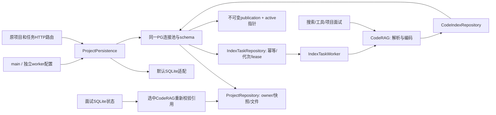
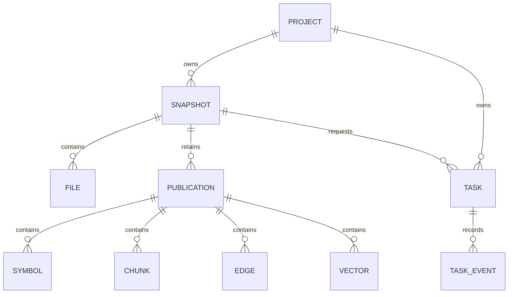
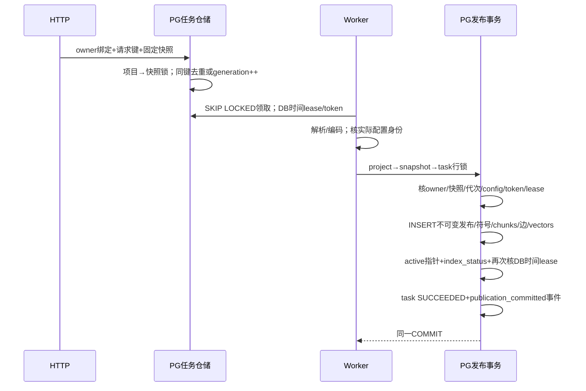

# S5 · 项目、快照、索引与任务的同一 PostgreSQL 权威域

2026-10-22。状态：工程合同、隔离真实PG/HTTP/本地Embedding及合成迁移 verified；生产迁移、Redis交付、独立语义质量未验。实施前合同见[S5 Spec](../tech-specs/expansion/S5-postgres-slice.md)。

源码仍无.git，不创建虚构提交。阶段起点S4最终源9d5b32c054309bccc65ea6ad99cc194f2c959be1298adf0abb75caa154ff9fef；真实Qwen HTTP及v3相关测试使用876063964b2bf665bdf26521673a56654d9dc606022414c09e7cc181180087f6；最后补配额并发/快照上限测试后为e5061d03c9756172c3c863bf5f8dce68302bd6089a49b291d4cfd6d2681dea2f，生产实现未改。hash/diff来自scripts/expansion_checkpoint.py与原始源码tar，不是Git历史。

## 业务变化与基线

原API已经有ZIP/快照、代码检索、面试引用和SQLite持久队列，但CodeRAG直接含SQLite SQL；旧PostgresRunRepository的Run模型与当前项目/快照任务不同，不能靠旧PG组件存在认定工作台已接PG。

现在默认SQLite兼容；显式PROJECT_BACKEND=postgresql时，原项目/索引/任务路由与独立worker使用同一原生PG仓储。简历、审批、岗位、面试状态继续在既有SQLite域。模型只通过原工具查询，不能选择owner或写SQL。项目源码仍不证明个人贡献，引用/C1不升级。

## 实际调用链和取舍



不选SQL占位符翻译层或继承旧Run仓储：这会隐藏不同的数据模型与事务边界。抽三个小协议，SQLite保留原表，PG使用psycopg显式事务/参数/字典行。代价是两个适配器需共享业务合同；收益是CodeRAG中已无连接/SQL，业务解析和检索继续复用。

不选任务先成功、索引后写另一库：PG将派生行、active指针、项目索引状态和任务成功放在同一事务。编码在事务外；发布期间只持有必要锁。不可变publication保留旧版，读取指针与所有载荷使用同一个repeatable-read事务，避免重建时混版。旧发布随快照/项目删除级联，不承诺在线压缩历史发布。

## ER与数据字典



|表/主键|关键字段、约束|写入/生命周期|
|---|---|---|
|v3_projects/project_id|owner_id、payload、created_at、current_snapshot、index_status；UNIQUE(owner,project)|可信owner配额锁；当前指针复合FK必须属于本项目|
|v3_project_snapshots/snapshot_id|project_id级联FK；内容hash/origin/commit/metadata；UNIQUE(project,hash)、UNIQUE(project,snapshot)；desired_generation、active_publication|文件不可变；当前发布复合FK必须属于本快照；最多10快照|
|v3_project_files/(snapshot,path)|快照级联FK；content_hash、text|每读校验manifest/文件hash；单文件256KiB、每快照24MiB、每owner100MiB|
|v3_index_publications/publication_id|快照级联FK；parser_version、report payload/hash、generation；UNIQUE(snapshot,publication)|事务内生成不可变发布；旧发布随快照清理|
|v3_index_symbols/(publication,symbol)|发布级联FK；符号payload|report内含完整符号payload hash清单|
|v3_index_chunks/(publication,chunk)|发布级联FK；chunk payload/hash|载荷与report清单双重校验|
|v3_index_edges/(publication,source,target,kind,line)|发布级联FK；静态关系|report含排序后的完整边hash；不是运行结果|
|v3_index_vectors/(publication,model_id)|发布级联FK；实际维度、payload/hash|model_id为完整scope/解析/编码文本/模型身份；不复用不完整键|
|v3_tasks/task_id|owner/project/snapshot复合FK；UNIQUE(owner,request_key)；request_hash、index/config版本、generation、status/stage/result/error、lease_token/until、attempts、创建/更新时间、event_seq|配额20全局/3每owner活动任务；队列索引status/lease/created；三次恢复上限|
|v3_task_events/(task,seq)|任务级联FK；kind、attempt、recorded_at|同事务追加安全状态码，不存源码/模型私有输入|
|v3_schema_migrations/version|ddl_hash|初始化可重复；同版本DDL不符拒绝启动，不能默默覆盖旧库|

时间：项目/快照沿用原ISO字符串；任务/事件使用数据库clock_timestamp的epoch秒。active/current两个环形指针为延后检查的复合FK。项目删除级联快照、文件、发布、派生、任务和事件；简历SQLite无跨库FK。代码索引仍有限制：12000 chunks/15000 symbols/30000 edges。

## 发布时序与故障边界



新请求提高期望代次，旧worker即使lease未过期也不能覆盖；同请求键去重不提高代次。Native PG worker不再调用另一个complete事务。中途异常回滚全部新行和指针，原发布继续可读。取消只接受QUEUED，领取先赢则取消409；不宣称已支持运行中强制取消。SKIP LOCKED只用于队列竞争，普通一致性读取不跳行（[PG14官方SELECT说明](https://www.postgresql.org/docs/14/sql-select.html)）。

面试SQLite与项目PG不构成分布式事务。InterviewRepository使用已选中CodeRAG，每次载入重查固定引用；同SQLite域才复用当前连接，跨PG域不传SQLite连接。源删除后引用失效，不能把旧面试文本当成仍有效源码。

## 功能轨迹与实际验证

1. **抽离SQLite存储**：project_storage.py协议、sqlite_code_indexes.py原表适配，CodeRAG仅解析/编码/排序。首轮252通过/1失败，真实HTTP发现`projects`路由函数遮住同名仓储；更名修复。保留s5-sqlite-extraction-v1.xml，未改断言或跳过失败。第二轮259通过/11跳过24.04秒：该轮尚无PG DSN，8个PG分支及3个PG专属SQLite分支跳过。
2. **真实PG与事务合同**：postgres_projects.py实现原生仓储；首轮14通过/3跳过3.21秒，增加迁移后16通过/4跳过3.44秒。跳过仅为PG专属合同在SQLite参数分支；真正PG参数已运行。回滚保留旧publication、任务不假成功，跨代次/过期token/不同encoder拒绝，双worker一次领取、owner404、删除级联均通过。
3. **真实服务/模型**：rules build/reload各5检查2查询；Qwen build/reload各5检查3查询（keyword/dense/hybrid）。真实Uvicorn/HTTP，build含ZIP→快照→后台任务→同事务发布→项目面试。rules之间实际停止并启动本轮PG实例；Qwen两个进程PID98646/99590，同库同scope/引用，四张SQLite影子计数均0。模型1024维Qwen3-Embedding-0.6B cuda:0，revision47191d5687dbf14319ccb312680caa31a179ed5e16539b8c06aeddc53b63ef6c，详见原JSON。重新启动公共知识预热仍有2次文档编码；新增项目编码只在build有1次，reload查询未重新编码项目文档，不能声称整个启动零模型开销。
4. **独立进程与备份**：实际执行原scripts/v3_task_worker.py --once，原生PG task一次SUCCEEDED并含publication_committed。保存单个合成HTTP业务PG dump/SQLite面试库/固定scope/state与hash，再恢复到本轮另一数据库s5_replay_v1，验证任务/项目/快照ID、所有保存引用、词面查询及向量payload hash。恢复探针未重新加载模型；不把这个小业务包当最终A—G评测索引。
5. **离线迁移**：project_migration.py只读一致SQLite快照和不覆盖备份，拒绝活动任务、损坏hash、非空目标；一PG事务导入并反投影核完整domain hash，保留旧project/snapshot/task/evidence ID。单元合同包括fixture向量缓存。实际CLI dry-run/apply样例2项目/2快照/2文件/2索引/4符号/4chunks/1完成任务，**该CLI样例向量为0**；源/目标域hash均95b6c48fa3407d226af7bc03ff5384a0c680407cc5138e5d0f22cfdd2b23222c。源进程退出后才导入，新PG读取旧引用和历史任务成功；另复制保留备份恢复SQLite并查旧引用/检索成功。未迁生产、未复制旧项目私料。

最后扩大原S4同模块并加新合同：**455通过/0失败/4跳过，32.34秒**；原S4的435项均包含，新增24参数用例有20通过/4上述限定跳过；补验并发项目配额只有一方占最后名额、快照去重/10版本上限和文件大小。不是全仓/前端/浏览器复验，也不是性能或语义收益实验；S0缺资源失败原样保留。

### 资源记录

apt缓存14.23的镜像404，官方索引下载后包直连读超时，两次失败日志保留。实际取官方jammy-security索引14.24、镜像下载3个包并逐一比对原索引SHA256，在output提取；没有apt install/系统服务变更。仅本轮/tmp/job-agent-v3-pg-s5-20261022由nobody运行，socket目录700、listen_addresses为空；实际server_version 14.24，psycopg3.3.4/libpq18仍只是客户端。重启仅针对这个实例。隔离实例保留给S6，不动旧项目/旧服务；不宣称生产安装完成。

### 证据入口

同目录[evidence/expansion](evidence/expansion)内：s5-related-v4.xml（此前v3=451通过/4跳过32.82秒保留）、s5-pg-migration-contract-v2.xml、s5-http-{rules,qwen}-{build,reload}-v1.json、s5-worker-cli-v1.json、s5-migration-cli-{dry,apply,verify-rollback}-v1.json、s5-pg-resource-v1.json、s5-pg-replay-restore-v1.json和s5-summary.json。失败日志/原XML同样保存。业务重放包在output/expansion/s5-http-qwen-replay-v1.tar.gz，manifest声明其有限范围；完整研究评测重放仍留S8。

## 已执行命令与复现约束

运行目录为独立远端job-agent-v3，.venv已有项目/psycopg/Torch依赖；先用本轮专属PG socket/测试数据库配置环境，不在共享或生产库跑测试。测试会创建/清理自身随机schema。

```bash
export JOB_AGENT_TEST_PROJECT_DSN='host=/tmp/job-agent-v3-pg-s5-20261022/socket port=55432 dbname=postgres user=job_agent'
.venv/bin/python -m pytest -q tests/test_v3_project_storage.py --tb=short
# 私有部署与独立worker同一套PROJECT_BACKEND/DSN/SCHEMA和Embedding配置。
JOB_AGENT_PROJECT_BACKEND=postgresql JOB_AGENT_PROJECT_DSN="$JOB_AGENT_TEST_PROJECT_DSN" JOB_AGENT_PROJECT_SCHEMA=s5_cli_worker_v1 \
  .venv/bin/python scripts/v3_task_worker.py --database output/expansion/s5-worker-cli-resume-v1.sqlite --once
```

HTTP实际执行脚本：scripts/expansion_postgres_http.py，build与reload分两次OS进程，给不同结果文件；拒绝覆盖state/output。真实Qwen的环境与S2一致；重复build须使用新schema、state和resume-db。迁移脚本scripts/migrate_v3_projects.py，必须先停止源写进程，--apply明确要求--source-quiesced；该标志是操作者声明，工具不能阻止别的进程稍后再次启动。切换只改变项目域的服务配置，回滚切回保留源/备份；不提供双写或零停机迁移。

## 限制与下一步

默认仍SQLite/Embedding关闭。新PG服务是本轮合成隔离验证，身份仍原本地token映射；无生产权限/运维/容量结论。schema只定义版本与hash，未来DDL变化需显式增量迁移，不能更改同版本hash后强行启动。历史publication未做在线回收，按快照生命周期保存。

S6继续同PG事务Outbox→Redis Streams→独立worker/ACK/重领故障矩阵；当前PG轮询不等于该闭环。S1最终60—80候选/人工、S7来源学习与S8统一验收尚待做。真实模型检索接通不代表准确率或个人掌握，用户学习不代勾完成。

## 30分钟学习单元

5分钟看调用图/ER，15分钟按五个入口跟一条任务：

1. [project_storage.py](../../src/job_agent/resume_workspace/project_storage.py)::ProjectPersistence/persistence_from_env：配置决定哪个域是权威，默认是什么。
2. [code_rag.py](../../src/job_agent/resume_workspace/code_rag.py)::CodeRAGService.build/_load：事务外编码与统一存储接口，为什么业务层不判断PG占位符。
3. [postgres_projects.py](../../src/job_agent/resume_workspace/postgres_projects.py)::PostgresIndexTaskRepository.submit/claim/guard：请求键、代次和租约各解决什么问题。
4. 同文件::PostgresCodeIndexRepository.publish/load：指针+任务同提交、repeatable-read载荷及最后一次DB时间校验。
5. [project_migration.py](../../src/job_agent/resume_workspace/project_migration.py)::sqlite_snapshot/import_to_empty_postgres：稳定ID、备份、完整反投影hash与源停写条件。

5分钟读首轮真实命名失败/最后XML，再用5分钟回答：

- **为什么不能只把任务表迁PG？** 项目存在、固定快照、派生发布和任务成功需要同一权威事务；两库先后写会有假成功和回滚窗口。本切片只跨域重新验证引用，不假装有跨库事务。
- **request_key、generation和lease_token能互替吗？** 请求键防重复/冲突；generation防旧请求覆盖新期望；token+DB时间防旧执行实例接管后继续提交，各有不同身份。
- **为什么索引有publication而不直接UPDATE chunks？** 用不可变行和active指针实现原子切换；同一读事务获得同版载荷，异常保留旧版。代价是多占历史空间，需明确清理生命周期。
- **恢复后为什么还要校验引用？** 数据库服务或任务成功不保证来源未删除/载荷未损坏；固定owner/快照/文件hash/原文行和report清单仍逐次核验，不提升个人贡献事实。
- **迁移hash相同为什么不等于生产迁移完成？** 这里只验证停止写入的合成库；需生产权限、备份/停写窗口、目标权限和运维验收。dry-run不切换权威，apply保留源，回滚也需配置切换和源状态核对。
