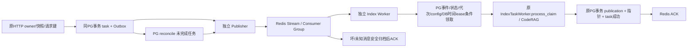
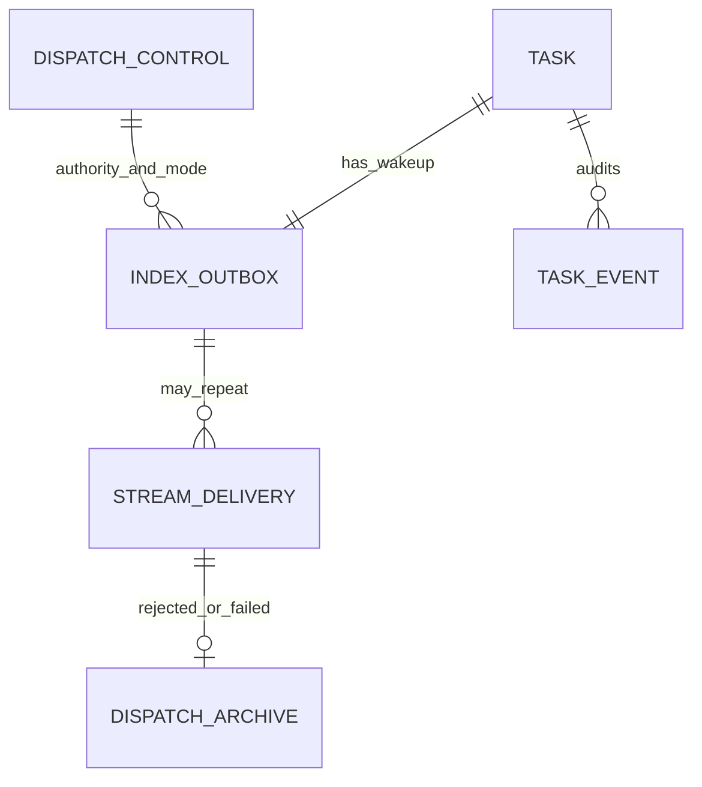
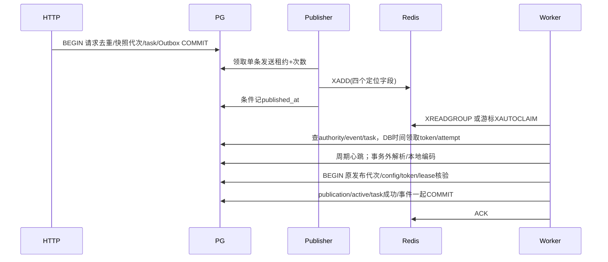

# S6 · Outbox/Streams与独立索引Worker

2026-10-22。状态：当前索引任务的工程/真实PG/Redis/独立进程故障/真实离线Embedding链 verified；生产运维、文本模型重放与独立语义质量不在本次通过范围。实施前合同见[S6 Spec](../tech-specs/expansion/S6-outbox-streams.md)。基线S5最后455通过/4限定跳过32.34秒；最后487通过/4同类跳过37.24秒，前端13项及生产构建通过。真实进程矩阵13场景/42子进程通过，首轮12通过后就绪探针失败保留。

无.git，不创建提交或推送。矩阵v2源9c717fbdd752b54c791882d8a994fdc65b4ffd701e635fa94b387841de67ba2f；487及Qwen HTTP源3a81ebe42de13d91ddab009306bee1e3a8563d7b3018cdd5104e5beeb9953f88，差异仅前端/checkpoint留痕等，不改变派发/领取核心。最后将发送耗尽测试扩大到默认12次后，源码0c892e5470105f272bb1af26e7d662c3f133fd4df70574e9b74e2ceaf6023501（只改测试），实际结果见下方。源码hash/diff/前端独立hash来自scripts/expansion_checkpoint.py，不伪造Git历史。

最后补强：维护轮换authority epoch并核模式+epoch，CLI遇旧身份停止，A→B→A旧A仍失效；源码1be116abf36d714fdc7c05e3ad9967f8b17d9818c406cd0dc3ae9d212a259852。该版本再次487通过/4限定跳过37.24秒（s6-related-v4.xml），实际另进程polling在Redis域启动被拒绝（s6-wrong-mode-cli-v1.json）。该同一源码v3矩阵13场景/42进程全部通过；Qwen build/reload v2各5检查/3查询通过，见原JSON及s6-summary.json，不覆盖原迹。

## 实现增量1：原业务接Outbox和Streams

- index_dispatch.py新增版本2迁移、持久authority/调度模式、task+Outbox同事务、Publisher租约/12次发送上限、消费条件领取、3次执行/恢复、归档与显式reconcile。S5原DDL hash不改，原publication/任务同提交fencing保留。
- index_streams.py继承旧RedisStreamDispatchQueue连接/group/ACK/监控原语，改当前定位消息、游标重领和有限保留；旧类仅增加可选client_parameters供有界连接超时，默认行为兼容。ACK不删除消息，丢失靠PG显式对账。
- 原IndexTaskWorker抽process_claim复用解析/编码/心跳；Redis模式拒绝本地轮询，任务模式在PG固定，变更要求无活动任务且旧进程重开。v3_index_dispatch.py提供独立publish/work/reconcile/inspect/switch-mode，维护入口只输出安全元数据，不接文本模型任务。
- 第一轮真实PG/Redis合同：45通过/4既有限定跳过，7.73秒（s6-contract-v1.xml）。包括原HTTP、任务/Outbox回滚、Redis不可用恢复、重复发布/ACK前中断、过期token、源删除、执行/发送上限、坏消息归档、队列丢失对账、单调度模式、心跳与pending游标尾部。均为真实服务合同；真实进程退出和Redis重启另由expansion_stream_faults.py验收，不能以合同替代。

## 首个资源增量

系统apt缓存Redis6.0不支持所需XAUTOCLAIM。固定Redis7.2.16、官方SHA256 960a8ec15e34ff40e57ff16837b26b33bd81f2da6d24497bb63de532a323a18e；官方hash通过web读取，远端raw GitHub TLS超时、官方tarball HTTP403，失败保留。镜像取同一tarball并核完全相同SHA，不改变版本/校验要求。

远端output/deps/redis-7.2.16编译（2个make jobs、MALLOC=libc、BUILD_TLS=no、OPTIMIZATION=-O2，只redis-server/redis-cli），exit0，实际--version 7.2.16；没有make install/系统包/旧服务变更。源码/二进制hash见s6-redis-download-v3.json和s6-redis-build-v4.json。

本轮独立实例仅Unix socket `/tmp/job-agent-v3-redis-s6-20261022.sock`，port0、socket权限700，数据/config/PID/log在output/expansion/redis-s6；实际PID102102。AOF everysec、128MiB/noeviction、RDB定时保存关闭，不承诺零丢失；后续明确验证PG对账恢复。此实例保留S6使用，不盲启动第二个。

真实resource probe：PING→本轮随机前缀Stream/group→XADD→consumer A读取→XAUTOCLAIM给B→ACK=1且XLEN仍1，最后只删自身probe key；没有FLUSHDB。证据s6-redis-resource-v1.json，明确resource_only_not_product_integration。没有跑新的业务索引或故障矩阵。

## 实施前计划（历史）

按Spec扩同PG任务+Outbox事务、持久单调度模式、Publisher与当前索引consumer；复用旧redis_streams.py原语/原IndexTaskWorker构建与心跳路径，不以旧Run模型代替当前task。PG仍本轮私有socket实例14.24。先合同后真实独立进程故障矩阵，保持S5原发布fencing和模型未知结果策略。

阶段结束再按实际补ER/数据字典、发送/领取/lease/提交/ACK时序、完整故障矩阵、20—40分钟导读/3—5代码锚点/5问参考答案，并更新CurrentSpec/矩阵/架构。当前这份资源记录不替代完整复盘或产品验收。

## 业务问题与实际变化

原S5的PG轮询已持久化索引任务，但没有事务后可靠发送，也没有Streams交付/确认/对账。现在原HTTP仍提交固定owner/project/snapshot；Redis模式只写PG task+Outbox，独立Publisher发定位消息，独立Worker查PG领取并调用原CodeRAG。不是另写一个只用于demo的索引器。

默认SQLite/PG polling仍可用；Redis模式必须PG，API内嵌轮询关闭，同一schema持久固定一种调度模式。调用`IndexTaskWorker`或默认开启内嵌worker时若是Redis域会拒绝。维护切换要求无QUEUED/RUNNING，并让旧进程重开；每个执行/发布事务共享模式锁，维护取排他锁，旧进程后续操作不能继续写入。

模型生成仍走S4未知派发保护，**只有可从不可变文件重建的索引任务会自动恢复**。CLI/消息无法选择Writer或面试生成任务类型；上传代码不执行。前端已去掉“故障恢复不执行模型”的错误旧文案，改为不运行上传代码，并用中文解释重试/停止。

## 当前真实架构与取舍



保留旧RedisStreamDispatchQueue的连接/group/ACK/lag/pending/retained原语，只增加可选有界连接参数；当前IndexStreamQueue适配四字段消息、重领游标及近似保留。旧Run数据模型不兼容项目/快照任务，故适配Outbox模式和原生PG仓储，不继承旧Run或做SQL翻译层。Publisher有自己的10秒DB租约，逐条领取待发送，避免先锁整批后慢发送耗尽后续记录租约。

不选DB提交前XADD：两资源无分布式提交；PG事务内创建Outbox，Redis发送在事务外，发送后条件记账。XADD后崩溃可以再次发送同一event_id；PG防重复有效发布。ACK只表示该唤醒已处理，不等于任务成功、不删除Stream记录。队列丢失不能宣称零丢失，按PG权威任务对账，超限进入可见终态。

## 新增schema数据字典与生命周期

S5的project-slice-1 DDL/hash未修改；index-dispatch-2是新增明确迁移，版本hash不符拒绝启动。



|实体/键|实际字段/约束|含义/清理|
|---|---|---|
|v3_dispatch_control/singleton=1|authority随机epoch、mode=polling或redis|每schema一个调度权威；维护轮换epoch，模式+epoch均校验；共享/排他事务锁；不含DSN或凭据|
|v3_index_outbox/event_id|task_id UNIQUE及级联FK、generation、created_at/available_at/published_at、send_attempts/error_code、publisher_token/until、exhausted|每逻辑任务一个事件；恢复复用同event_id；最多12次发送/对账预算，10秒Publisher lease；随任务删除|
|v3_dispatch_archive/stream_id|event_id/task_id可空、reason、payload_digest、recorded_at|未知/已删任务不能依赖Task FK，故无此FK；只存定位/安全码/digest，不存原文；保留最近1000条供CLI检查|
|Redis消息|authority、event_id、task_id、generation，严格字段/格式|不带owner/源码/简历/模型输入；owner从PG任务获取；错误authority/事件/代次拒绝|
|Stream/group|job-agent:v3:authority / index-workers|默认近似MAXLEN10000；ACK与XLEN不同；pending游标持续前进，NOGROUP可重建group|

任务/事件仍S5原表。task三次执行/恢复，Publisher十二次发送是不同预算。available_at指数退避上限60秒；Redis连接/读取超时2秒，worker读取block200ms。程序错误的重试只适用于重建索引，来源/完整性/版本错误为终态；未知DB/网络结果不ACK。模式冲突/配置不符不能抢写。任务失败可由原HTTP历史或CLI inspect定位，检查后用新请求键重建，不篡改旧终态。

旧已发布/取消Outbox行按任务生命周期保存，Outbox未发布行数不直接等于可执行任务数；CLI同时提供权威任务状态。Stream的lag/pending/物理保留、Outbox的发送/耗尽、任务失败与归档分别报告，不把任一项冒充另一项。备份克隆到新DB重放时须隔离Redis域，不能把两个数据库克隆的同authority同时指向同一生产队列。

## 关键提交时序



另一路：坏消息先PG归档再ACK；活租约/延迟/配置不匹配暂不ACK。源码删除时发布/引用失效，不插回数据；已成功的消息重领只ACK，不再构建。发送最后一次租约丢失也由reconcile收为可见终态，避免send_attempts达到上限却永远QUEUED。

## 真实故障矩阵

最后权威证据s6-process-fault-matrix-v3.json（v2同样通过，保留），每行保留schema、项目/快照/任务/authority、子PID/参数/退出码/日志、PG任务/事件和Stream计数。13场景42个真实子进程，退出注入为os._exit(71)，不是仅抛异常的替身。所有源码为合成CC0且不执行。

|场景|实际观测/不变量|结果|
|---|---|---|
|并发相同请求/不同内容|真实HTTP同键同任务/一Outbox；不同snapshot409|通过|
|Redis不可用后恢复|子Publisher连真实不存在socket失败，PG任务/Outbox保留；恢复投递执行|通过|
|XADD后未记成功即退出|真实退出71，Stream有消息而PG未记发送；等10秒租约后再发；一次有效publication|通过|
|领取后退出|真实退出71，RUNNING保留；DB时间到期另一PID接手，attempts2|通过|
|A过期、B成功、A迟到|A仍是活进程时B已提交；A后续不能覆盖；最终一次发布/attempts2|通过|
|双worker竞争|两个真实活PID，只有一次有效执行/attempts1|通过|
|提交后ACK前退出|任务SUCCEEDED/Redis pending1；另一进程只ACK，publication仍1|通过|
|派生写事务内退出|原事务连接退出回滚，发布数0；另PID恢复后一次有效发布|通过|
|构建期间来源删除|领取后HTTP删项目，子进程不复活项目/任务/派生；归档后ACK|通过|
|三次恢复耗尽|三次真实领取后退出，第四次明确FAILED/worker_recovery_exhausted/无发布/无pending|通过|
|坏/未知/永久错误|损坏文件hash失败、坏消息和未知task安全归档；不存注入正文|通过|
|队列信息丢失|只删除本轮自身Stream，PG reconcile后重发；成功任务不重做|通过|
|真实Redis重启|仅停止验证PID对应本轮UDS实例，AOF/group/消息恢复，随后真实执行；新旧PID不同|通过|

原v1矩阵12通过，最后Redis启动命令刚返回即连接socket失败；实测同一新PID103011随后ready。修复探针等待同一实例PING，不因观察未就绪盲启第二个。v1 JSON/log保留；v2新PID103501，13项通过；最终v3再次13项通过，新PID107338。该探针失败与业务丢消息不同，不能删掉原记录。

## 回归、真实模型与前端

- 首轮真实PG/Redis合同45通过/4既有限定跳过7.73秒；后加最后发送租约耗尽对账、活consumer重建group合同。最后扩大原S5全部模块并加新合同和原backend_service模块：487通过/4限定跳过37.46秒，s6-related-v2.xml；4项是PG专属用例在SQLite参数分支，真正PG分支运行，不是缺PG服务。
- 默认12次发送耗尽另用真实PG/不可用Redis连接逐次核对（退避到期由测试显式提前，**不当成生产耗时实验**）；s6-default-cap-v3.xml为17通过/0跳过4.53秒，后又包含在487全相关中。没有为凑通过提高任务3次执行或清空unknown保护。
- 真实Qwen3-Embedding-0.6B cuda:0/1024维：原HTTP ZIP→PG task+Outbox→独立Publisher PID103996→独立模型Worker PID104013→PG成功→原HTTP keyword/dense/hybrid与项目面试，各5流程检查/3查询；另一新进程PID104944读取同引用/向量/任务，再5检查/3查询，四张SQLite影子计数均0。证据s6-http-qwen-{build,reload}-v1.json。模型身份revision47191d5687dbf14319ccb312680caa31a179ed5e16539b8c06aeddc53b63ef6c，配置与S2一致。
- HTTP父进程的编码计数不含独立Worker，不能把父进程documents=2误读为索引没有编码；子任务report/vector模型身份与原构建代码路径证明Worker本地编码。新进程查询没有重新编码项目文档；公共启动仍有两次预热，不称零启动成本或准确率收益。
- 前端既有13项状态模型测试、Vite8.3.4生产构建通过；只修任务提示/失败原因和重试等候，不新增布局。首次依赖下载因沙箱DNS失败保留，随后授权网络范围下同锁定依赖/ignore-scripts安装成功，未改锁文件。JSX编译已验，未新增浏览器视觉验收，留S8统一demo。

全部HTTP/模型/故障脚本子进程已观察终止，只有本轮PG及Redis守护实例保留，当前服务PID另见s6-current-services-v2.json，不用历史初始PID盲重启。


最终同源码模型补充：build父PID105532，独立Publisher/Worker为106003,106016；reload父PID107390。两次均source_identity=1be116ab…，无影子写、排名/原文引用相同，实际CLI inspect安全归档与pending0另已运行。子日志在output/expansion/s6-final-runtime-evidence-v1.tar.gz，82条较早子日志也保留。

## 已执行复现入口与边界

在独立远端job-agent-v3运行，PG/Redis只用本轮测试实例；测试建/清自己随机schema或本轮Stream。先设真实连接，不能把测试指向生产。

```bash
export JOB_AGENT_TEST_PROJECT_DSN='host=/tmp/job-agent-v3-pg-s5-20261022/socket port=55432 dbname=postgres user=job_agent'
export JOB_AGENT_TEST_INDEX_REDIS_URL='unix:///tmp/job-agent-v3-redis-s6-20261022.sock?db=0'
.venv/bin/python -m pytest -q tests/test_v3_index_dispatch.py tests/test_v3_project_storage.py tests/test_v3_tasks.py --tb=short
# 下条会重启配置/PID核实后的本轮Redis；使用新结果文件，不覆盖历史。
.venv/bin/python scripts/expansion_stream_faults.py --restart-owned-redis --output output/expansion/new-fault-matrix.json
```

部署配置见workbench.env.example：同PROJECT_DSN/SCHEMA、INDEX_DISPATCH=redis及本地Embedding配置；私有main会关闭内嵌轮询。独立命令v3_index_dispatch.py publish/work；inspect读PG发送/任务/归档与Stream指标，reconcile对账未完成任务；switch-mode仅在无活动任务下维护。普通demo仍默认SQLite，不自动读取私有配置。当前实现不是零停机生产迁移/跨库事务/高可用Redis/付费模型压测；12次上限不是无限重发承诺。

## 30分钟学习单元

5分钟看图/表，15分钟顺读五个入口，用一条task_id追踪：

1. [postgres_projects.py](../../src/job_agent/resume_workspace/postgres_projects.py)::PostgresIndexTaskRepository.submit/guard，追踪任务与事件创建、原发布fencing为何继续有效。
2. [index_dispatch.py](../../src/job_agent/resume_workspace/index_dispatch.py)::IndexDispatchRepository.enqueue/take_pending/published，分清DB事务、发送租约和外部网络操作。
3. 同文件::claim_delivery/retry/reconcile，区分request generation、执行attempt、publisher次数；找到最后租约丢失如何终止。
4. [index_streams.py](../../src/job_agent/resume_workspace/index_streams.py)::IndexStreamQueue.reclaim，追踪游标、NOGROUP、ACK与保留量；对应旧transport哪些被复用。
5. [tasks.py](../../src/job_agent/resume_workspace/tasks.py)::IndexTaskWorker.process_claim，跟到原CodeRAG/PG提交及ACK，对照独立CLI已列的运行命令，观察os._exit与普通失败的区别。

5分钟读矩阵v1最后失败/同PID就绪和v2的A迟到案例，最后5分钟回答：

- **Outbox为什么仍可能重复？** PG与Redis不做分布式提交，XADD后记账前退出会重发；稳定event与PG条件领取/不可变发布防重复有效执行，不宣称传输exactly-once。
- **XAUTOCLAIM为什么不是业务接管？** 它只转pending消息消费所有权；DB中仍要检查活租约/token、来源/代次和配置，活worker不能被重复消息夺权。
- **完成后ACK前退出是否要再构建？** 查权威任务已SUCCEEDED，仅ACK；原publication/结果不重复。DB未知时不ACK，不能把连接失败当完成。
- **队列被裁掉如何恢复？** Stream有限保留且ACK不删除；PG未完成任务/Outbox按显式对账重投，发送/执行上限和归档可见；AOF每秒策略不等于零丢失。
- **为什么生成模型任务不能照搬？** 索引有不可变源可重建，模型可能已花费/产生未知副作用；S4保留inflight/unknown、明确人工决策，不能默认重放或把共享State当跨进程共享内存。

用户学习不代标掌握。下一步S7有来源的学习记忆，再S8统一验收；S1最终60—80候选/人工与完整研究索引重放仍待做，不以本阶段故障恢复成功替代语义质量。
