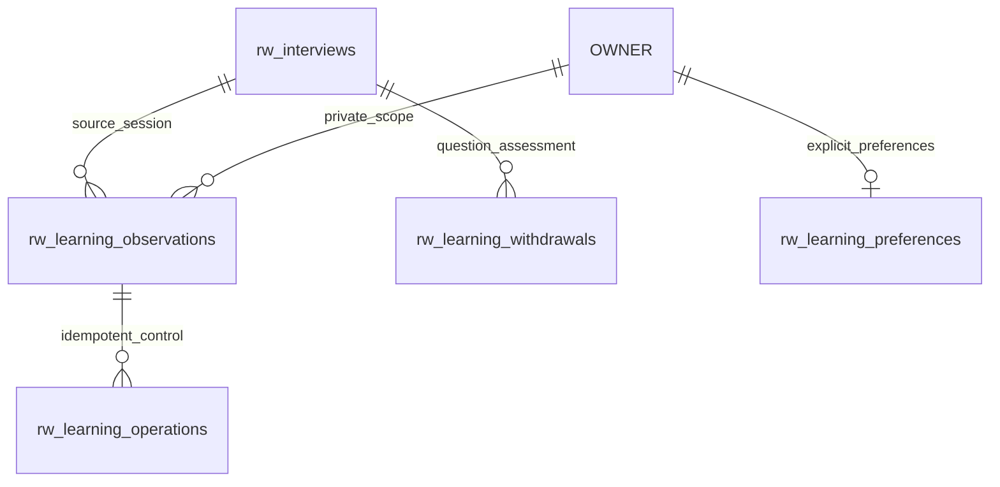
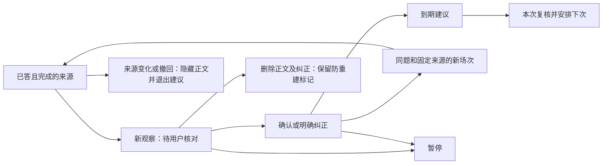

# EXPAND-S7 · 从面试记录到可纠正的学习闭环

2026-10-22。工程/合成规则/真实PG来源/浏览器已验证；真实Qwen7B闭环未通过，保留停止证据。整体S0—S8 Goal仍未完成。最后相关517通过、0失败、4既有限定跳过，JUnit 50.353秒；不是全仓全绿，也不是教学质量成绩。

本地和独立远端新版均无.git；不创建虚构提交，不动旧服务及另一个聊天的handbook。源码身份c603ae740483bdd56cbc4148c538858f7f7a07c66ea5086f043dd44349c9fc14；真实diff/hash由expansion_checkpoint.py保存，前端另计。旧阶段证据保留。

## 业务问题、基线与实际结果

S6基线487通过/4限定跳过。旧复盘能够显示待补充项并重新检索题目，但没有可持久核对的观察、明确偏好或复习队列；再次检索可能换题，不能把要点数量变化直接说成学习进步。

本阶段先写[S7合同](../tech-specs/expansion/S7-learning-loop.md)，再接入原面试仓储、图与页面。完成的闭环是：用户回答并结束→保存已答观察→用户核对/纠正→规则复习→复用原题与固定来源的新场次→再次回答→结束复盘→保存新观察。没有新建另一套面试器，也不自动写简历或认定用户掌握。

规则队列替代方案是全部聊天向量化和隐式能力画像；当前不选，因为缺少可解释来源、纠正和删除语义。学习域留在面试同一SQLite事务域；项目仍可选PG，读时通过选中CodeRAG验证引用，不制造跨库FK或分布式提交承诺。

## 实体、键与生命周期



|实体/关键字段|真实用途和约束|
|---|---|
|rw_learning_observations.observation_id|owner/session/question/point/来源指纹的确定ID；同源重复导入去重|
|session_id、question_id、point_id、source_fingerprint|已答、complete源；用户/版本/引用与实时指纹再核对。追问仅生成focus观察|
|payload / payload_hash|题面、知识点、回答/hash、评价/方法/模型、rubric/aliases指纹、来源定位；引用不额外复制quote|
|controls / controls_hash、revision|用户核对、纠正说明、暂停、到期/复核时间；CAS更新，原评价不改|
|rw_learning_operations|observation/request_key唯一；请求hash阻止同键换内容，重复不再次更改；practice的result_id指原场次|
|rw_learning_withdrawals|session/question唯一；保留理由，撤回该题评价作学习依据，原面试历史独立保留|
|rw_learning_preferences|owner唯一；间隔1—30天、每日1—20、暂停/纳入新观察，标system_default或explicit_user_preference|

单owner最多2000观察（含无正文tombstone），单场最多100；页面最近200，队列最多20。新回答记录提交时间；旧状态缺字段时明确legacy建场时间回退，不虚构答题时间。90天未核对标过期，不推定遗忘；用户重新核对保留原发生时间。



“自述已理解”仍是用户自述。单次、不同场次同条件一致与明确用户纠正分开显示，均不变成独立掌握证明。撤回使整题观察失效、不再驱动旧weakness；纠正保留原评价，若不再采用原评价需明确撤回。

删除观察清除回答与纠正正文，保留不含正文的标记；即使同一题/点来源指纹变化也不重新生成。删来源面试/简历由FK级联清理；PG项目删除无法跨库级联，读取时隐藏学习正文并拒绝再练习，旧面试原文不声称已同步物理清除。

每日额度按上海日期和owner下仍保存的不同观察的最近复核时间计算，不因换简历筛选或撤回而退款；删除清除时间后不再计该条。额度限制自动建议，用户手动练习另由原预算控制。全局暂停停止建议，单条暂停还禁止从该条新建练习；已创建面试仍用原暂停/结束操作。

## 调用链与五个源码锚点

`InterviewPanel/LearningPanel → learning_api → LearningRepository → InterviewRepository._load/start → 原RetrievalInterviewEngine图 → 原checkpoint/回答/结束API → 原SQLite + 选中CodeRAG引用校验 → 复盘/新观察`。

1. [learning.py](../../src/job_agent/resume_workspace/learning.py)::observation_payload/condition：来源指纹与“可比较”条件，知识点不是事实认证。
2. 同文件::LearningRepository.materialize/_view：owner、完成状态、实时来源与hash、去重、过期、删除和跨域失效。
3. 同文件::act/queue/practice：CAS/幂等、用户层、上海日建议额度、在同一事务复用原start。
4. [interview_repository.py](../../src/job_agent/resume_workspace/interview_repository.py)::start/_load/review 与 [retrieval_interview.py](../../src/job_agent/resume_workspace/retrieval_interview.py)::prepare：固定题面/focus/rubric/引用、派生执行身份、旧请求hash兼容、活视图仍白名单。
5. [LearningPanel.jsx](../../frontend/src/LearningPanel.jsx)::LearningPanel/Observation：明确控制和理由；活动面试不挂载这块旧回答区，纠正/删除/撤回后更新复盘。

API前缀/api/v2：POST interviews/{sid}/learning-observations；GET learning/observations及单条；POST单条/actions、/practice；GET learning/queue；GET/PUT learning/preferences。owner只来自原鉴权依赖，正文不能指定用户。

practice复用原题与完整rubric，保留原focus/引用但生成新question_id和空回答历史；项目学习仍绑定原project/snapshot。版本/JD/来源须与观察一致；最新head变化后需明确允许原版本。新学习字段进入请求/共享执行身份，旧无字段的JSON/hash兼容。规则/模型仍走原同意、可用性与未知派发门禁，不自动调用模型。

题面、focus、完整rubric/aliases、引用版本、简历/JD、记录模型配置和评价方法相同，才显示同记录条件参考；换模式/用户纠正/撤回/失效则不直接比较。原非检索规则模型标签与新检索规则标签不同也保守不比较。学习练习只呈现这条比较，不再同时呈现旧按topic末次回答的比较。相同记录条件不证明供应商后台永远没变，更不证明能力提升。

再次练习会重置历史并生成新身份，因此“同记录条件”也不表示完整模型输入逐字相同。用户已看过旧复盘，不是盲测；本阶段没有用这些参考变化计算模型教学效果。

## 功能轨迹与真实验证

|增量|做法/结果|证据|
|---|---|---|
|观察与用户控制|先做来源/owner/去重/CAS/纠正/删除，原面试回归同跑49通过；后加入来源生命周期/双后端等59通过|s7-contract-v1.xml、v2.xml|
|固定来源再练习|同事务复用start/同图，活视图无rubric；源面试移除后新场次独立复盘可读，比较失效|test_v3_learning.py、test_v3_learning_project_source.py|
|有限复习与删除|新/到期/已复核、历史/过期/暂停、上海日额度；删除抹正文且来源变更不重建|最终517通过/4既有跳过，s7-related-v3.xml|
|真实规则HTTP|实际Uvicorn+httpx，已答→完成→观察→核对→复习→新场次→新观察，控制/删除、无rubric|s7-http-rules-v3.json：5项流程检查|
|真实PG项目HTTP|真实ZIP/索引任务→固定源码题→同学习流程→HTTP删除项目→隐藏学习正文且不复活；只清本轮随机schema|s7-http-pg-v3.json：7项流程检查|
|浏览器|合成账号2场/6观察、刷新保留、固定原题/空历史/活页无旧答案，纠正/暂停恢复/撤回/偏好、重启后额度核对；未点删除|s7-browser-final-dom-v2.txt、correction-v2.png、final-v2.png|
|前端|原13项状态测试、Vite8.3.4构建通过；构建资源index-Bn8LIz8N.js|s7-summary.json及checkpoint前端hash|

517是S6相同模块加新增30例后的当前一次结果，不能与49/59/515/516累加。4项仍是PG专属用例在SQLite参数分支的限定跳过，真实PG分支执行。没有重新跑全仓，也没有把FixtureBackend当真实Embedding质量。

### 失败、纠正与限制

真实Qwen2.5-7B-Instruct cuda:0/bfloat16，权重revision f5d2f698…、8192输入/1600全局输出/25秒，单角色原限制900输出。首个evaluator实际1次调用：1850输入、161输出token、4.378秒生成，JSON只给p2评价，缺少其他参考要点，触发interview_incomplete_semantic_review；**业务闭环失败**，没有降级编造观察、补默认分数或自动重试。模型provider的completed只表示生成完成，不等于业务成功。完整身份、原合成输出在s7-http-qwen-v1.json。其源码7d30360e…早于最后复盘投影和每日额度修正，失败所在模型完整性门禁未改，不冒充最终同源码模型成功。

浏览器两次自动化选择失败均保留在检查说明：summary在AX称button、DOM是generic，换到已观察的summary文本；第二次完整回答已自动结束，原预设结束按钮消失，观察实际结束状态后继续，没有重放回答。这些是验收脚本分支问题，不宣称业务故障。Windows JSON读取初用默认GBK失败，改显式UTF-8；不改业务数据。

收尾发现“撤回后因公开视图隐藏controls而退款当天额度”，改为按owner内部控制记录计数，撤回不退、删除才清时间；增加合同并重启本轮服务，页面实见已复核1/上限2/剩余1。删除后来源指纹变更也不得重建，另加针对合同。没有改全局默认模式或把模型失败包装成教学收益。

尚无人工掌握、真实教学对照、LLM完整学习闭环、生产多实例/容量结论。日期规则目前上海固定时区，未做用户自选时区。业务只保留有限观察和规则建议，不提供无限记忆/自动画像。S1最终60—80题/人工与S8统一trace/研究重放/交付仍待。

## 实际复现命令

在独立远端job-agent-v3，.venv及本轮专属PG已准备；不要把测试变量指向生产。s7-related-command-v1.json记录原S6同模块命令，最后仅将JUnit后缀改v3。

```bash
export JOB_AGENT_TEST_PROJECT_DSN='host=/tmp/job-agent-v3-pg-s5-20261022/socket port=55432 dbname=postgres user=job_agent'
export JOB_AGENT_TEST_INDEX_REDIS_URL='unix:///tmp/job-agent-v3-redis-s6-20261022.sock?db=0'
.venv/bin/python -m pytest -q tests/test_v3_learning.py tests/test_v3_learning_project_source.py tests/test_workbench_interview.py
# 使用新的结果文件名，不覆盖历史证据
.venv/bin/python scripts/expansion_learning_http.py --output output/expansion/new-learning-http.json
.venv/bin/python scripts/expansion_learning_http.py --project-backend postgresql --output output/expansion/new-learning-pg.json
# 独立合成UI，loopback监听；不读取原用户数据库
.venv/bin/python scripts/expansion_learning_http.py --serve --port 8119
```

上述定向测试是最终扩大回归的子集；独立重新执行时实际数量以输出为准。真实模型命令加--model-path现有本地目录，本轮结果为失败，不承诺重跑通过。UI用合成演示令牌s7-demo；它不是用户SSH或API凭据，不在页面输入真实材料。本轮最终新服务PID112423、原PID109328已核命令后停止，loopback转发供验收；S8负责最终清理/交付，不动旧服务及PG/Redis验证实例。

## 30分钟学习单元与五问

先5分钟看实体/状态图，用一次观察分清原评价、用户纠正、来源真实性和建议状态。接着15分钟按五个源码锚点走一次“保存→确认→practice→answer→complete”，找到同事务的连接传递、作用域验证和旧hash兼容。再5分钟看Qwen原失败、每日额度与tombstone回归；最后5分钟回答：

1. **为什么纠正不直接覆盖模型评价？** 原评价是一次可追溯结果，用户说明是另一来源；覆盖会丢失冲突与比较基础。确认/自述已理解均不提升C1或现实真实性。
2. **重复保存和删除后同步如何处理？** 确定键/唯一约束去重，操作请求hash+revision防重放/并发覆盖；tombstone不含正文，同一来源题/点即使指纹变更也不重建。
3. **PG项目删除为什么还能留一行观察？** 学习与项目不同事务域，无跨库FK；每次读重新校验选中来源，删除后隐藏正文并禁再练习。物理清理与显示失效是不同承诺。
4. **同一道题就能说学习进步吗？** 还需相同focus/rubric/引用/版本/JD/记录模型与方法；用户纠正或撤回使基准失效。即使同记录条件，也只是参考变化，缺少独立教学效果验证。
5. **为什么Qwen输出JSON仍失败？** 结构能解析但只评价部分要点；provider完成不代表业务合同完整。保留已发生调用和失败，不补造结果、不自动重放，更不能把没有观察写成用户不会。

用户学习进度仍由用户决定，不自动勾选掌握。
