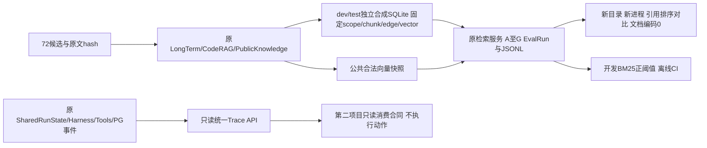

# S8 · 固定研究重放与统一追踪（工程验收完成）

2026-10-23；先Spec1.0再实现。用户已明确“稍后人工核对，继续工程”，支持/近重复人工核查仍为0，不以AI候选替代。工程核心已完成，完整回归、解包启动和逐项审计见末节；人工仍按用户安排待验。

## 已运行增量与负结果

S1保留32旧题/历史实验，新增26原文/72 AI候选，36dev+36test（每组22项目+14公共、34可回答+2无答案）。冻结v2后、评分前发现dev28与test36语义近似，保留v2，改dev28并冻结v3。机械1296跨split对照不代表语义清白；8题原文包保持deferred_by_user。Markdown在最终索引前补标题/段落切分，围栏内伪标题忽略，超预算表格/围栏标structural_fragment；原文、行号、flat基线均保留。索引chunks-3-markdown-1，旧派生索引needs_rebuild。

73项切块/检索相关合同通过；研究重放合同14通过（第一轮13/1：BM25多证据正门槛不能从0基线生成，保留失败并明确该项仅观察）；统一追踪相关64通过（第一轮63/1是测试把说明里的rubrics误当字段泄漏，改为实际字段/哨兵检查）；ACK反例5通过（首轮误读原review公开结构，原5失败保留，使用原assessment_details修正探针）。这些阶段集合有重叠，不能简单相加。

真实Qwen3-Embedding-0.6B + 本地CrossEncoder：固定索引后A—G各3重复，dev630/test630调用均0错误。A—D每split36题，E/F/G仅项目22题。质量取第0次，全部重复用于延迟，不挑最好一次。两次全新模型进程分别从新目录恢复dev/test210组合，引用所有字段、sparse/dense/fused顺序相同，文档编码0次。不是新UUID重建或只比较成功状态。原始行与完整run身份在evidence/expansion/s8-eval-{dev,test}-v1。

|split/策略|Hit@5|Evidence Recall@5|MRR@5|多证据充分|边界|
|---|---:|---:|---:|---:|---|
|dev A_bm25|0.7353|0.7059|0.6716|0/6|34可回答；语义待人工|
|dev B_dense|1.0000|0.9706|0.9044|4/6|34可回答；语义待人工|
|dev C_hybrid|1.0000|0.9706|0.9338|4/6|34可回答；语义待人工|
|dev D_hybrid_rerank|1.0000|0.9706|0.9020|4/6|34可回答；语义待人工|
|test A_bm25|0.8235|0.8235|0.7426|2/5|34可回答；语义待人工|
|test B_dense|1.0000|0.9902|0.9314|4/5|34可回答；语义待人工|
|test C_hybrid|1.0000|0.9902|0.9412|4/5|34可回答；语义待人工|
|test D_hybrid_rerank|0.9706|0.9706|0.8245|5/5|34可回答；语义待人工|

表由已保存run.json计算并逐项核对，展示四舍五入的机械值；精确数字以原始文件为准。关系扩展F把dev/test多证据覆盖增至6/6、5/5，但MRR从E约0.89/0.93降至0.85/0.90；flat基线更弱。复杂策略没有全面优势，默认配置未因test成绩调参。原始36×各路包含无答案；检索无答案仅报告有无上下文，不称“错误作答率”。全部claim_support/final_business_quality为null。

离线门禁用实际dev BM25基线减一个query等价值，四项正阈值约Hit .7059/Recall .6765/充分 .6471/MRR .6422，引用必须合法、错误0、题/gold/覆盖非空。dev多证据0基线明确仅观察，不设置0质量阈值。固定语料/配置/hash漂移失败；候选代码可变并记录新算法身份用于回归，严格研究重放要求算法一致。已实跑新目录CPU门禁，无模型/文档编码调用。

## 调用链、实体与数据字典



|实体/文件|主键与关系|实际保存|
|---|---|---|
|CorpusSnapshot/EvalCase|corpus snapshot→case source_snapshot；family/source disjoint|确切quote/hash/行范围、all/any、显式retrieval_scope、AI状态|
|research manifest|scopes dev/test→项目/快照/index/chunk/edge/public versions|模型/配置/算法文件hash、五个工件hash、固定重复/预算，seal不含自身|
|dev/test SQLite|复用原v3_projects/snapshots/files/indexes/symbols/chunks/edges/vectors/public表|只有本次合成项目；非研究表非空拒绝，源文本必须与固定语料完全一致|
|PublicCacheSnapshot|两类pool→manifest key/chunk顺序/向量hash|模型身份、数值/维度/非零校验；全部合法后原子恢复，无普通用户写API|
|EvalRun/queries.jsonl|run_id→case/variant/repeat；raw SHA|真实方法/trace/引用/延迟/失败；失败可回答仍按0进分母；用量缺失null|
|UnifiedTraceEvent|trace/run/span+seq；source_stream/source_seq|ID/hash/时间或unknown/单调用与汇总用量/审批摘要；不保存原文|

研究文件hash防意外变化，不是恶意生产者签名。离线门禁不是生成回答、中文语义或真人教学质量门禁。索引包不是用户生产库备份，也不执行导入源码。PG/SQLite的生产事务边界仍同S5/S7。

## 已实现入口与复现

1. `knowledge/markdown_chunks.py::markdown_ranges`、`resume_workspace/code_rag.py::_chunks`：原文范围→结构块/显式片段。
2. `knowledge/research_contract.py::prepare/inspect_bundle/open_services/evaluate/replay`：原服务固定身份，不另造检索引擎。`public_knowledge.py::export_dense_snapshot/restore_dense_snapshot`保存真实公共派生向量。
3. `resume_workspace/unified_trace.py::from_execution/from_task/install_trace_routes`：GET→原owner/来源校验→白名单投影，原记录缺失不补造。
4. `scripts/expansion_ci.py`及`research_contract.py::freeze_gate/check_gate`：固定输入→CPU开发回归，不加载模型/真实服务。
5. `scripts/expansion_demos.py`、原`expansion_stream_faults.py`：四演示复用原API/Worker；ACK反例沿用原local_evaluate，不是通用语义Judge。

```text
python scripts/expansion_ci.py --output output/new-offline-check
python scripts/expansion_demos.py rewrite --output output/new-rewrite.json
python scripts/expansion_demos.py project-interview --output output/new-interview.json
python scripts/expansion_demos.py insufficiency --output output/new-insufficiency.json
# recovery须显式专用PG/Redis测试环境；不使用生产服务
python scripts/expansion_demos.py recovery --output output/new-recovery.json
```

模型路径通过expansion_research.py参数明确提供；prepare只接原固定合成dataset，evaluate test需要显式score-heldout并持久预留，失败也不静默再评分。replay只检索固定索引，不重放模型文本、审批或外部副作用。所有输出新建，失败保留，不覆盖已有证据。

## 30分钟新增量学习与五追问

0—5分钟看上图和固定manifest的scopes；5—13分钟读prepare→open_services→replay，解释为什么新UUID重建不能证明恢复；13—21分钟看from_execution与usage汇总，区分根账本、调用详情、unknown时间；21—26分钟看四个正阈值和0多证据负结果；最后4分钟复述以下回答。

1. 引用相同就证明答案正确吗？只证明固定原文位置、版本和排序；语义支持、个人贡献和运行成果要独立判断。
2. 为什么公共向量也需保存？新进程的内存缓存会丢；重编码即使数值相同也不能证明复用了固定工件，真实计数必须为0。
3. 如何避免用量翻倍？总量只取run_aggregate，子调用用于核对覆盖；缺根用量仍unknown，不把部分子记录充作完整账单。
4. 0基线怎样设门禁？不包装0为质量保证；该项仅观察，其他有正基线指标减一题形成版本化阈值，覆盖/引用硬合同仍必须满足。
5. 为什么重排没全面胜出仍可交付？同口径负结果说明默认策略应保守；工程可选择不等于效果已证实。人工核查仍由用户稍后完成。

待最终补：完整相关与全仓诊断、四演示/五贯穿案例索引、当前源码身份/真实diff、干净解包启动/离线门禁、源码/学习/研究包与最终需求逐项审计。


## 最终回归与四演示（2026-10-23）

最终相关s8-related-v3.xml：612通过/0失败/4既有PG-only参数跳过，71.63秒，616个唯一node ID，无重复，包含S7全部521个唯一用例。离线s8-stable-ci-v1.xml：583通过/0失败/33依赖范围跳过，66.48秒；同616个用例中29个真实PG/Redis合同在普通离线lane跳过，专用服务lane实际已跑，另4为既有限定参数。四项正阈值门禁先运行通过。GitHub workflow是配置工件，本轮没有远端Git/云CI运行。

全仓诊断s8-full-diagnostic-v1.xml：1024通过/44失败/54跳过，98.14秒。分类见s8-full-classification-v1.json：41缺历史评测资源、2旧127.0.0.1:63799 Redis未启动、1无Git仓库。没有把自己专用UDS Redis冒充旧端口服务，没有复制可能含私料的旧语料。宽选agent_*的相关v2出现2个相同历史fixture缺失；稳定CI明确只选所依赖的业务/运行合同模块，全部全仓失败仍保留。

四演示：s8-demo-rewrite-v1、s8-demo-interview-v2、s8-demo-insufficiency-v1均真实HTTP通过（各3业务检查，共5份Trace）；s8-demo-recovery-v2为12真实故障场景全部通过，含每场PG Trace/owner门禁，源级联删除场景trace正确404。首interview-v1在默认关闭Embedding时纯中文问题未检出符号而安全409，改演示显式源词save_receipt，不宣称BM25自然语言召回已修复；首recovery-v1误把删除后的正确404当失败，修正探针保留原件。S6独立13场景另含专用Redis真实重启；不把两个版本相加成25个独立场景。

7份实际合成流程Trace样例已导出，来源于审批、项目引用/ACK追问和两条PG崩溃恢复。三包使用脚本package_expansion.py生成逐文件manifest和ZIP SHA；check_expansion_delivery.py先验证全成员覆盖/CRC/路径，再解压新目录、用已声明的隔离依赖跑CPU门禁及真实HTTP首页/静态JS/身份检查。最终解包结果以交付目录verification.json及summary补录为准；不冒充全新依赖安装。

对总计划61条S0—S7任务及6条S8汇总验收已逐项登记s8-requirement-audit.json。S1.7人工延期、S1.6语义近重复未人工核清、S4/S7真实模型负结果、生产SLA/迁移未验都明确保留。当前只剩最终包内检查，工程不能拿人工延期改成human通过。


首版三包解压实测：所有成员hash/CRC和CPU门禁通过，但真实HTTP启动暴露根目录fit_verdict_engine漏打包，ModuleNotFoundError；s8-delivery-check-v1.json保留失败。已补原模块、既有启动/容器文件和roadmap，并在smoke中检查实际导入来自新解包目录。没有用原目录PYTHONPATH掩盖漏项；下一版必须重新实际启动。


## 交付验收收尾

修正后delivery-v2三包逐文件hash/CRC全部通过：源码820文件、学习47文件、研究30文件。新解压目录实际通过CPU离线门禁及真实loopback服务：健康200、首页200、随包JS200、匿名401、合成owner空列表200、三条Trace路由已注册；7份真实合成Trace样例只读检查全部通过。实际导入位置来自新目录，包括原根模块fit_verdict_engine；没有借原工作区模块填漏。依赖条件是已声明的Python3.12隔离运行库，不是全新安装。原v1启动失败与修正后v2成功都保留。

最终发布目录为output/expansion/delivery-final，包含三包/各自SHA256/delivery.json，最终同包重验结果在该目录verification.json旁证。最终包只补验收状态、当前Spec和真实留痕，不重新调整冻结RAG方案。源码包不带用户库、凭据、权重、运行库或Git历史；研究包仅带明确合成SQLite。当前代码身份与真实diff见checkpoint.json和workspace-diff.patch；README/CI/本轮学习入口和固定研究工件也纳入独立hash，另一个聊天的handbook未修改。

本轮专用8119合成服务/SSH转发、PG与Redis UDS验收实例已核对进程/目录后停止，持久化验收数据保留；旧服务未动，见s8-resource-cleanup-v1.json。后续默认SQLite演示可按runbook自行启动。

总计划61条S0—S7任务与6条S8汇总验收已登记；工程范围完成。人工gold支持/近重复核查由用户明确延期仍0；真实Qwen完整学习闭环失败、未获得改稿收益、全仓历史依赖失败、生产迁移/SLA未验均不改标成功。无需为后续人工核对继续无限扩工程范围。
