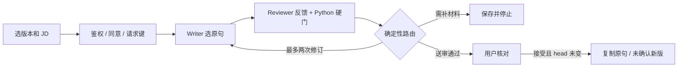

# PHASE-03B · Writer/Reviewer 有界协作

日期：2026-10-20。状态：**摘录式摘要本地闭环已验证；在线接口经替身验证，真实模型未验收**。
Git：main / 067bfc7d63408e1e6b0ab6c227e863bd08a5857a，已有前轮修改；无提交、推送或重置。
起点见 [m3b-start](evidence/m3b-start.json)，终点/hash/环境/命令见 [verification](evidence/m3b-verification.json)。

## 1. 业务目标与验收标准

用户已同意推进协作方案。交付：选版本/JD → 选经历原句 → 独立角色评审 → 按反馈改选 → 有限再审 → 用户接受/拒绝 → 未确认新版。
展示真实稿件和交接；原文、C1、人工决定和版本约束不能被模型覆盖。
仅将项目/工作完整原句复制到摘要，不是自由润色、完整生成或完整长期求职产品。

## 2. 原有问题和基线

M3 有版本/JD 快照与排序建议，没有根据评审反馈修订的协作状态。候选必须来自当前版本，不能重用原件中已被删除的字段。
修改前实际复跑 **201 passed / 0 failed / 0 skipped**，见 [baseline](evidence/m3b-before.log)。
前一阶段前端 9 项、旧 568/0/16 和 R12 都保留各自历史范围，不能移植为本次新成绩。

## 3. 技术方案及取舍

- **合同**：仅当前版本 projects/experience.bullets，全句复制到 summary；新 fact_id、原 SourceSpan，原经历不变。仍为 C1，自述确认不升级；个人信息、裸技能、JD、参考材料不入候选。
- **职责**：Writer 提议，Reviewer 判断相关性/上下文；Python 硬门校验路径、全句、重复、容量；确定性 Supervisor 路由；仅用户审批后仓库可写版本。
- **编排**：复用 LangGraph StateGraph，writer→reviewer→supervisor→writer/end；最多两次修订、三稿、六次角色调用。在线两个 SkillSpec/Schema、零工具，不调用旧 AgentLoop，不称为自由 ReAct。
- **模式**：local_demo 是规则角色；在线分别调用已配置 provider 的两个角色，不必是两个模型。反馈进入下一稿输入；两模型同意不证明经历真实。
- **预算**：每角色最多三次，总模型请求预留最多六次，1600 输出 token/次；材料 JSON 最多 30000 字符；累计活动时间达 120 秒后不再派发。不硬取消已开始请求，沿用 provider 超时；无自动传输重试、Schema 修复或静默降级。
- **恢复**：SQLite 应用级 checkpoint 在节点后保存；派发前另保存计数/model_inflight；token/600 秒 lease 防并发和旧持有者写回。未接原生 LangGraph saver 或 PG/Redis Worker。
- **不确定性**：model_inflight 为真时，即使 lease 过期也禁止自动重放。预留不等于已知实际计费；费用未知为 null，不宣称 0 元或 exactly-once。
- **取舍**：自由改写需要证明新句语义受来源支持，不能放宽 text==source slice；群聊/新总线成本更高。本轮保留事实模型和有界回路，代价是还不能完整润色。

## 4. 实际调用链与代码地图



| 顺序 | 文件::符号 | 输入 → 输出/目的 |
|---|---|---|
| 1 | `frontend/src/CollaborationPanel.jsx::CollaborationPanel` | 版本/JD、同意、轨迹、原文与审批 |
| 2 | `src/job_agent/resume_workspace/collaboration_api.py::install_collaboration_routes` | owner、预留、执行/恢复、查询和决定 |
| 3 | `src/job_agent/resume_workspace/collaboration_contracts.py::CollaborationState` | 三稿、消息、下一节点、预算与不确定标记 |
| 4 | `src/job_agent/resume_workspace/collaboration.py::CollaborationEngine.execute` | 三节点图、预算、反馈路由与 checkpoint |
| 5 | `src/job_agent/resume_workspace/collaboration.py::OnlineRoles.invoke` | 角色 Schema → Harness 单次结构化输出，零工具 |
| 6 | `src/job_agent/resume_workspace/collaboration.py::hard_review` | 路径/原句/重复/容量 → 不可被模型覆盖的限制 |
| 7 | `src/job_agent/resume_workspace/collaboration_repository.py::CollaborationRepository.claim` | owner/hash/lease → token 与下一节点 |
| 8 | `src/job_agent/resume_workspace/collaboration_repository.py::CollaborationRepository.decide` | 最新稿 hash/revision、人工决定和 head → 幂等新版 |
| 9 | `src/job_agent/resume_workspace/repository.py::SqliteResumeRepository._validate_document` | owner/kind/hash/offset/逐字来源校验 |
| 10 | `tests/test_resume_collaboration.py::test_feedback_really_changes_selection_and_trace_has_no_thoughts` | 反馈改变第二稿的可复现例子 |

完整链：main.jsx→CollaborationPanel→POST /api/v2/resumes/{id}/collaborations→begin→claim→execute 三节点→checkpoint JSON/hash/counter→展示。
接受走独立 decision 接口：BEGIN IMMEDIATE→最新稿/反馈/父版本/重复决定检查→复制原句和 SourceSpan→旧 _append 再验来源→待确认新版。
消息只含业务交接和类型反馈，没有隐含推理、原始提示词或敏感响应日志。

## 5. 功能开发轨迹

### A. 首个摘要协作

- 问题：原排序入口没有角色反馈和修订状态。
- 改动：共享状态、三节点、WriterDraft/ReviewerOutput、稿件 hash 消息、两次修订和摘要面板。
- 备选：一次生成交给用户读更便宜，但不验证反馈；自由群聊更难控制成本/事实。
- 调用：面板→API→execute→三节点→SQLite→用户审批。
- 实例：海报首稿被 unrelated 退回；按反馈改选 Python/RAG 原句，二稿送用户，接受后形成 v2。
- 首稿相关则不强造退回；无替代返回空稿；否定关键词命中转 needs_input。
- 验证：42 个新增合同用例、合成浏览器及 17 HTTP；规则不是语义模型质量。

### B. 来源、版本和调用保护

- 问题：错误认可、旧反馈覆盖新版和超时重复付费调用。
- 改动：全句/路径硬门、source 重读、稿件 hash/revision、事务 head 和决定幂等。
- 调用：begin→claim→派发前 reservation→节点后 checkpoint→显式 resume；接受→decide→_append。
- 备选：全部失败自动重放更省人工，但外部结果未知时不能推断没有产生费用。
- 验证：超时/坏 Schema 不重试；越权/旧稿/并发/篡改/lease/派发前崩溃/完成节点恢复均有用例。
- 限制：单机同步 SQLite，不是生产队列或原生 saver；token 和费用可能未知。

### C. 发现并修正的失败

- 首轮新增 **35 通过、1 失败**：容量误用 distinct text 数，漏掉重复文字占用的真实条数；改为列表长度，未删测试。首轮 log/XML 被后续运行覆盖，只有当时执行输出和本报告记录，未伪造还原文件。
- 浏览器发现同级 MatchingPanel/CollaborationPanel 的相同 key 造成旧面板残留；改不同前缀，最终重启、导入和保存后各一个。
- 一次 Vite `build --root frontend` 参数错误失败，改在 frontend 正常 build；错误与最终日志均保留。
- 这些是工程调试记录，不是模型实验结果。

## 6. 可复现验证

Windows、Python 3.12、已有 audit venv，LangGraph 1.2.16、Node 24.19.0。未新加依赖；实际包版本在 verification。
后端在仓库根执行，TEMP/TMP 指向工作区 work/tmp，获准本地 API/socket 测试。

```powershell
python -m pytest -q tests/test_resume_import.py tests/test_resume_workspace.py tests/test_resume_pdf_autofill.py tests/test_resume_matching.py tests/test_resume_collaboration.py tests/test_source_audit_regressions.py tests/test_career_store.py tests/test_application_assistant_evaluation.py tests/test_backend_service.py tests/test_evidence_source_store.py tests/test_evidence_mapping_v2.py tests/test_evidence_projections.py tests/test_evidence_requirement_analyzer.py tests/test_knowledge_ingestion.py --basetemp=../../work/m3b-final-temp --junitxml=../../work/m3b-final.xml
# frontend 目录，本机实际用缓存 Node 绝对路径
node --test src/model.test.js
node node_modules/vite/bin/vite.js build
# 仓库根目录
python scripts/demo_resume_workbench.py --port 8015
# 完成下面合成浏览器流程后
python scripts/verify_collaboration_demo.py --port 8015
```

| 实际运行 | 通过 | 失败 | 跳过 | 证据（evidence/） |
|---|---:|---:|---:|---|
| 修改前相关回归 | 201 | 0 | 0 | m3b-before.xml/log |
| 容量修正后新增测试 | 36 | 0 | 0 | m3b-unit.xml/log |
| 最后补充上下文/否定前的相关回归 | 241 | 0 | 0 | m3b-related.xml/log |
| 最终相关后端（含新增 42） | **243** | **0** | **0** | m3b-final.xml/log |
| 最终前端 | **11** | **0** | **0** | m3b-frontend-final.log |
| 独立真实 HTTP | **17** | **0** | 不适用 | m3b-live-http.json，不计入 pytest |

最终构建成功；仅既有 Starlette/AnyIO 弃用 warning。未跑全仓库、真实模型/GPU、真实 PG/Redis、三组质量实验。
冻结 eval/旧 Evidence 内核 hash 对照在 verification；未改标签、数据、指标或历史成绩。

**Demo**：开 8015，用脚本内公开合成口令，粘贴下文并本地解析、核对保存 v1。

```text
姓名：合成同学
教育经历
合成大学 | 硕士 | 计算机 | 2024-2027
项目经历
校园海报 | 设计 | 2024
- 使用图像工具完成校园海报。
RAG 检索平台 | 后端开发 | 2025
- 使用 Python 实现 RAG 检索接口。
- 未使用 Kubernetes 进行生产部署。
技能
Python、SQL
```

协作整理摘要→填入合成要求→本地送审→两稿→核对原文/上下文→接受→v2 待确认。
不要先做项目排序：顺序改变后首稿可能直接过审，这是正确行为，不能强造修订。
仅建这一份简历和一次协作再运行 HTTP 脚本；它拒绝非 demo/模型开启服务，唯一写请求是重复已接受决定验幂等。
截图：[反馈](evidence/m3b-browser-feedback.png)、[接受](evidence/m3b-browser-accepted.png)、[v2](evidence/m3b-browser-version.png)。

## 7. 效果与实验数据

| 对象 | 之前 | 本次 | 结论 |
|---|---|---|---|
| 合成海报→RAG 选择 | 无摘要协作 | 首稿退回，按反馈改选 | 回路影响选择，不是质量提升率 |
| 相关工程集合 | 201 | 243 | 新增 42；集合不同，不是准确率对照 |
| 模型质量/token/费用/耗时优势 | 未做同口径实验 | 仍未做 | **尚无结论** |

单 Agent、顺序多角色、反馈协作、同预算单 Agent 自修订为待做对照，须共享输入/硬门/标注/预算。
本地单次 81 ms 是轨迹耗时，不是 benchmark；替身 token 仅验统计接口。
R12 93.07%/97.30%、17 JD/101 gold atoms 不适用于新协作，不移植成绩。

## 8. 风险、技术债、下一步

完成的是摘录协作和可追踪审批；自由改写、真实模型效果和外部事实证明未完成。
引用正确仍可能误分组；独立原句可能依赖项目/角色/时间上下文。在线 Reviewer 收到所选条目上下文，用户可打开完整原文。
经历正文不会自动完全脱敏，在线需配置与逐次同意；本次没有读取私人材料或真实 Key。
应用 checkpoint≠原生 saver，lease≠生产调度，旧 Worker 不管理本协作；不确定调用保守停止。
PDF、长期投递、面试协作按路线逐步做，本轮停止扩展。未引入群聊、ES、Milvus、新队列或数据库。

## 9. 事后学习路线（约 45 分钟）

1. 5 分钟：Demo 看两稿，复述摘录能做/不能做的事。
2. 10 分钟：读 State/Draft/ReviewerOutput，再读 execute 的节点、条件边与停止出口。
3. 10 分钟：读 hard_review/decide，解释改词、旧 hash、越权为何不能写版本。
4. 10 分钟：读 claim/checkpoint，对照 uncertain dispatch 与 completed writer resume 测试，区分业务恢复和外部 exactly-once。
5. 10 分钟：读报告和 resume_notes；可单跑 `python -m pytest -q tests/test_resume_collaboration.py` 学习。本阶段最终成绩来自上述 243 项命令。

## 10. 面试追问（5 题）

1. **只是拆 Prompt 吗？** 两角色有不同目标/Schema/反馈职责，第二稿收到反馈后改选，Python 控制回路。在线不要求不同模型；规则演示不代表模型智能/优势。
2. **Reviewer 同意就能写吗？** 不能。硬门/来源库之外，仍需用户明确接受与 head 未变。两模型认可不升级 C1。
3. **为何不自由润色？** 引文存在不能保证新句数字、责任、否定受支持；现模型要求逐字来源，因此先实现摘录合同，旧投影不变。
4. **成本和恢复？** 三稿六次请求、输出/材料/派发时间限制、零重试；保存下一节点/不确定标记，未知外部结果不重放，不宣称 exactly-once 或原生 checkpointer。
5. **优于单 Agent 吗？** 尚无质量结论。42 个工程用例和浏览器/HTTP 证明约束与回路工作；需同口径对照，不能借旧 R12。
