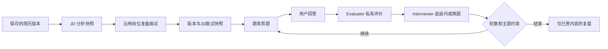

# PHASE-03C · 核验分层与面试协作

日期：2026-10-20。状态：**两项本地产品增量已验证；在线接口经替身测试，真实模型未验收**。
Git：main / 067bfc7d63408e1e6b0ab6c227e863bd08a5857a，已有多轮未提交修改。未提交、推送或重置。
基线见 [m3c-start](evidence/m3c-start.json)，最终命令、环境、源码 hash 和结果见 [verification](evidence/m3c-verification.json)。

## 1. 业务目标与验收标准

用户明确要求两项一起做：拆清“核验通过”，随后接面试协作，同时保留产品主线。
验收：原句对上不等于事实真实；用户接受不等于独立证明。岗位可转入版本/JD 绑定面试，评估反馈真实改变下一题；进行中不泄漏参考要点，结束后能复盘和重开历史。
本轮是有限技术题库的面试子集，不是完整招聘面试系统；PDF、投递和长期记录仍按后续路线推进。

## 2. 原有问题和基线

M3B 的“送审通过”容易把来源、相关性和真实性混在一起；当所有建议已处理，标题还可能像仍在等审批。
旧项目已有 QuestionAnchorLibrary、evaluate_answer 和脚本追问基础，但新 React/SQLite 简历没有面试入口，旧应用库与新版本模型不同。
修改前实际跑原243项相关测试，加3个现有面试模块文件，共 **257 passed / 0 failed / 0 skipped**，见 m3c-before.xml/log。
M3B 的243不是本次257的模型成绩；扩展测试集合不能当质量提升。

## 3. 方案、结构和取舍

**核验分层**：服务端从已校验的 base 版本和最终稿派生 ProposalVerification：来源 matched/not_matched、整句 exact_copy、相关性 keyword_lead/model_recommends/需改选/需上下文、C1、真实性 not_verified、用户决定、该次保存版本的确认状态。
确认后仍 not_verified/C1；字段是派生视图，不修改历史状态格式和旧 Evidence 投影。不能仅改文案，接口和测试都区分这些判断。

**面试**：复用六个已有题库 anchor 和旧 evaluate_answer，增加中文问法/别名与安全追问适配；按 JD 术语为三主题排序。无特定题型时仍是通用 AI/后端技术练习，不宣称覆盖任意岗位。
新工作台的版本/JD 自成快照；沿用岗位时校验 match owner、所属简历和完全一致的 JD，新面试版本单独记录，允许分析旧版而面试新版，但不复用旧版支持结论。
来源材料只取所选版本项目/工作正文，个人信息及已删字段不进入在线输入。C1 不适配成旧 verified claims；本地评估传空独立证据集合，个人经历风险只表示需材料，不认定为假。

**协作**：LangGraph evaluator→interviewer→route。Evaluator 判断要点覆盖/需证据风险并给行动建议；Interviewer 独立选择 follow_up/next 与合法 focus_id。在线是两次不同 Schema/目标调用，可使用同一模型；协调器不用 LLM。
Interviewer 不接收完整 rubric/标准答案，只收合法关注点 ID、建议与剩余预算；问题从经过审核的题库问法渲染，模型没有任意向用户输出答案的通道。
每主题最多一次追问，三主题；用户可设2～6轮，整体最多12次模型预留，900输出token/次，材料JSON最多30000字符。活动时间达到 max_turns×60秒后不再派发，不硬取消进行中的provider请求。无工具、传输重试或Schema修复。

**状态与权限**：SQLite rw_interviews/rw_interview_answers，owner、起始请求键、逐条回答键、问题ID/修订、请求/hash、执行token/600秒lease；Evaluator/Interviewer/路由后保存应用checkpoint，派发前保存不确定标记。未知外部调用不自动重放。
活动 API 明确构建 PublicQuestion/PublicTurn：不返回 plan、rubric、evaluation、focus_id 或评价 note。GET review 在未结束时409；结束后只能看已答轮次，不能继续答题或恢复来偷看下一题。公开交接只含角色、轮次、动作和固定说明。

**备选与代价**：直接挂旧 ApplicationCopilotService 会强绑旧 application/verified-claim 仓库，容易误升 C1；整套重写题库/评估会破坏可追溯性。因此只做新版本适配，旧服务保持原状。自由生成追问更灵活但有泄题/越界风险；本轮模型只选合法动作，代价是题型和问法有限。

## 4. 完整调用链与源码地图



| 顺序 | 文件::符号 | 要理解的边界 |
|---|---|---|
| 1 | `src/job_agent/resume_workspace/collaboration_repository.py::CollaborationRepository._view` | 由来源、稿件和用户决定派生核验分层 |
| 2 | `frontend/src/MatchingPanel.jsx::MatchingPanel` | 将保存的 JD/match_id 移交面试，未偷偷改写分析 |
| 3 | `frontend/src/InterviewPanel.jsx::InterviewPanel` | 开始、回答、逐次同意、历史、结束与复盘 |
| 4 | `src/job_agent/resume_workspace/interview_api.py::install_interview_routes` | 身份/同意、请求、执行、恢复和只读查询 |
| 5 | `src/job_agent/resume_workspace/interview_collaboration.py::build_plan` | 复用旧anchor，有限中文题库与JD排序适配 |
| 6 | `src/job_agent/resume_workspace/interview_collaboration.py::local_evaluate` | 中文别名→旧evaluate_answer；不是语义准确率 |
| 7 | `src/job_agent/resume_workspace/interview_collaboration.py::InterviewEngine.execute` | 三节点、反馈/合法动作/预算、checkpoint |
| 8 | `src/job_agent/resume_workspace/interview_repository.py::InterviewRepository` | start/answer/claim/checkpoint/get/review 的存储与公开投影 |
| 9 | `tests/test_workbench_interview.py::test_feedback_changes_question_and_live_projection_hides_rubric` | 真实反馈与防泄漏的最小可复现测试 |

新链：main.jsx→MatchingPanel回调→InterviewPanel→POST /resumes/{id}/interviews→start（版本/JD/题库快照）→get（公开首题）。
答题：POST /interviews/{id}/answers→answer（同键幂等/旧题检查）→claim→InterviewEngine.execute→Evaluator→Interviewer→route→checkpoint→公开下一题；结束后 GET review。
LLM只在在线Evaluator/Interviewer调用；本地二者是规则。来源/hash/请求/权限/预算/路由/渲染/公开投影由Python负责。
旧Streamlit/CLI/RAG/后端入口未强行统一；新面试不走旧AgentLoop或PG/Redis Worker。应用checkpoint不等于原生LangGraph saver或外部计费exactly-once。

## 5. 功能开发轨迹

### A. 核验分层

- 问题：来源匹配、岗位相关、事实真实和接受建议容易被合成一个“通过”。
- 实现：增加只读ProposalVerification，接受、拒绝和版本确认分别派生，事实核实固定为not_verified/C1。
- 调用：CollaborationRepository._view→CollaborationPanel→四行分层；全处理后标题改已处理。
- 备选：只换标题不够，接口仍会含糊，因此同步结构化字段及状态测试。
- 验证：4个新增后端用例、2个前端用例，以及浏览器接受后仍未独立核实的截图。
- 限制：来源证明文字出自哪里，不能证明经历现实真实性。

### B. 岗位到面试的协作闭环

- 问题：新工作台没有面试，旧系统已有能力但模型/存储不同。
- 实现：复用anchor/evaluate_answer，新增新版本适配、两角色结构化决策和有限追问；在线零工具，首题无需模型。
- 调用：岗位快照→面试快照→回答→Evaluator缺口→Interviewer关注点→追问/换题→结束复盘。
- 真实演示：只谈执行标识→追问超时结果；补查询回执/禁止盲重放→换到Agent循环停止主题。
- 验证：30个新面试合同用例；本地浏览器/HTTP；在线替身验证不同Schema、合法关注点、最多12次及不重试。
- 限制：有限题型/本地词面；没有真实模型质量或多Agent优越性实验。

### C. 记录与失败边界

- 问题：参考要点泄漏、页面刷新丢记录、重复回答/未知模型重放。
- 实现：显式公开投影、结束后独立复盘；SQLite应用checkpoint和请求键/租约。JD由起始请求hash绑定，不能只重算状态hash让JD漂移。
- 备选：直接返回完整state省代码但暴露rubric；全部失败自动重放无法控制外部未知结果。本轮不选。
- 验证：活动review被拒、结束不可继续、并发同键一次、旧题拒绝、完成Evaluator恢复不重跑、未知派发停止、篡改拒绝、删除级联。
- 浏览器刷新/重新登录后从历史打开同一两轮复盘；这不是进程重启或生产Worker恢复测试。
- 本轮业务测试执行均通过；复核中补充JD请求hash校验和恢复到结束时前端自动加载复盘，未改标准或删除测试。

## 6. 实际验证与复现命令

Windows / Python3.12 / 既有audit venv / Node24.19.0 / LangGraph1.2.16；详细版本在verification。
后端仓库根运行，TEMP/TMP指向工作区work/tmp，获准本地API/socket测试；未新安装依赖。

```powershell
python -m pytest -q tests/test_resume_import.py tests/test_resume_workspace.py tests/test_resume_pdf_autofill.py tests/test_resume_matching.py tests/test_resume_collaboration.py tests/test_workbench_interview.py tests/test_source_audit_regressions.py tests/test_career_store.py tests/test_application_assistant_evaluation.py tests/test_backend_service.py tests/test_evidence_source_store.py tests/test_evidence_mapping_v2.py tests/test_evidence_projections.py tests/test_evidence_requirement_analyzer.py tests/test_knowledge_ingestion.py tests/test_stateful_interview_copilot.py tests/test_interview_question_bank.py tests/test_adaptive_interview_controller.py --basetemp=../../work/m3c-final-temp --junitxml=../../work/m3c-final.xml
# 前端目录（实际用缓存Node绝对路径）：
node --test src/model.test.js
# 最后一次构建在仓库根，指定frontend根目录：
node frontend/node_modules/vite/bin/vite.js build frontend
python scripts/demo_resume_workbench.py --port 8016
python scripts/verify_interview_demo.py --port 8016 --stage active
# 浏览器结束本场后：
python scripts/verify_interview_demo.py --port 8016 --stage complete
```

| 运行 | 通过 | 失败 | 跳过 | 日志（evidence/） |
|---|---:|---:|---:|---|
| 修改前扩展相关基线 |257|0|0|m3c-before.xml/log|
| 初轮新面试+原协作 |69|0|0|m3c-new.xml/log|
| 中间相关回归 |290|0|0|m3c-related.xml/log|
| 最终相关后端（新增34） |**291**|**0**|**0**|m3c-final.xml/log|
| 最终前端 |**13**|**0**|**0**|m3c-frontend-final.log|
| 活动阶段真实HTTP |14|0|不适用|m3c-live-active.json|
| 结束阶段真实HTTP |15|0|不适用|m3c-live-complete.json|

两个HTTP阶段含重复公共检查，**不相加为29个独立用例**，也不计入pytest。构建成功；既有Starlette/AnyIO弃用warning一项。
未运行全仓库、真实模型/质量/成本、GPU、生产PG/Redis、完整PDF/投递流程或单Agent对照。冻结eval25文件、旧Evidence内核和旧面试代码对照hash见verification，未改旧标签/指标。

Demo按PHASE-03B材料导入保存v1→本地摘要摘录接受成v2→岗位分析输入“使用 Python 开发 RAG 接口。\n理解 LangGraph Checkpoint、恢复和幂等。”→生成快照→沿用此岗位准备面试→默认4轮建立本场。
首答“Checkpoint 可以保存当前运行状态。我会用幂等键记录同一个操作的执行标识。”；再答“先用执行标识查询回执和已有结果；结果不明确时不盲目重放，必要时人工核对。”。
此时先跑active脚本，再点结束并跑complete脚本；脚本要求仅一份简历、一次摘录、一个岗位快照、一场两轮面试，并拒绝私有/模型开启服务。
截图：[核验分层](evidence/m3c-verification-layers.png)、[动态追问](evidence/m3c-interview-followup.png)、[复盘](evidence/m3c-interview-review.png)。

## 7. 效果与实验口径

| 观察 | 之前 | 本次 | 能证明什么 |
|---|---|---|---|
| 摘录状态解释 | 总体送审标题 | 分层数据+用户决定/确认 | 减少语义混淆，非事实准确率提升 |
| 同一合成回答的反馈 | 新工作台无面试 | 缺回执→相关追问→换题 | 反馈改变下一题，不是模型质量实验 |
| 工程集合 |257|291|新增34合同用例，非准确率比较|
| 多角色质量/费用优于单Agent |未测|未测|尚无结论|

旧R12的93.07%/97.30%、17JD/101 gold atoms仅为历史原范围，不属于新面试或核验分层成绩。替身token只验证统计接口；本地耗时不是benchmark。

## 8. 风险、技术债与产品主线

规则别名不理解所有同义表述，未命中不能直接认定不会；个人风险标记可能保守误报，只请求澄清/材料。题库六anchor/三主题，覆盖有限。在线语义实际效果仍待授权模型/样本验收。
经历正文未自动完全脱敏；在线每次提交需同意。本轮没有真实Key/私人简历或模型调用。
同步API、单机SQLite、应用checkpoint；未知模型不自动重放，不宣称exactly-once/原生saver/生产Worker恢复。
本次不重写旧面试/评测，也不接新总线、群聊或数据库。**下一产品主线仍是绑定确认版本的模板/预览/PDF，再到岗位/投递与长期面试历史**；本轮只完成用户指定两项。

## 9. 学习路线（约50分钟）

1. 10分钟：Demo看分层与两轮面试，复述来源、相关性、真实性、接受、确认的差别。
2. 10分钟：读ProposalVerification和InterviewState/PublicQuestion，找出哪些字段故意不返回活动客户端。
3. 10分钟：读InterviewEngine.execute，解释Evaluator建议、Interviewer选择和Python路由各自权力；模型为何只能选focus_id。
4. 10分钟：读InterviewRepository.answer/claim/checkpoint/review，对照重复/恢复/防泄题测试，区分页面恢复、应用checkpoint和外部计费。
5. 10分钟：运行 `python -m pytest -q tests/test_workbench_interview.py` 学习，读本报告与resume_notes，不能把规则结果讲成真实质量。

## 10. 面试追问与参考答案

1. **“核验通过”现在证明什么？** 分开说：来源逐字对应、完整摘录、相关性规则/模型建议、C1事实尚未独立核实、用户接受和版本确认。用户确认不升级证据。
2. **两个角色如何协作？** Evaluator返回覆盖ID/风险/建议，Interviewer独立选择合法关注点和追问/换题；LangGraph和Python控制上限，反馈实际影响下题。在线可共用模型，本地是规则。
3. **如何防答案泄漏？** Interviewer不接完整rubric；服务端渲染审核问法；活动API使用显式小投影，review未结束时409，结束后仅已答记录且不能继续会话。不是只在前端藏字段。
4. **为什么不直接复用整套旧面试服务？** 旧服务绑定application/verified-claim仓库，新简历为C1模型。复用题库/评估函数，单独适配版本/JD/公开投影，避免误升等级或双库迁移。
5. **证明比单Agent强了吗？** 没有。291个相关工程用例、合成浏览器和两阶段HTTP证明接口/约束/反馈工作；真实质量、成本及同预算对照仍未测。
