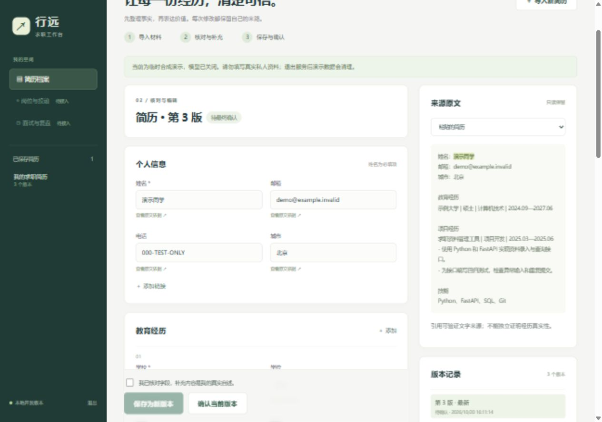

# 第 2 步：从上传文件到可以核对、编辑的简历

日期：2026-10-20。本步完成本地简历工作台；匹配、生成建议、PDF 和长期投递闭环仍按路线推进。
界面演示名为“行远”。这是一份可运行的产品增量，不是完整多 Agent 系统已经验收。

## 1. 本次解决什么问题

M1 已能保存带来源的结构化事实，但需要开发者自己构造 JSON，普通用户无法直接使用。
M2 把文件/文字、字段草稿、人工补充、版本库连接到同一个 React 页面。

原文保留只读；解析得到的每个字段都必须引用原文。模型漏掉的内容不应被当成用户没有能力，
未识别内容仍在原文面板；用户补充会产生独立的自述来源，不能伪装成文档中的原话。

## 2. 已实现的操作

| 操作 | 实际行为 |
|---|---|
| 粘贴文字 | 保存为 original_resume，规范化换行/NFC 后计算 hash |
| 上传 TXT/MD/PDF/DOCX | 最大 5 MB；复用现有文本 loader；原始字节、原文件 hash、抽取器元数据与规范化文本分别保存 |
| PDF 检查 | 加密、超过 40 页或格式损坏会拒绝；没有可提取文字返回 needs_ocr，未假装已经做 OCR |
| DOCX 检查 | 先检查 ZIP 内容和展开大小上限，不把上传文件解压到用户给定路径 |
| 本地规则解析 | 按明确标签、段落标题、竖线分隔的经历标题提取；是确定性规则，调用模型 0 次 |
| 在线模型解析 | 需服务端显式配置 + 本次发送同意；使用既有 DeepSeekCompatibleProvider / LLMHarness；模型只提议字段路径和原文引用 |
| 草稿核对 | 个人信息、教育、工作、项目、技能、简介可编辑；必填项缺失会提示，不能保存完整版本 |
| 来源定位 | 点击字段的“查看原文依据”定位引用；正确处理 Unicode 字符和浏览器 UTF-16 差异 |
| 用户补充 | 修改/新增字段写入新的 user_statement；空值表示从新版移除，旧文档和历史不改 |
| 保存与确认 | 核对后保存；重复提交同一草稿返回同一版本；更改请求重复提交返回冲突；最终确认仍为独立动作 |
| 历史编辑与恢复 | 只允许当前最新版本保存编辑；恢复旧版新增版本并重新待确认 |
| 来源管理 | 显示最近 200 份自有材料；引用中的来源不能删除；删除未引用来源会级联移除附件记录 |

草稿和完整版本的结构不同：草稿允许姓名、学校/组织/项目名称暂缺；完整版本沿用 M1 严格合同。
所以扫描或缺失信息不会被一个占位姓名或虚构项目“补齐”。

## 3. 代码从哪里读

下面路径以项目根目录为起点，函数名是检索入口。

```text
frontend/src/main.jsx: App.parse
  → api.py: import_file（文件） / add_source（粘贴）
  → ingestion.py: extract_upload
  → knowledge/source_loader.py: load_source
  → repository.py: save_upload（同一事务保存规范化来源与原始附件）
  → api.py: parse_source（检查 owner 与在线处理同意）
  → parsing.py: ResumeParser.parse
       本地：local_candidates
       模型：LLMHarness.invoke_structured，工具列表为空
  → parsing.py: materialize（字段路径白名单、唯一原文/有效字符范围、Python 生成 IDs）
  → repository.py: save_draft
  → React：原文与表单核对，changedFields 只提交显式改动
  → api.py: accept
  → repository.py: accept_draft / _apply_edits / _append
       同一事务保存用户补充来源、完整版本和已接受草稿标记
  → confirm_version：确认确切版本/hash
```

现有简历局部编辑使用 `api.py:edit → repository.py:edit_version`；父版本检查继续保护并发编辑。
`fields.py:checked_path` 同时限制模型输出和用户编辑，禁止越界数组、任意属性和来源等级字段写入。

模型预算：输入最多 30,000 个字符，每次输出上限 6,000 tokens，最多 2 次调用。
只有 schema/引用校验失败可额外修复一次；传输失败/超时不自动重试可能已计费的调用，
失败也不偷偷切换成规则结果。成功草稿保存 provider/model/parser_version、调用次数、耗时与实际 token 用量；
用量未知保留 null，费用没有配置计价表，始终为未知，没有编造成本或模型分数。

## 4. 为什么这样设计

**抽取与改写分开。** 本步允许重新组织字段、人工补充，但模型输出仍须是原文片段。
这让导入能先获得确定性的来源保证。后续优化建议会使用独立合同并做语义/数字检查，
不能仅凭一个真实引用就把新增数字或技能当成有证据。

**确认不是证据升级。** 人工补充和原始简历均属用户自述。确认不会变成第三方证明，
也不会改变现有 Evidence v2 的 C1/C2/C3 限制。新工作台还未接入旧匹配流程。

**复用 loader 和模型传输。** 不为上传重新实现一套 PDF/DOCX 抽取，也不引入第二个模型 SDK。
新增的是上传限制、字段解析合同与产品适配层。

**用户操作进事务。** 草稿的来源 hash、接受请求 hash、版本和新自述来源一起提交；
失败回滚，不留下半份简历；重复接受不重复建简历。普通版本编辑仍以当前父版本检查防重复。

**前后端同源。** React 构建产物由同一个 FastAPI 应用提供，避免本地演示额外配置跨域。
访问口令只存在前端内存，不放在 URL/localStorage 中。刷新后重新连接是当前刻意保留的限制；
生产登录/会话管理未实现，不以此替代完整用户认证。

## 5. 启动并演示

在项目根目录，Python 3.11+：

```powershell
python -m pip install -e ".[dev,workbench]"
```

只体验合成演示时，源码包含已构建界面，可直接运行：

```powershell
python scripts/demo_resume_workbench.py
```

打开 `http://127.0.0.1:8012/`，使用公开的**演示专用**口令 `job-agent-synthetic-demo-only-2026`。
此启动器只监听本机、使用临时数据库、不读取私人工作区配置、不配置模型；页面明确标注合成演示。
正常停止服务后清理演示目录，强制终止可能留下 `output/demo-tmp/` 临时文件。
不要在这个演示实例提交真实私人资料。真实个人使用请采用下面的私有工作区启动方式。

源码包若已包含 `frontend/dist`，可以直接启动。开发/重建界面需 Node 22.12+（本轮实测 Node 24.19.0）：

```powershell
cd frontend
npm ci --ignore-scripts
npm test
npm run build
cd ..
```

在本机生成私有访问口令并复制到剪贴板，**不要输出口令、写入源码或发给第三方**：

```powershell
$env:JOB_AGENT_WORKSPACE_API_TOKEN = [guid]::NewGuid().ToString('N')
Set-Clipboard -Value $env:JOB_AGENT_WORKSPACE_API_TOKEN
python -m uvicorn job_agent.resume_workspace.main:create_app --factory --host 127.0.0.1 --port 8011
```

打开 `http://127.0.0.1:8011/`，粘贴口令进入工作台。
默认数据库为 `output/resume-workspace/workspace.sqlite`；可用 `JOB_AGENT_WORKSPACE_DB` 指定私有路径。
模型默认关闭；不需要真实简历、GPU、Redis 或 PostgreSQL 即可体验本步。

建议演示路径：

1. 点击“填入合成示例” → 本地解析，观察模型调用为 0、电话为空。
2. 点击字段查看原文依据；补充一个合成电话，核对并保存。
3. 确认第 1 版，修改一段项目描述，保存第 2 版，检查重新待确认。
4. 恢复第 1 版，得到第 3 版，历史仍保留。
5. 上传仅有技能的合成 DOCX，观察姓名缺失；直接保存被拒绝，补充姓名后保存。
6. 在“管理来源材料”查看原文/人工补充的分离与引用保护；删除草稿/简历后可清理来源。

若实际使用在线模型，由操作者私下配置 `JOB_AGENT_WORKSPACE_MODEL_KEY`，
再设置 `JOB_AGENT_WORKSPACE_ENABLE_LLM=1` 并重启；界面选择在线模式并明确同意发送。
更换材料、修改粘贴内容或开始一次解析后，前端清除发送同意，需要下次重新确认。
本轮没有读取已有 `.env`、使用真实 Key、调用真实模型或发送私人简历。

前端源码锁文件对应 React/React DOM 19.3.1、Vite 8.3.4。方案参考
[React 构建指引](https://react.dev/learn/build-a-react-app-from-scratch) 和
[Vite 文档](https://vite.dev/guide/)，依赖的具体结果以 package-lock.json 与本地构建为准。

## 6. 实际验证与边界

- 修改前聚焦回归：40 passed。
- M2 新增 38 项后端测试，随合并相关模块回归执行：**154 passed / 0 failed / 0 skipped**。
- 前端数据转换与 Unicode 引用测试：**4 passed / 0 failed**；最终构建成功。
- 浏览器实际完成：粘贴解析 → 补充 → 保存 → 确认 → 编辑 → 恢复；DOCX 上传 → 必填缺失拒绝 → 补充保存；刷新重新连接可看到旧版本；来源管理引用保护可见。
- 桌面 1280px 与窄屏 390px 实际检查，来源高亮正确、无水平溢出；检查后恢复默认视口。
- 本轮浏览器控制台检查未见 warn/error；未把手工浏览器步骤虚报成自动化测试数量。
- npm 官方审计接口本次报告 0 个已知漏洞，不等于应用安全已完成；默认镜像不支持审计，已保留该失败并改用官方接口检查同一锁文件。
- 首轮有 65 passed / 2 errors：大文件参数自动生成的测试名称超过 Windows 环境变量长度限制；设置短参数 ID 后原输入/断言重跑通过，未缩小测试文件或放宽条件。
- 原有 Starlette/AnyIO 弃用警告仍存在，未为消除它改依赖。

证据：`docs/audit/upgrade-m2/verification.json`、JUnit、前端构建日志、npm 审计结果和浏览器截图。
25 个公开 eval 文件继续与冻结基线对比，未改历史标注或沿用新模型成绩。



尚未验证/实现：真实模型质量与耗费、多格式复杂布局覆盖、OCR、RAG/ES、JD 匹配/优化/PDF 接入、
新产品 PG/Redis 集成及多进程恢复、完整生产认证、原始附件对象存储、生产负载与安全隔离。
本步模型调用是请求内有界调用，不宣称已经接入可靠 Worker。导入请求/解析请求本身尚无跨重启的付费调用幂等协议，
未知完成状态时应先查看已保存草稿，不盲目重复解析。

当前 SQLite 保存来源与原附件，删除是逻辑记录删除，不保证磁盘/备份物理擦除。
5 MB/页数/ZIP 上限不是 CPU/内存硬隔离；解析不可信公网文件的进程隔离与超时属于后续集成验收。
本地规则仅适合明确标注的简历，不能把合成示例成功当成任意真实简历的解析准确率。

## 7. 你需要掌握的解释

1. **为什么允许不完整草稿？** 解析会漏字段，缺失需要向用户问清楚；完整版本仍有必填和来源校验。
2. **为什么字段不能只带 source_id？** 还要检查 owner、来源种类、hash 和 exact span，才能确认它确实来自该用户那一版材料。
3. **为什么人工改一句话要加来源？** 这句话不在原文件里，独立自述来源把“原文事实”和“用户补充”留在不同记录中。
4. **模型出错怎么办？** 最多修复一次结构/引用错误；不能核验就停止，不用规则假装模型成功；传输失败不自动重试可能已计费的请求。
5. **为什么现在不称完整多 Agent？** 当前只接通解析角色与编辑版本库；后续匹配、优化、校验角色和统一 LangGraph/Worker 链还需实际接通和测试。

可以这样向面试官描述本步：

> 我把结构化简历底座接成了 React + FastAPI 工作台，支持文字/PDF/DOCX 导入、字段引用核对、
> 人工补充和版本确认。解析器只提出原文片段，Python 校验字段路径与引用；人工补充另建自述来源。
> 在线模型最多调用两次，真实模型质量还需单独验收，当前合成流程和来源/版本边界已做回归。
