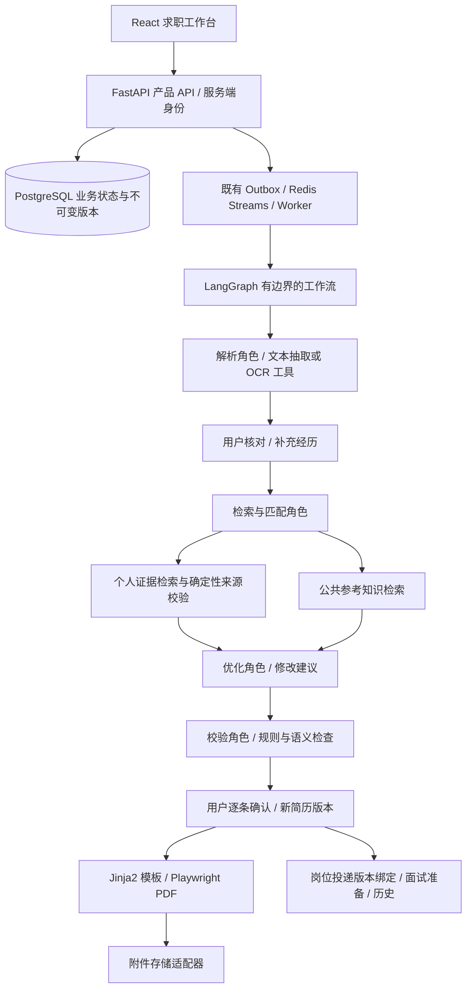

# 长期求职助手：产品升级路线

日期：2026-10-20。本文记录**新一轮升级的目标**，不能作为已完成能力的清单。
用户已明确：既要单次“简历 → JD → 修改确认 → PDF”的闭环，也要持续使用的岗位、投递、
面试和历史记录；代码全部由助手实现，用户重点理解问题、方案、收益和取舍。

后续执行与学习留痕采用用户提供协议：根 `AGENTS.md`、[继续开发手册](../CONTINUE_DEVELOPMENT.md)
和 [devlog 导航](../devlog/INDEX.md)。M1/M2 报告已补录；编号映射以 devlog 为准，不把默认模板 JD 阶段误标完成。

## 1. 怎样才算“完整”

最终验收以同一个用户的连续使用为单位：

1. 导入自己的简历，检查结构化提取，补充缺失内容；扫描材料进入 OCR 分支。
2. 建立个人经历档案，保留来源，区分用户自述、项目材料和外部参考资料。
3. 保存多个目标岗位及 JD 快照，查看要求与个人证据的对应关系、部分支持、缺口和冲突。
4. 生成有依据的修改建议，逐条接受或拒绝，局部修改后得到新版本。
5. 校验事实、数字、时间线和技术表述；用户确认指定版本后预览、导出可选择文本的中文 PDF。
6. 记录一次投递，绑定当时的 JD、分析和简历版本；之后修改基础简历不改变历史投递记录。
7. 持续记录笔试、面试、反馈和状态变化，准备岗位相关问题，看到历史与待办。
8. 耗时任务可观察进度、失败重试和恢复；重试不会重复保存版本、重复发布文件或隐式重复调用付费模型。
9. 能用完全合成的材料演示；真实模型模式明确显示模型、调用范围、耗时和实际 token 用量。
   演示脚本成绩与真实模型评测分开；无法计算准确费用时显示未知。

第一版定位为研究生实习项目和个人长期使用的完整产品；多人联网部署另有认证、数据隔离、
删除、运维和安全验收，不能拿本地演示替代这些保证。不承诺录用概率或自动向第三方投递。

## 2. 从已有代码出发

| 当前资产 | 源码 | 升级处理 |
|---|---|---|
| 直接处理少量材料的证据主链 | `evidence/pipeline.py:EvidenceV2Pipeline.run`、`mapping.py`、`projections.py` | 保护来源校验和 C1/C2/C3 边界，为新工作台提供适配层 |
| 持久化知识模块与混合检索基础 | `knowledge/durable.py`、`faiss_vector_index.py`、`bm25_index.py:BM25Index`、`hybrid_retriever.py`、`rrf.py` | 保留独立模块，不把参考知识转成个人事实 |
| 岗位库、状态和面试资料 | `career/workspace.py:JobWorkspaceService`、`career/store.py`、`job_search_workflow.py:JobSearchWorkflow.run` | 复用业务规则；统一面向新工作台的 ID 和接口时增加适配测试 |
| 后台任务可靠性 | `backend_service/outbox.py`、`redis_streams.py`、`reliable_worker.py`、`recovery.py` | 扩展任务适配器；保留已测 PG/Redis 机制 |
| 工具治理与恢复 | `agent_runtime/loop.py`、`policy.py`、checkpoint/budget 模块 | 给检索角色使用；PDF 等确定性步骤按任务执行 |
| 当前界面与文本提取 | `ui/app.py`、`ui/resume_source.py`、`knowledge/source_loader.py` | 旧界面留作兼容和对照；逐步由新前端承接正式产品流程 |
| 新增简历产品入口 | `resume_workspace/`、`frontend/src/main.jsx` | M1/M2/M2A 已接导入与版本；M3 已用版本视图适配旧证据内核，未接队列/检索 |

已有模块的存在不等于集成完成。旧版 `job-agent-harness` 不作为升级依据。
历史基线源码包 `job-agent-final-source.zip` 保留，不覆盖。

## 3. 目标架构及边界

这是**目标图**，不是当前已接通的完整调用图。M1 提供事实/版本 API；M2 已加入 React、导入与字段解析，
其余角色、PDF、长期投递与新产品队列集成尚未完成。
目标产品的 PostgreSQL 统一存储需要迁移和真实集成测试；M1 的本地 SQLite 只是可运行的先行增量，
不会与 PostgreSQL 业务表双写，也不会宣称已完成生产迁移。

四个角色有各自输入、输出和权限；不要求每个角色都用无限循环自主规划。
信息解析和优化适合结构化模型输出；检索角色可在预算内调用工具；校验混合确定性检查与语义模型。
工作流负责步骤、等待确认和有限重试；队列负责后台执行；数据库负责业务状态。

## 4. 技术取舍

| 决策 | 解决的问题和收益 | 代价与验收 |
|---|---|---|
| React + FastAPI 作为目标界面与 API | 编辑、差异对比、进度、岗位看板在同一界面使用 | M2 简历界面及合成浏览器路径已实现；完整岗位看板/生产鉴权仍未完成 |
| LangGraph 编排四种职责 | 限制步骤与执行次数，清楚地等待用户补充/确认 | 不能把业务确认仅放在内存；必须验证 checkpoint 和重复执行 |
| 复用 Redis Streams + Outbox | 现有任务可靠性已验证，避免再维护第二套投递/重试协议 | 新产品任务仍需真实 PG/Redis 接入验收；本轮 M1 未接入 |
| 先完成事实与版本，再接生成 | 生成建议能定位原始经历，投递能回看当时版本 | 比直接拼一段生成文本多一些数据建模 |
| 公共参考库和个人证据池分开 | “参考怎么写”和“本人做过什么”可分别解释和测试 | 每次检索都要带用途/身份过滤，验证不能串库 |
| Elasticsearch 在检索阶段评估接入 | 可在一个搜索服务中提供关键词和向量召回 | 新服务、权限过滤、embedding 维度/索引迁移、资源占用、版本/许可条件需要实测；不能只加依赖就称接通 |
| 现有 Qwen/FAISS 作为检索基线 | 有现成接口、来源与持久化测试，可比较 ES 改动收益 | 若切换主后端，保留历史结果范围，不混用新旧分数 |
| 文本 PDF 先抽取，扫描 PDF 才 OCR | 减少不必要的 OCR 成本和文字识别错误 | OCR 有漏字/错序，必须允许人工核对；个人材料不得默认发送外部视觉 API |
| JSON → Jinja2 HTML/CSS → Playwright PDF | 结构化内容与排版分离，多模板和分页可测试 | 要安装浏览器/中文字体；阻止模板脚本/任意网络访问，验证长文本、分页、可选中文文本 |

暂不引入 Celery/RabbitMQ/Kafka、Milvus 等额外服务。它们不解决当前已识别的产品缺口。
Elasticsearch 和 reranker 是否作为最终默认配置，以检索阶段的实测收益与机器资源决定，
没有测试前不写成已完成。用户不需要先搭齐所有服务才能看见早期增量。

官方设计依据（查阅于 2026-10-20；实施时仍须与锁定依赖版本核对）：

- [LangGraph interrupts](https://docs.langchain.com/oss/python/langgraph/interrupts)：等待用户需 checkpointer 和 thread ID；恢复会重跑中断节点开头，副作用要幂等。当前已测 1.2.11，不能直接照搬要求更新版本的 API。
- [Elastic hybrid search](https://www.elastic.co/docs/solutions/search/hybrid-search)：作为混合检索方案依据；不构成本项目的实现或性能证据。
- [Playwright page.pdf](https://playwright.dev/python/docs/api/class-page#page-pdf)：目标 PDF 工具接口；需用实际模板、浏览器和字体验证。
- [FastAPI Background Tasks](https://fastapi.tiangolo.com/tutorial/background-tasks/)：跨进程耗时计算不依赖请求内后台回调；本项目继续复用既有可靠队列。

## 5. 实施顺序与验收

| 增量 | 交付与验收 | 当前状态 |
|---|---|---|
| M1：结构化经历与版本底座 | 源材料 → 字段引用 → 保存/编辑 → 指定版本确认 → 恢复/删除；鉴权、跨用户、并发和持久化测试 | 已实现本地仓库/API/合成脚本；测试见 01 文档 |
| M2：导入、解析与前端编辑 | React 页面；文本/PDF/DOCX 导入；解析角色产出字段草稿；缺失信息补问；用户核对后入库；明确真实模型与演示模式 | 本地产品增量已实现；154 项相关后端/4 项前端测试、合成浏览器流程通过；在线模型接口已接，真实模型验收待完成，见 02 文档 |
| M3：岗位匹配与受限建议 | JD/来源快照；证据 v2 适配；检索与匹配、优化、校验角色；逐条建议接受/拒绝；数字/事实/冲突测试 | 快照/内核/受限排序首个闭环已完成；自由改写、补充 C2/C3、真实模型待验收/实现 |
| M4：确认、排版与 PDF | 局部编辑、多模板、预览、中文长简历 PDF、导出绑定确切版本；可选中文文本与分页验证 | 待实现 |
| M5：长期求职闭环 | 岗位库/看板、投递绑定版本、面试资料与记录、待办和历史；复用现有规则 | M3C已接技术面试练习子集；完整长期闭环待实现 |
| M6：后台与检索集成 | PG 产品存储迁移，既有队列新任务适配、进度/恢复；个人与公共资料检索；ES/向量/reranker 对照实验；OCR 分支 | 待实现 |
| M7：完整 Demo 与交付 | 一套可启动配置、合成演示数据、浏览器 E2E、服务重启/重复提交/跨用户测试、真实模型验收、成本耗时记录、文档与安全代码包 | 待实现 |

不同增量可以调整细节，但不能省掉最终统一验证。每次只运行受影响测试和必要回归；
重大替换保留基线与对照实验。旧 R12 数据、标注和指标定义保持原样。

## 6. 用户如何参与

不要求用户写代码，也不把每个实现细节变成审批。每个增量交付：

1. 具体问题：此前什么操作做不到或容易出错。
2. 方案和取舍：为什么选择它，有什么成本和剩余边界。
3. 一次演示：输入、处理、输出，含一个失败例子。
4. 源码入口：需要看哪 2～4 个函数。
5. 面试回答：可以怎样描述，哪些说法目前没有证据。

涉及产品取舍、真实模型/外部服务的付费或私人材料传输时，再向用户核实必要信息。
普通代码、测试和文档由助手继续完成，不要求用户逐次批准。

M2 后补充完成 M2A：普通文字 PDF 自动填表，见 [PHASE-02A](../devlog/PHASE-02A-pdf-autofill.md)。它属于导入体验补强，未改变 M3 JD 与后续 PDF 导出的顺序。扫描/OCR 与复杂栏仍单独验收。

M3 最新：版本/JD 快照→本地预检查/可选旧证据内核→原文/限制/缺口→逐条排序接受拒绝→新版的首个产品闭环已完成，见 [PHASE-03](../devlog/PHASE-03-match-and-rewrite.md)。自由改写、C2/C3 产品输入和真实模型质量仍需后续增量，不能把首个闭环称作完整 M3 或完整 AI 简历优化。

M3B 后续增量已完成：LangGraph 原文摘要 Writer/Reviewer 两次以内反馈修订、类型轨迹、应用 checkpoint 和逐条审批；见 [PHASE-03B](../devlog/PHASE-03B-writer-reviewer.md)。这是 M3 的摘录子集，不是完整自由改写或完整协作产品。真实模型与同预算对照待验收；PDF/长期求职主线保持。

M3C按用户授权完成核验分层与岗位→有限技术题库面试协作/复盘，见 [PHASE-03C](../devlog/PHASE-03C-verification-interview.md)。不替代M4：下一产品主线继续模板/预览/绑定确认版本PDF，再逐步做投递和长期记录。真实模型/成本/同预算对照仍待验，不能将有限题库说成完整求职产品。
